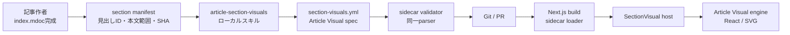

# 記事セクション可視化（Article Visual engine）

## 目的

長文記事の各セクションについて、本文を読まなくても主張・関係・流れを短時間で把握できる図を表示する。

記事作成エージェントは本文完成後に構造化データを作り、記事と同じディレクトリのsidecarへ保存する。公開サイトはsidecarを読み、自前のArticle Visual engineで描画する。デスクトップでは本文横のsticky rail、狭い画面では該当セクション内に表示する。

この設計の状態は**Proposed**である。既存の`treemap.yml`とMarkdoc本文の挙動は、実装が完了するまで変えない。

## 解決する問題

`treemap.yml`は記事全体の構造・読書位置・段落間の関係を示す。一方、個々のタイルは短い要約文が中心であり、セクションが伝える仕組み・比較・因果を一目で理解する用途には向かない。

セクション可視化はtreemapを置き換えず、役割を分ける。

| 表示 | 役割 |
| --- | --- |
| treemap | 記事全体の地図・ナビゲーション・段落間リンク |
| セクション可視化 | 現在のセクションの主張・関係・流れの直感的理解 |

## 設計原則

1. **本文が正である。** 図は本文の派生物であり、本文にない事実・数字・因果を加えない。
2. **生成物は構造化データとする。** エージェントにHTML・SVG・JavaScript・React・座標を書かせない。
3. **envelopeは変換しない。** envelopeはengineへpayloadを渡すだけであり、汎用形式からengine固有形式への翻訳層にはしない。
4. **engineを明示する。** v1は自前の`article-visual`だけを許可する。将来別のengineを追加しても、既存payloadの意味は変えない。
5. **仕様と実装を分ける。** 記事作成スキルはArticle Visual specだけに依存し、Reactコンポーネントやサイト構造を知らない。
6. **見た目はrendererが所有する。** sidecarは色・座標・フォント・CSS・アニメーションを指定しない。
7. **AIはビルド時・実行時に動かさない。** 記事を書いたエージェントがsidecarを作り、サイトは検証済みファイルを読むだけにする。
8. **図を強制しない。** 空間的な表現で意味が明確にならないセクションには図を置かない。
9. **アクセシビリティを図と同じ成果物として扱う。** 各図に本文と矛盾しない代替説明を必須とする。

## 対象外

- treemapの撤去または統合
- Mermaid・D2・Vega-Liteの置き換え
- ブラウザ上での図の編集
- 生成済みSVG・PNGのGit管理
- 任意HTML・JavaScript・外部URLの埋め込み
- 複数engineを横断する共通diagram IR
- 全H2・H3への機械的な図の割り当て
- ポッドキャスト音声への図の内容の読み上げ
- 外部の図生成スキルやリモートテンプレートの実行

## Article Visual engine

`article-visual`は、記事セクションの説明に必要な少数の図を描く自前engineである。公開仕様は構造化されたArticle Visual specとし、`@hskksk/markdoc-react`が標準rendererを提供する。

Article Visual specはengineのnative payloadであり、別の描画言語へ変換しない。rendererはpayloadから安全なReact要素とSVGを決定論的に組み立てる。

初期実装では外部の描画ライブラリを使わない。カード・比較・手順はHTMLとCSS、接続線・階層・数値図はReactが生成するSVGで描画する。文字列はReactの通常のtext nodeとして扱い、`dangerouslySetInnerHTML`は使わない。

## 全体構成



責務の境界は次のとおり。

| 部品 | 責務 |
| --- | --- |
| `article-section-visuals` | 対象セクションの選定・図の種類の選択・payload作成・本文との照合 |
| Article Visual spec | engineが受理するデータ構造と上限の定義 |
| 検証スクリプト | SHA・見出しID・envelope・payload・安全制約の機械検査 |
| `@hskksk/markdoc-react` | engine-neutralなhost・Article Visual parser・各図のrenderer |
| `apps/web` | sidecar読込・記事との結合・active section・responsive layout・サイトテーマ |

## ファイル配置

```text
content/docs/<slug>/
  index.mdoc
  treemap.yml
  section-visuals.yml
```

長文Wiki記事では記事作成フローの対象とする。`content/web-clips/`は任意とし、初期実装では自動生成対象にしない。

`treemap.yml`と`section-visuals.yml`は別ファイルにする。更新条件・読込先・表示責務が異なるため、一つのsidecarへ統合しない。

## sidecar envelope

```yaml
version: 1
sourceSha256: "39a0650aeaaebd7bab3894ea7d8c1c81423c9c42ead839c917998516d7c64e5b"
visuals:
  - sectionId: "cloudflare-osの中身"
    engine: article-visual
    engineVersion: "1"
    alt: "社員の操作はWorkspaceとGatekeeperを経由し、許可された能力だけが社内サービスへ渡される。"
    spec:
      type: flow
      title: 権限ゼロから必要な能力だけ渡す
      nodes:
        - id: employee
          label: 社員
          icon: person
        - id: workspace
          label: Workspace
          icon: workspace
        - id: gatekeeper
          label: Gatekeeper
          icon: shield
          emphasis: true
        - id: service
          label: 社内サービス
          icon: database
      edges:
        - from: employee
          to: workspace
          label: 操作
        - from: workspace
          to: gatekeeper
          label: 許可を要求
        - from: gatekeeper
          to: service
          label: 許可済み能力
```

### ルート

| キー | 型 | 必須 | 説明 |
| --- | --- | --- | --- |
| `version` | `1` | yes | sidecar envelopeの版 |
| `sourceSha256` | string | yes | frontmatterを除いたMarkdoc本文のSHA-256 |
| `visuals` | array | yes | セクションに割り当てる図。空配列は許可しない |

### `visuals[]`

| キー | 型 | 必須 | 説明 |
| --- | --- | --- | --- |
| `sectionId` | string | yes | Markdoc transform後の見出しDOM `id` |
| `engine` | string | yes | v1は`article-visual`のみ |
| `engineVersion` | string | yes | Article Visual specのmajor version。v1は`"1"` |
| `alt` | string | yes | スクリーンリーダーと描画失敗時に使う代替説明 |
| `spec` | object | yes | 指定engineが直接解釈するnative payload |

`version`は記事との結合方法を表し、`engineVersion`はpayloadの意味を表す。両者を独立させることで、engineを変更せずにenvelopeを拡張できる。

`sectionId`には見出し文字列そのものではなく、公開ページと同じMarkdoc configが生成したIDを使う。見出し名または本文を変更した場合はsidecar全体を再生成する。

envelopeは`spec`の内部を解釈も変換もしない。`article-visual`のparserだけが、対応する`engineVersion`のpayloadを解釈する。

## Article Visual spec v1

### 共通フィールド

すべての`spec`は次の共通フィールドを持つ。

| キー | 型 | 必須 | 説明 |
| --- | --- | --- | --- |
| `type` | enum | yes | 描く情報構造 |
| `title` | string | yes | 図が伝える主張。見出しの転載ではなく結論を書く |
| `caption` | string | no | 図の読み方に必要な短い補足 |

項目やノードでは次の共通語彙を使う。

| キー | 型 | 必須 | 説明 |
| --- | --- | --- | --- |
| `id` | string | 種類による | payload内で一意の参照ID |
| `label` | string | yes | 短い名詞句または動詞句 |
| `detail` | string | no | 一文以内の補足 |
| `icon` | string | no | rendererが提供するsemantic icon ID |
| `emphasis` | boolean | no | 主張上の中心を示す。1図につき最大2件 |

色・大きさ・位置・フォント・class名・URL・SVG pathはspecへ入れない。

### `cards`

順序や接続を持たない、並列の要点を示す。

```yaml
type: cards
title: 信頼境界を守る三つの仕組み
items:
  - label: 短命な権限
    detail: 必要な時間だけ能力を渡す
    icon: timer
  - label: 操作の記録
    detail: 誰が何をしたかを残す
    icon: document
```

`items`は2〜6件とする。単に見出しを並べただけのcardsは作らない。

### `sequence`

順序・段階・時系列・段階的な絞り込みを示す。

```yaml
type: sequence
title: 要求は検証を経て一時的な能力になる
mode: steps
items:
  - label: 要求
  - label: 検証
  - label: 能力を発行
    emphasis: true
  - label: 失効
```

`mode`は`steps`・`timeline`・`funnel`のいずれかとする。`items`は3〜7件で、記載順を意味のある順序として扱う。

### `interaction`

人物やシステム間のメッセージ交換を時系列で示す。

```yaml
type: interaction
title: Workspaceが権限発行を仲介する
actors:
  - id: employee
    label: 社員
  - id: workspace
    label: Workspace
  - id: gatekeeper
    label: Gatekeeper
steps:
  - from: employee
    to: workspace
    label: 操作を要求
  - from: workspace
    to: gatekeeper
    label: 許可を照会
  - from: gatekeeper
    to: workspace
    label: 短命な能力
```

`actors`は2〜4件、`steps`は2〜8件とする。rendererがactorのlaneとstepの位置を計算する。

### `comparison`

二者・変更前後・二つの選択肢を同じ観点で比較する。

```yaml
type: comparison
title: 常設権限を短命な能力へ置き換える
sides:
  - label: 常設権限
    items:
      - label: 有効期間
        detail: 明示的に失効させるまで残る
      - label: 漏えい時
        detail: 長期間悪用される
  - label: 短命な能力
    emphasis: true
    items:
      - label: 有効期間
        detail: 操作に必要な時間だけ
      - label: 漏えい時
        detail: 時間経過で使えなくなる
```

`sides`は必ず2件とする。両側の`items`は同じ順序と観点で2〜5件を並べる。

### `hierarchy`

包含・分類・構成要素を根から子へ示す。

```yaml
type: hierarchy
title: 制御面が三つの機能を束ねる
root:
  label: 制御面
  children:
    - label: ID確認
    - label: ポリシー判定
    - label: 監査記録
```

深さは4段、ノード総数は12件までとする。複数の親を持つ関係は`flow`を使う。

### `flow`

依存・因果・データ移動を有向グラフで示す。

```yaml
type: flow
title: 許可済み能力だけがサービスへ届く
nodes:
  - id: request
    label: 操作要求
  - id: policy
    label: ポリシー判定
    emphasis: true
  - id: capability
    label: 短命な能力
  - id: service
    label: 社内サービス
edges:
  - from: request
    to: policy
  - from: policy
    to: capability
    label: 許可
  - from: capability
    to: service
```

ノードは3〜9件、edgeは2〜12件とする。v1は有向非巡回グラフだけを扱う。rendererはトポロジカル順序からlayerを決め、同じlayer内の配置をIDと入力順で安定させる。

### `matrix`

二つの軸による位置づけを四象限で示す。エージェントは座標ではなく象限を指定する。

```yaml
type: matrix
title: 権限は期間と範囲をともに絞る
xAxis:
  low: 狭い範囲
  high: 広い範囲
yAxis:
  low: 短い期間
  high: 長い期間
items:
  - label: 短命な能力
    quadrant: low-low
    emphasis: true
  - label: 管理者キー
    quadrant: high-high
```

`quadrant`は`low-low`・`low-high`・`high-low`・`high-high`のいずれかとする。同じ象限の項目はrendererが重ならないよう整列する。

### `chart`

本文に明記された数量の比較または推移を示す。

```yaml
type: chart
title: 権限の有効期間を短縮する
variant: bar
unit: 分
values:
  - label: 常設キー
    value: 1440
  - label: 短命な能力
    value: 15
    emphasis: true
```

`variant`は`bar`・`line`・`donut`のいずれかとする。`values`は2〜8件で、`value`は有限数とする。本文に同じ数値と単位がない場合はchartを作らない。軸の切り詰めや対数変換はv1で扱わない。

## rendererの選択

記事作成エージェントは視覚テンプレートを選ばない。本文の意味構造に対応する`type`だけを選び、rendererが画面幅・項目数・文字量から具体的な配置を決める。

| 本文の関係 | `type` |
| --- | --- |
| 順序を持たない並列の要点 | `cards` |
| 順序・段階・時系列 | `sequence` |
| 複数人物・システムのやりとり | `interaction` |
| 二者比較・前後比較・トレードオフ | `comparison` |
| 階層・包含・構成 | `hierarchy` |
| 依存・因果・データ移動 | `flow` |
| 2軸による位置づけ | `matrix` |
| 本文に明記された数量 | `chart` |

図の主張は一つに絞る。複数の異なる主張を一枚へ詰めず、本文の見出しをそのまま並べるだけの図も作らない。

## section manifest

記事作者が見出しIDや行範囲を推測しないよう、専用の抽出スクリプトがJSON manifestを出力する。

```json
{
  "mdocPath": ".../index.mdoc",
  "sourceSha256": "...",
  "sections": [
    {
      "id": "cloudflare-osの中身",
      "level": 2,
      "title": "Cloudflare OSの中身",
      "startLine": 104,
      "endLine": 137,
      "body": "..."
    }
  ]
}
```

抽出には公開サイトと同じMarkdoc heading transformと`slugify`を使う。treemapの内部ノードIDはsection bindingに使わない。

manifestは作業用でありGitへ保存しない。

## 対象セクションの選定

既定では内容を持つH2を候補とする。次は原則として除外する。

- `TL;DR`
- 概要だけを再掲する導入
- まとめ
- 出典一覧
- 付録の参考リンク
- 本文を図にしても見出しと同程度の情報しか増えない節

H3は、親H2の図では表現できない独立した仕組み・比較・時系列を持つ場合だけ対象にする。1記事あたりの上限は8枚を初期値とする。

## `article-section-visuals`スキル

このリポジトリへローカルのcallable skillとして追加する。外部スキルは呼び出さない。

入力は完成した`index.mdoc`、出力は検証済みの`section-visuals.yml`とする。同じ記事を書いたエージェントが続けて実行し、別のサブエージェントへ委譲しない。

ワークフローは次のとおり。

1. section manifestを生成する。
2. 各セクションを読み、図にすると理解が速くなる候補を選ぶ。
3. 候補ごとに、図で伝える主張を一つに絞る。
4. 本文の関係を分類し、対応する`type`を選ぶ。
5. Article Visual spec v1に従って`spec`を作る。
6. 固有名詞・数値・因果を対象セクション本文と照合する。
7. envelopeへ格納して`section-visuals.yml`を保存する。
8. validatorが成功するまでpayloadを直す。

スキルはArticle Visual specと検証コマンドだけを知る。React component名・CSS・SVG構造・`apps/web`の配置は記載しない。これにより、rendererを作り直してもspec v1を維持する限りスキルは変わらない。

親の`podcast-research2`には、スキル名・呼ぶ時点・入力成果物・検証成功を次へ進む条件としてだけ記載する。specの全フィールドを親スキルへコピーしない。

## specの正本と互換性

Article Visual specの正本は、`@hskksk/markdoc-react`が公開するversion付きTypeScript型・機械検証用schema・parserとする。Reactを読み込まないexport pathを用意し、Node.jsのvalidatorからも利用できるようにする。

記事作成スキルは文章だけで正しさを保証せず、最後に同じparserを使うrepository commandを実行する。rendererとauthoring validatorが異なる解釈を持つ状態を避ける。

互換性は次の規則で管理する。

- optional field追加など後方互換の変更はengine version 1のまま行う。
- fieldの意味・必須条件・描画結果を変える場合は新しいmajor versionを追加する。
- rendererは移行期間中、現行版と一つ前のmajor versionを読めるようにする。
- envelopeはpayloadを自動変換しない。移行は明示的なcodemodでsidecarを書き換える。
- 未対応のengineまたはversionは`alt`へfallbackする。

## `@hskksk/markdoc-react`の変更

engine-neutralなhostと、自前のArticle Visual engineを追加する。

公開APIの概念形は次のとおり。

```ts
type SectionVisualEnvelope = {
  engine: string;
  engineVersion: string;
  alt: string;
  spec: unknown;
};

type VisualEngineDefinition<T> = {
  id: string;
  versions: readonly string[];
  parse(version: string, spec: unknown): T;
  Component: React.ComponentType<{
    spec: T;
    alt: string;
    theme?: "light" | "dark";
  }>;
};
```

```tsx
<SectionVisual
  visual={visual}
  engines={[articleVisualEngine]}
/>
```

markdoc-react側の変更範囲:

- `SectionVisual` host component
- `VisualEngineDefinition`とfallbackの型
- Article Visual spec v1の型・schema・parser
- `cards`・`sequence`・`interaction`・`comparison`・`hierarchy`・`flow`・`matrix`・`chart` component
- 共通のicon resolver・theme token・text wrapping
- server renderingとhydrationを壊さない決定論的layout
- accessibility・tests・demo

Article Visual engineはmarkdoc-reactのfirst-party engineとして同梱する。アプリが描画ライブラリやadapterを注入する必要はない。将来別engineを追加する場合だけ、`VisualEngineDefinition`をregistryへ追加する。

任意のMarkdoc tagは初期実装に含めない。セクション可視化はsidecarからのみ読み、記事本文へengine payloadを直接埋め込ませない。

## layout engine

エージェントは座標を出力しない。各componentは入力順・ID・項目数から配置を計算する。

- `cards`・`comparison`はCSS Gridで列数を決める。
- `sequence`は広い画面で横、狭い画面で縦に並べる。
- `interaction`はactorごとのlaneとstep順から位置を決める。
- `hierarchy`は深さごとにlevelを分け、親の子を入力順に並べる。
- `flow`は有向非巡回グラフをlayerへ分け、同じlayerを安定順で並べる。
- `matrix`は指定された象限内で項目を等間隔に並べる。
- `chart`は0を起点とし、値域からbar・line・arcを計算する。

結果は同じspec・engine version・container classに対して常に同じになる。乱数・現在時刻・ブラウザ固有の文字計測をlayoutの入力にしない。

日本語ラベルはrendererが意味の切れ目で折り返す。最大行数を超える場合は省略せずvalidatorで拒否し、記事作者に短い表現へ直させる。

## podcasterの描画

### sidecar loader

`apps/web`へserver-only loaderを置く。

1. `section-visuals.yml`がなければ`null`を返す。
2. YAML parse・version・必須フィールドを検証する。
3. `sourceSha256`がレンダー用本文またはディスク上の本文のどちらにも一致しなければsidecar全体を無視する。
4. `sectionId`がtransformed article treeに存在しない図を除外する。
5. engine・engineVersion・spec・altをengine parserで検証する。
6. 不正な図だけを除外して警告を出し、残りの図は表示する。

記事本文の変更後に古い図が残らないよう、SHA mismatchでは一部を採用しない。

### デスクトップ

十分な横幅がある場合、本文と図を二列にする。

```text
┌──────────────────────────────────────────────────────┐
│ 章マップ                                               │
├────────────────────────────────┬─────────────────────┤
│ 本文（最大48rem）                │ sticky visual rail  │
│                                │ 20〜26rem            │
└────────────────────────────────┴─────────────────────┘
```

- railはviewport上部から一定位置でstickyにする。
- `IntersectionObserver`で現在の見出し階層を追跡する。
- 現在の最深セクションに図があればそれを表示する。
- H3に図がなければ、図を持つ親H2を表示する。
- 図を持たないH2へ移った場合はrailを空にする。
- 図の切替はopacityの短いtransitionだけとし、reduced motionでは無効にする。
- rail内の重複テキストはPagefindの検索対象から除く。

### モバイル

sticky railを使わず、対応する見出しの直後に図を置く。

server側でtransformed Markdoc treeへ`SectionVisualSlot`を挿入し、sidecar mapから該当図を描画する。DOM mount後に見出しを検索して要素を移動する方式は採用しない。

同じ画面幅でrailとinline slotの両方をmountしない。responsive componentが表示方式を一つ選ぶ。

### server rendering

Article Visual componentはDOM測定や外部resourceを必要としないため、図本体をserver renderingできる。モバイルのinline図はHTMLへ含め、JavaScriptが無効でも読めるようにする。

デスクトップrailではactive sectionの切替にclient componentを使うが、図の描画自体は事前に作られたReact要素を表示するだけにする。rendererをclientで再実行しない。

## テーマ

sidecarへ色を保存しない。サイトのlight/dark tokenをArticle Visual componentへ渡す。

- 背景は記事背景に合わせる。
- 文字色と線色はWCAGコントラストを満たす。
- 強調色は一色を基本とする。
- 正常・注意・危険などの意味を色だけで区別しない。
- 日本語フォントはサイトの既定sans-serifを使う。
- 360px幅でも本文と補足を読める文字サイズを保つ。

## icon

`icon`はengineが定義したsemantic IDだけを受理する。初期集合は`person`・`document`・`database`・`shield`・`timer`・`workspace`・`service`・`network`・`chart`など、記事で頻出する概念に絞る。

iconはmarkdoc-react内のReact componentへ解決する。sidecarからpackage名・ファイル名・URL・SVG本文は指定できない。未知のIDはvalidatorが拒否し、runtimeでは汎用placeholderへfallbackする。

## accessibilityとfallback

- `alt`は必須とし、図が伝える結論と主要な関係を一文で書く。
- 図全体は`figure`とし、視覚表現には`role="img"`とaccessible nameを付ける。
- rendererが生成する装飾線・矢印・iconは読み上げ対象にしない。
- 図内の全文を順に読み上げず、`alt`を簡潔な代替表現として使う。
- engine未登録・version未対応・payload不正の場合は`alt`のtext cardを表示する。
- 図だけにリンク・操作・本文にない情報を置かない。
- 図を見なくても記事本文を順番どおり読める。

## 安全性

sidecarは信頼済みコードではなく、検証対象のcontent dataとして扱う。

- `spec`はversion付きparserでunknownから検証する。
- objectの未知fieldを拒否する。
- 文字数・配列長・階層深さ・node数・edge数へ上限を設ける。
- prototype key、URL、HTML、SVG、CSS、event handlerを受理しない。
- `eval`・動的import・`dangerouslySetInnerHTML`を使わない。
- runtimeに外部resource取得・外部skill実行・AI呼び出しを置かない。
- parserの失敗で記事本文のbuildや表示を止めない。

記事生成時に使うのは、このリポジトリで管理する`article-section-visuals`だけとする。第三者が更新できる外部スキルをインストールまたは実行しない。

## 検証

### authoring validator

一つの記事を対象に次を確認する。

- YAMLとenvelope schema
- `sourceSha256`
- 重複しない`sectionId`
- section manifestに存在するID
- engineとengineVersion
- Article Visual parserが受理するspec
- type別の必須field・参照整合性・項目数上限
- flowが有向非巡回グラフであること
- icon allowlist
- 禁止field・URL・inline markup
- `alt`の存在と長さ
- sidecar内の固有名詞と数値が対象セクション本文に根拠を持つこと

最後の項目は機械的な文字列照合だけで決めず、記事作者が本文と照合する。数値・単位・固有名詞は機械検査でも差分を出す。

### repository check

全`section-visuals.yml`を走査するcheck commandをCIと`pnpm typecheck`に含める。既存記事にsidecarがないことはエラーにしない。

### markdoc-react

- spec parserのvalid/invalid fixture
- 全typeのserver rendering
- 同じ入力から同じmarkupが得られること
- light/dark theme
- reduced motion
- alt・ARIA・decorative element
- 長い日本語labelの拒否と折り返し
- flowのcycle・不正参照・過大payloadの拒否
- unknown engine/versionのfallback

### web

- sidecarなしの記事が従来どおり表示される
- stale SHAのsidecarが無視される
- desktop railのsection切替
- mobile inline slot
- JavaScript無効時のinline図
- heading deep linkとtreemap navigation
- Pagefindへvisual文言が重複登録されない
- Keystatic previewと公開ページが一致する

## 性能

- 外部描画ライブラリを追加しない。
- 図本体は可能な限りserver renderingし、描画用client runtimeを持たない。
- desktopで同時に表示する図は一つとする。
- mobileでは通常のdocument flowに静的な図を置き、observerを追加しない。
- SVG pathとlayoutは項目数に対して線形または`O(V + E)`で計算する。
- payload上限により、極端に大きなDOMやSVGを生成できないようにする。

## エラー処理

| エラー | 表示 |
| --- | --- |
| sidecar不在 | セクション可視化を表示しない |
| SHA mismatch | sidecar全体を無視し、server warning |
| 一部entryが不正 | そのentryを除外し、他は表示 |
| engine未登録 | `alt` fallback |
| engine version未対応 | `alt` fallback |
| spec parse失敗 | `alt` fallbackとserver warning |
| icon不明 | authoring時はエラー、runtimeはlocal placeholder |

記事本文の表示を図の失敗で止めない。

## 実装境界

### `hskksk/markdoc-react`

1. engine-neutralな`SectionVisual` hostとregistry
2. Article Visual spec v1の型・schema・parser
3. type別React componentとlayout
4. theme・icon・accessibility・fallback
5. tests・demo・npm release

### `hskksk/podcaster`

1. 更新済みmarkdoc-reactの導入
2. section manifest extractor
3. sidecar型・loader・validator・repository check
4. desktop railとmobile slot
5. `article-section-visuals` skill
6. `podcast-research2`からの呼び出し
7. 一記事のpilot sidecar

## 導入順

1. Cloudflare記事から`cards`・`sequence`・`interaction`・`comparison`・`hierarchy`・`flow`・`matrix`・`chart`のfixtureを作る。
2. markdoc-reactへspec parserと各componentを追加し、fixtureをserver renderingする。
3. podcasterのloaderとresponsive layoutを実装し、手書きsidecarで確認する。
4. validatorとrepository checkを追加する。
5. `article-section-visuals`を追加し、Article Visual specを生成する。
6. `podcast-research2`の記事完成後工程へ接続する。
7. pilot記事で手書き版とスキル生成版を比較し、文字量と項目数の上限を固定する。

## 受け入れ条件

- Cloudflare記事で少なくとも5セクションの図が本文と矛盾せず描画される。
- 5種類以上の`type`が、外部描画ライブラリなしで表示される。
- desktopでは現在のセクションに対応する図だけが右railへ表示される。
- mobileでは同じ図が該当見出しの直後へ表示される。
- 本文を変更すると古いsidecarは表示されない。
- 図が壊れても本文とtreemapは表示される。
- runtimeにAI呼び出し・外部resource fetch・外部skill実行がない。
- 記事作者はHTML・SVG・React・座標・色を生成しない。
- sidecarはArticle Visual specと記事envelopeだけで構成される。
- `pnpm typecheck`とvisual sidecar checkが成功する。
