# 記事セクション可視化（AntV Infographic）

## 目的

長文記事の各セクションについて、本文を読まなくても主張・関係・流れを短時間で把握できる図を表示する。

記事作成エージェントは本文完成後にセクションごとの AntV Infographic DSL を作り、記事と同じディレクトリの sidecar に保存する。公開サイトはビルド時に sidecar を読み、デスクトップでは本文横の sticky rail、狭い画面では該当セクション内に描画する。

この設計の状態は **Proposed** である。既存の `treemap.yml` と Markdoc 本文の挙動は、実装が完了するまで変えない。

## 解決する問題

`treemap.yml` は記事全体の構造、読書位置、段落間の関係を示す。一方、個々のタイルは短い要約文が中心であり、セクションが伝える仕組み・比較・因果を一目で理解する用途には向かない。

セクション可視化は treemap を置き換えず、役割を分ける。

| 表示 | 役割 |
| --- | --- |
| treemap | 記事全体の地図、ナビゲーション、段落間リンク |
| セクション可視化 | 現在のセクションの主張、関係、流れの直感的理解 |

## 設計原則

1. **本文が正である。** 図は本文の派生物であり、本文にない事実・数字・因果を加えない。
2. **生成物はコードではなく AntV DSL とする。** エージェントに HTML、SVG、JavaScript、React を書かせない。
3. **envelope は変換しない。** 汎用 YAML から各描画エンジンへ翻訳せず、選択したエンジンの native source を保持する。
4. **描画エンジンは明示する。** v1 の許可値は `antv-infographic` だけだが、スキーマ上は将来の追加を可能にする。
5. **見た目はサイトが所有する。** 記事 sidecar は色、座標、フォント、CSS、アニメーションを指定しない。
6. **AI はビルド時に動かさない。** 記事を書いたエージェントが sidecar を作り、サイトは検証済みファイルを読むだけにする。
7. **図を強制しない。** 空間的な表現で意味が明確にならないセクションには図を置かない。
8. **アクセシビリティを図と同じ成果物として扱う。** 各図に本文と矛盾しない代替説明を必須とする。

## 対象外

- treemap の撤去または統合
- Mermaid、D2、Vega-Lite の置き換え
- ブラウザ上での infographic 編集
- 生成済み SVG や PNG の Git 管理
- 任意 HTML、任意 JavaScript、外部 URL の埋め込み
- 複数エンジンを横断する共通 diagram IR
- 全 H2・H3 への機械的な図の割り当て
- ポッドキャスト音声への図の内容の読み上げ

## 採用する既存仕様

図の内容とテンプレートは [`@antv/infographic`](https://github.com/antvis/Infographic) の DSL を正として保存する。独自仕様は記事との紐付けを担う薄い envelope だけに限定する。

記事作成では公式の `infographic-syntax-creator` スキルを使う。このスキルは AntV DSL だけを返し、HTML やコンポーネントを生成しない。AntV 本体開発用の sibling skill と、CDN 付き単独 HTML を生成する `infographic-creator` は記事ワークフローでは使わない。

## 全体構成

```mermaid
flowchart LR
  A["記事作者<br/>index.mdoc 完成"] --> B["section manifest<br/>見出しID・本文範囲・SHA"]
  B --> C["article-section-visuals"]
  C --> D["infographic-syntax-creator<br/>AntV公式スキル"]
  D --> E["section-visuals.yml"]
  E --> F["sidecar validator"]
  F --> G["Git / PR"]
  G --> H["Next.js build<br/>sidecar loader"]
  H --> I["markdoc-react Infographic host"]
  I --> J["AntV adapter<br/>SVG描画"]
```



責務の境界は次のとおり。

| 部品 | 責務 |
| --- | --- |
| `infographic-syntax-creator` | セクションの意味構造に合う AntV テンプレートを選び、DSL を返す |
| `article-section-visuals` | 対象セクションの選定、本文との整合、sidecar 保存、検証完了までの進行 |
| 検証スクリプト | SHA、見出しID、envelope、AntV構文、安全制約を機械検査する |
| `@hskksk/markdoc-react` | engine-neutral な Infographic host と AntV adapter API を提供する |
| `apps/web` | sidecar 読込、記事との結合、active section、responsive layout、テーマ、ローカル資源を管理する |

## ファイル配置

```text
content/docs/<slug>/
  index.mdoc
  treemap.yml
  section-visuals.yml
```

長文 Wiki 記事では記事作成フローの対象とする。`content/web-clips/` は任意とし、初期実装では自動生成対象にしない。

`treemap.yml` と `section-visuals.yml` は別ファイルにする。更新条件、読込先、表示責務が異なるため、一つの sidecar へ統合しない。

## sidecar スキーマ

```yaml
version: 1
sourceSha256: "39a0650aeaaebd7bab3894ea7d8c1c81423c9c42ead839c917998516d7c64e5b"
visuals:
  - sectionId: "cloudflare-osの中身"
    engine: antv-infographic
    engineVersion: "0.2"
    alt: "社員から社内サービスへの操作はGatekeeperを経由し、許可された能力だけが渡される。"
    syntax: |
      infographic relation-dagre-flow-tb-badge-card
      data
        title 権限ゼロから必要な能力だけ渡す
        nodes
          - id employee
            label 社員
            icon user
          - id workspace
            label Workspace
            icon layout dashboard
          - id gatekeeper
            label Gatekeeper
            icon shield check
          - id service
            label 社内サービス
            icon database
        relations
          employee - 操作 -> workspace
          workspace - 許可を要求 -> gatekeeper
          gatekeeper - 許可済み能力 -> service
```

### ルート

| キー | 型 | 必須 | 説明 |
| --- | --- | --- | --- |
| `version` | `1` | yes | sidecar envelope の版 |
| `sourceSha256` | string | yes | frontmatter を除いた Markdoc 本文の SHA-256 |
| `visuals` | array | yes | セクションに割り当てる図。空配列は許可しない |

### `visuals[]`

| キー | 型 | 必須 | 説明 |
| --- | --- | --- | --- |
| `sectionId` | string | yes | Markdoc transform 後の見出し DOM `id` |
| `engine` | string | yes | v1 は `antv-infographic` のみ |
| `engineVersion` | string | yes | v1 は互換系列 `0.2` |
| `alt` | string | yes | スクリーンリーダーおよび描画失敗時の代替説明 |
| `syntax` | string | yes | AntV Infographic native DSL。コードフェンスは含めない |

`sectionId` は見出し文字列そのものではなく、公開ページと同じ Markdoc config が生成した ID を使う。見出し名変更や本文変更後は sidecar 全体を再生成する。

エンジン固有の source は `syntax` にそのまま保存する。envelope は AntV DSL を別の表現へ変換しない。

## section manifest

記事作者が手で見出し ID や行範囲を推測しないよう、専用の抽出スクリプトが JSON manifest を出力する。

```json
{
  "mdocPath": ".../index.mdoc",
  "sourceSha256": "...",
  "sections": [
    {
      "id": "cloudflare-osの中身",
      "level": 2,
      "title": "Cloudflare OSの中身",
      "startLine": 104,
      "endLine": 137,
      "body": "..."
    }
  ]
}
```

抽出には公開サイトと同じ Markdoc heading transform と `slugify` を使う。treemap の内部ノード ID は section binding に使わない。

manifest は作業用であり Git に保存しない。

## 対象セクションの選定

既定では内容を持つ H2 を候補とする。次は原則として除外する。

- `TL;DR`
- 概要だけを再掲する導入
- まとめ
- 出典一覧
- 付録の参考リンク
- 本文を図にしても見出しと同程度の情報しか増えない節

H3 は、親 H2 の図では表現できない独立した仕組み・比較・時系列を持つ場合だけ対象にする。1 記事あたりの上限は 8 枚を初期値とする。

選択時は本文中の関係を先に分類し、その後でテンプレートを選ぶ。

| 本文の関係 | AntV テンプレート系列 |
| --- | --- |
| 順序、段階、時系列 | `sequence-*` |
| 複数人物・システムのやりとり | `sequence-interaction-*` |
| 並列の要点 | `list-*` |
| 二者比較、前後比較、トレードオフ | `compare-binary-*` |
| 2 軸の位置づけ | `compare-quadrant-*` |
| 階層、包含、構成 | `hierarchy-*` |
| ノード間の依存、因果、交換 | `relation-*` |
| 本文に明記された数量 | `chart-*` |

図の主張は一つに絞る。複数の異なる主張を一枚に詰めず、本文の見出しをそのまま項目として並べるだけの図も作らない。

## スキルの構成

ローカルの callable skill として `article-section-visuals` を追加する。

入力は完成した `index.mdoc`、出力は検証済みの `section-visuals.yml` とする。同じ記事を書いたエージェントが続けて実行し、別のサブエージェントへ委譲しない。

ワークフローは次のとおり。

1. section manifest を生成する。
2. 各セクションを読み、図にすることで理解が速くなる候補を選ぶ。
3. 候補ごとに主張一つと必要な要素・関係を決める。
4. `infographic-syntax-creator` を名前で読み、その手順に従って AntV DSL を作る。
5. 公式スキルが返した単一コードフェンスから DSL 本体だけを取り出す。
6. 色・フォント・theme・アニメーションを除き、ローカルのアイコン語彙に合わせる。
7. `section-visuals.yml` を保存する。
8. validator が成功するまで本文との不整合と DSL を直す。

親の `podcast-research2` はスキル名、呼ぶ時点、入力成果物、検証成功を次へ進む条件としてだけ記載する。公式スキルのテンプレート一覧や内部ファイルは親へコピーしない。

## AntV DSL の制約

公式 DSL のうち、記事 sidecar では次の profile だけを許可する。

- 先頭行は登録済みの `infographic <template-name>`
- `data` ブロックを一つ持つ
- 主要データ系列はテンプレートに対応する一種類だけ
- `title`、`desc`、`label` は記事本文と同じ言語
- 一つの図の主要項目は原則 3〜7 個
- ラベルは短い名詞句、説明は一文以内
- `value` は本文に同じ数値がある場合だけ使用
- template、node、relation、item の個数に上限を設ける

次は禁止する。

- `theme` ブロック
- `design` ブロック
- 名前に `animated` を含むテンプレート
- `http:`、`https:`、`data:` URL
- inline SVG、HTML、script
- `illus`
- remote、search、custom resource 指定
- 任意の width、height、padding

配色、フォント、余白、ダークモードは renderer が指定する。

## アイコンと外部資源

AntV は icon キーワードに対して search resource へフォールバックできるため、既定挙動のままでは実行時に外部アクセスが発生しうる。

公開サイトでは remote/search loader を使わない。アプリが登録する resource loader は、許可された semantic icon ID をローカル SVG へ解決する。初期候補は Lucide の限定セットとし、未知の ID は汎用プレースホルダーへ置き換える。

sidecar validator は URL、resource object、未知の icon ID を拒否する。これにより、記事データからネットワークアクセス先や SVG 本文を指定できないようにする。

## `@hskksk/markdoc-react` の変更

AntV の個別テンプレートを React コンポーネントとして再実装しない。AntV がレイアウトと SVG を所有し、markdoc-react は engine-neutral な host を提供する。

追加する公開 API の概念形は次のとおり。

```ts
type InfographicEngine = "antv-infographic";

type InfographicInput = {
  engine: InfographicEngine;
  source: string;
  theme?: "light" | "dark";
  alt: string;
};

type InfographicRenderer = (
  input: InfographicInput,
  container: HTMLElement,
) => Promise<VizMountResult>;
```

```tsx
<Infographic
  engine="antv-infographic"
  source={syntax}
  alt={alt}
/>
```

markdoc-react 側の変更範囲:

- `Infographic` component
- `InfographicRenderer` / `InfographicHandler` 型
- `MarkdocProvider` の `infographicRenderer`
- mount、dispose、resize、theme change を扱う共通処理
- AntV インスタンスを受け取る optional adapter
- fallback と accessibility
- 必要なら fenced source を受ける `` Markdoc tag

`@antv/infographic` 自体を markdoc-react の必須 dependency にしない。既存の Mermaid、D2、ECharts と同様に、アプリが dynamic import した実装を adapter へ渡す。

## podcaster の描画

### sidecar loader

`apps/web` に server-only loader を置く。

1. `section-visuals.yml` が無ければ `null`。
2. YAML parse、version、必須フィールドを検証する。
3. `sourceSha256` がレンダー用本文またはディスク上の本文のどちらにも一致しなければ sidecar 全体を無視する。
4. `sectionId` が transformed article tree に存在しない図を除外する。
5. engine、version、syntax profile、alt を検証する。
6. 不正な図だけを除外し、警告を出す。残りの図は表示する。

記事本文の変更を古い図が説明し続けることを防ぐため、SHA mismatch は部分採用しない。

### デスクトップ

十分な横幅がある場合、本文と図を二列にする。

```text
┌──────────────────────────────────────────────────────┐
│ 章マップ                                               │
├────────────────────────────────┬─────────────────────┤
│ 本文（最大 48rem）               │ sticky visual rail  │
│                                │ 20〜26rem            │
└────────────────────────────────┴─────────────────────┘
```

- rail は viewport 上部から一定位置で sticky にする。
- `IntersectionObserver` で現在の見出し階層を追跡する。
- 現在の最深セクションに図があればそれを表示する。
- H3 に図が無ければ、図を持つ親 H2 を表示する。
- 図を持たない H2 へ移った場合、直前の無関係な図を残さず rail を空にする。
- 図の切替は opacity の短い transition だけとし、reduced motion では無効にする。
- rail 内の重複テキストは Pagefind の検索対象から除く。

### モバイル

sticky rail を使わず、対応する見出しの直後に図を置く。

server 側で transformed Markdoc tree に `SectionVisualSlot` を挿入し、client 側が sidecar map から該当図を描画する。DOM mount 後に見出しを検索して要素を移動する方式は採用しない。

同じ画面幅で rail と inline slot の両方を mount しない。描画エンジンの二重起動を避けるため、responsive client component が表示方式を一つ選ぶ。

## テーマ

sidecar に色を保存しない。サイトの light/dark token を AntV theme config へ変換する。

- 背景は記事背景に合わせる
- 文字色と線色は WCAG コントラストを満たす
- 強調色は一色を基本とする
- 色だけで状態を区別しない
- 日本語フォントはサイトの既定 sans-serif を使う
- SVG 内テキストが 360px 幅でも読める下限を設ける

テーマ変更時は infographic を再描画し、古い instance を dispose する。

## accessibility と fallback

- `alt` は必須とし、図が伝える結論と主要な関係を一文で書く。
- 描画された SVG は `role="img"` と accessible name/description を持つ。
- SVG 内の装飾要素は読み上げ対象にしない。
- renderer 未設定、構文エラー、資源解決失敗時は `alt` のテキストカードを表示する。
- 図だけにリンク、操作、本文にない情報を置かない。
- 図を見なくても記事本文を順番どおり読める。

## 検証

### authoring validator

一つの記事を対象に次を確認する。

- YAML と envelope schema
- `sourceSha256`
- 重複しない `sectionId`
- section manifest に存在する ID
- engine と engineVersion
- AntV parser が受理する syntax
- template allowlist
- field と項目数の上限
- 禁止ブロック、URL、inline markup、外部 resource
- `alt` の存在と長さ
- sidecar 内の可視テキストと数値が対象セクション本文に根拠を持つこと

最後の項目は機械的な文字列照合だけで決めず、記事作者が本文と照合する。数値と固有名詞は機械検査でも差分を出す。

### repository check

全 `section-visuals.yml` を走査する check command を CI と `pnpm typecheck` に含める。既存記事に sidecar が無いことはエラーにしない。

### markdoc-react

- engine 未設定時の fallback
- valid/invalid DSL
- mount、resize、dispose
- light/dark 切替
- reduced motion
- alt と ARIA
- resource loader が外部 URL を拒否すること
- long Japanese label の wrapping

### web

- sidecar 無しの記事が従来どおり表示される
- stale SHA の sidecar が無視される
- desktop rail の section 切替
- mobile inline slot
- heading deep link と treemap navigation
- Pagefind に visual 文言が重複登録されない
- Keystatic preview と公開ページの一致

## 性能

- `@antv/infographic` は sidecar を持つ記事でだけ dynamic import する。
- 同時に mount する infographic は desktop で一つ、mobile では viewport 周辺に限定する。
- 非 active な desktop 図は instance を保持せず dispose する。
- icon はローカルで解決し、ネットワーク待ちを発生させない。
- 生成済み SVG の永続キャッシュは初期実装に含めない。実測後に必要なら build cache を追加する。

## エラー処理

| エラー | 表示 |
| --- | --- |
| sidecar 不在 | セクション可視化を表示しない |
| SHA mismatch | sidecar 全体を無視し、server warning |
| 一部 entry が不正 | その entry を除外し、他は表示 |
| AntV import 失敗 | `alt` fallback |
| DSL parse/render 失敗 | `alt` fallback と client warning |
| icon 不明 | ローカル placeholder。外部検索はしない |

記事本文の表示を infographic の失敗で止めない。

## 実装境界

### `hskksk/markdoc-react`

1. Infographic runtime 型と host component
2. AntV adapter
3. optional Markdoc tag
4. styles、tests、demo
5. npm release

### `hskksk/podcaster`

1. released markdoc-react と pinned `@antv/infographic` の導入
2. section manifest extractor
3. sidecar 型、loader、validator、repository check
4. desktop rail と mobile slot
5. local icon resolver
6. `article-section-visuals` skill
7. `podcast-research2` からの呼び出し
8. 一記事の pilot sidecar

## 導入順

1. Cloudflare 記事から代表的な `relation`、`compare`、`hierarchy`、`sequence`、`chart` fixture を作る。
2. markdoc-react の host と AntV adapter で fixture を描画する。
3. podcaster の loader と responsive layout を実装し、手書き sidecar で確認する。
4. validator と repository check を追加する。
5. `article-section-visuals` を追加し、公式スキルの出力を sidecar に保存する。
6. `podcast-research2` の記事完成後工程へ接続する。
7. pilot 記事で手書き版とスキル生成版を比較し、許可テンプレートと文字量上限を固定する。

## 受け入れ条件

- Cloudflare 記事で少なくとも 5 セクションの図が本文と矛盾せず描画される。
- desktop では現在のセクションに対応する図だけが右 rail に表示される。
- mobile では同じ図が該当見出し直後に表示される。
- 本文を変更すると古い sidecar は表示されない。
- 図が壊れても本文と treemap は表示される。
- runtime に AI 呼び出し、CDN `latest`、外部 icon fetch がない。
- 記事作者は HTML、SVG、React、座標、色を生成しない。
- sidecar は公式 AntV DSL と薄い記事 envelope だけで構成される。
- `pnpm typecheck` と visual sidecar check が成功する。
