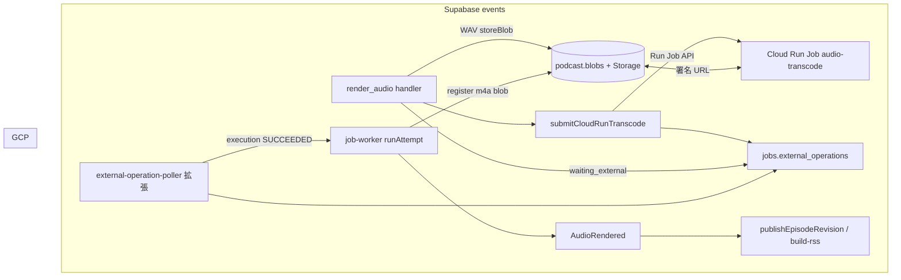

# 音声 transcoding（Cloud Run Jobs）

## 前提

制作パイプラインは events モード（`jobs` / `job-worker` / `external-operation-poller` / `ProductionPolicy` / `publishEpisodeRevision`）だけを対象とする。legacy pgflow（`craftEpisodeSubmit` / `craftEpisodeDownload` / `audio_files` ライフサイクル）には手を入れない。

Gemini Batch TTS の出力は、PCM を連結したうえで WAV として `podcast.blobs` に登録する。配信用の AAC（m4a コンテナ）への変換は、Edge Functions では CPU と実行時間の制限に当たる。変換処理は Google Cloud Run Jobs 上の ffmpeg コンテナに任せ、Supabase 側は投入・完了の検知・Blob 更新だけを行う。

## 目的と非目的

| 目的 | 非目的 |
|------|--------|
| WAV Blob を m4a などに変換し、配信用 Blob として登録する | TTS ベンダー（Gemini）の差し替え |
| transcoding を Edge の実行時間・CPU 制限の外に出す | 変換 API（Transloadit 等）の採用 |
| 既存の ExternalOperation・poller・`waiting_external` の型に載せる | legacy pgflow / `pipeline-stages` の音声 RSS 経路 |
| RSS の `enclosure` に正しい `type` と `length`（`podcast.blobs.byte_size`）を載せる | 初版からチャンク並列 transcoding |
| | GCP 以外の ffmpeg ホストの詳細設計 |

## 現状（events）

```text
ProductionPolicy → requestJob(render_audio)
  → submit Gemini Batch → external_operations (batch) → waiting_external
  → external-operation-poller → job-worker (resume)
  → downloadBatchWav → storeBlob → jobs/.../audio.wav (podcast.blobs, mime audio/wav)
  → job succeeded → AudioRendered (blob_id, duration_ms 等)
  → ProductionPolicy → auto_publish → buildRssFeedXml (enclosure length = blobs.byte_size)
```

| 箇所 | 現状 | transcode 導入時の注意 |
|------|------|------------------------|
| `render_audio` | WAV を `Deno.readFile` で丸ごと読み、`storeBlob` する | 長尺ではメモリ不足になりうる。ストリーム upload に切り替えるときは `byte_size` を必ず確定する（後述） |
| `storeBlob` | `ReadableStream` 入力時は `byte_size = 0` で登録する | events の RSS は `byte_size` に依存するため、0 のまま publish しない |
| RSS | `_adapters/feed/build-rss.ts` の `length="${ep.audioByteSize}"` | `publish-episode.ts` が `podcast.blobs.byte_size` を読む。legacy の `pipeline-stages.buildRssFeed`（`length="0"` 固定）は使わない |
| 公開タイミング | `AudioRendered` のあと `auto_publish` | m4a Blob が確定するまで `render_audio` を succeeded にしない（WAV のまま公開しない） |

## 目標アーキテクチャ



### Cloud Run Jobs を選ぶ理由

| 要件 | Jobs との対応 |
|------|----------------|
| ffmpeg バイナリ | カスタム Docker イメージ |
| 1 エピソードあたり数分〜十数分 | タスク timeout 最大 168 h（音声のみなら 10〜30 分で足りる） |
| アイドル時のコスト | 実行時のみ課金（スケールゼロ） |
| 再試行 | `--max-retries` とタスク再試行 |
| 将来のチャンク並列 | 同一 Job の `taskCount` / `parallelism` |

HTTP Service で同期 encode する方式は、Edge と Kong のタイムアウトと噛み合わない。Jobs と poller の組み合わせなら、Gemini Batch と同じ「外部処理を待つ」形にできる。

## コンポーネント

### 1. Cloud Run Job `audio-transcode`

実装フェーズでは `services/audio-transcode/` に Dockerfile とエントリシェルを置く。

初版は 1 タスク = 1 エピソードとする。

1. 環境変数からジョブ入力を読む。
2. `INPUT_URL`（Supabase の署名付き読み取り URL）から WAV をストリーム取得する。
3. ffmpeg（既定）: `-c:a aac -b:a 128k -movflags +faststart` → `/tmp/out.m4a`
4. `OUTPUT_UPLOAD_URL`（署名付き upload）へ m4a を送る。
5. 標準出力または小さな結果 JSON に `OUTPUT_BYTE_SIZE` と `DURATION_MS`（ffprobe）を載せ、Edge が poller 再開後に読む。初版は poller 側が Storage の HEAD や metadata から `byte_size` を取ってもよい。

リソース目安（初版）:

| 設定 | 値 |
|------|-----|
| CPU | 2 vCPU |
| Memory | 1〜2 GiB |
| task timeout | 900 s |
| max retries | 1 |

GCP では、Supabase に近いリージョン（例: `asia-northeast1`）に Job を置く。Job 実行用 SA に Supabase 鍵は載せない。

### 2. Supabase：`render_audio` 内の transcode フェーズ

トリガーは、Gemini Batch 完了後に WAV を `storeBlob` した直後とする。`podcast_config` で transcode が有効なときだけ走る。

`podcast_config` のキー:

| キー | 例 | 意味 |
|------|-----|------|
| `audio.delivery.format` | `m4a` / `wav` | `wav` なら transcode をスキップ（デバッグ用） |
| `audio.transcode.enabled` | `true` | マスタースイッチ |
| `audio.transcode.bitrate_kbps` | `128` | ffmpeg `-b:a` |
| `audio.transcode.container` | `m4a` | 出力 MIME `audio/mp4` |
| `gcp.project_id` | `...` | Run API |
| `gcp.region` | `asia-northeast1` | Job リージョン |
| `gcp.run.job_name` | `audio-transcode` | Job 名 |

transcode が有効なときの `render_audio` の流れ:

1. 既存どおり Gemini Batch → WAV を `storeBlob`（staging として `job.output.wav_blob_id` / `storage_path` を job output に残す）。
2. `submitCloudRunTranscode()` で Run Job API を呼ぶ。`INPUT_URL` は WAV の署名 GET、`OUTPUT_UPLOAD_URL` は同一 job 配下または `jobs/.../audio.m4a` への署名 PUT。
3. `jobs.external_operations` に 2 件目を insert する（Batch 行は `completed_at` 済み）。

| 列 | 値 |
|----|-----|
| `operation_name` | Execution リソース名（`projects/.../executions/...`） |
| `state` | `EXECUTION_RUNNING` 等 |
| `next_poll_at` | 現在時刻 + 30 s |

4. `job.output.transcode` に `{ execution, wav_blob_id, output_storage_path }` を保存する。
5. handler は `waiting_external` を返す。この時点では `AudioRendered` を出さない。

Edge から Run Job API を呼ぶとき:

- Secret: `GCP_SERVICE_ACCOUNT_JSON` → OAuth2 → `run.googleapis.com`
- コンテナ env: `INPUT_URL`, `OUTPUT_UPLOAD_URL`, `BITRATE_KBPS`, `JOB_ID`, `ATTEMPT_ID`

### 3. Poller：`external-operation-poller` の拡張

`operation_name` の形で Gemini Batch と Cloud Run を分ける。

| `operation_name` の形 | ポール先 |
|------------------------|----------|
| `batches/...` など Gemini batch 名 | 既存 `pollBatch` |
| `projects/` で始まる Execution フルリソース名 | Cloud Run Executions API（`GET .../executions/{id}`） |

同一 `attempt_id` に Batch 完了行と transcode 行が並ぶ。ポーラーは `completed_at IS NULL` の行だけ処理するため、Batch 完了後は transcode 行だけが残る。

Execution が成功したとき:

1. `external_operations.completed_at` を設定する。
2. `jobs.status` を `running` に戻し、`startRunJobFlow(job_id)` を呼ぶ（Batch 成功時と同型）。
3. `render_audio` が再入場し、`job.output.transcode` がある場合は finalize する。
   - Storage 上の m4a から `byte_size` と `duration_ms` を確定する（HEAD または Job ログ）。
   - `registerBlob` するか、既存 path の `podcast.blobs` 行を update する（`mime_type: audio/mp4`）。
   - 初版は WAV Blob 行は残し、m4a を正の `blob_id` として job output に載せる。
4. `render_audio` を `outcome: succeeded` とする。`blob_id` / `storage_path` / `mime_type` / `byte_size` / `duration_ms` は m4a 側の値とする。
5. `job-worker` が `AudioRendered` を出し、`ProductionPolicy` が `auto_publish` する（従来どおり）。

Execution が失敗したときは job を `failed` とする。再試行は Production 側のポリシーと `pnpm cli requeue` など events 経路に任せる。

方式 B（Callback）として、Job 末尾から `transcode-callback` Edge を叩く案もある。初版は Poll のみとし、Callback は Phase 3 で検討する。

### 4. RSS と Blob（events のみ）

| 項目 | 正本 |
|------|------|
| enclosure `url` | `podcast.blobs.storage_path` から組み立てた公開 URL |
| enclosure `type` | `podcast.blobs.mime_type`（m4a なら `audio/mp4`） |
| enclosure `length` | `podcast.blobs.byte_size`（`build-rss.ts` ← `publish-episode.ts`） |

transcode 完了前に `AudioRendered` を出さないため、WAV や `byte_size = 0` の Blob が RSS に載る経路はない。

`storeBlob` をストリーム upload に切り替える場合:

- upload 完了後に Storage metadata または ffprobe でサイズを取り、`podcast.blobs.byte_size` を正しい値で insert または update する。
- transcode をスキップ（`delivery.format=wav`）するときも `byte_size` は必須とする。

## セキュリティ

| 原則 | 実装 |
|------|------|
| Job に Supabase service role を載せない | 署名 URL のみ |
| 署名 URL の TTL | Job timeout より長く（15〜60 分） |
| upload 先 | env で固定（`jobs/{jobId}/{attemptId}/audio.m4a` 等） |
| GCP SA JSON | Supabase Secret のみ |

## 冪等性と失敗

- 同一 job で Execution が RUNNING のときは再 submit しない（`job.output.transcode.execution` を参照）。
- 成功後、`mime_type` が既に `audio/mp4` なら finalize は no-op とする。
- 失敗時は job を `failed` とし、WAV staging Blob を正本として transcode をやり直せる。
- upload が途中で切れた場合、m4a は upsert する。失敗時は WAV だけが残る。

## 実装フェーズ

### Phase 0 — GCP

1. `services/audio-transcode`、Artifact Registry、Cloud Run Job を用意する。
2. 実行 SA に `run.jobs.run` と `run.executions.get` を付与する（poller 用 SA は Edge Secret に紐づく SA と同一でもよい）。
3. 署名 URL で Job を 1 回 execute し、m4a が upload されることを手動確認する。

### Phase 1 — events 統合

1. `_shared/transcode/` に `submitCloudRunTranscode`、`pollCloudRunExecution`、`finalizeTranscodedAudioBlob` を置く。
2. `render_audio` で WAV 保存のあと transcode を submit し、`waiting_external` にする。
3. `external-operation-poller` に `projects/` 分岐を足す。
4. `podcast_config` の seed と、必要なら migration（キー追加のみ）。
5. ローカルで `pipeline.mode=events` とモック Gemini を使い、ingest から m4a Blob・`feed.xml` の length まで通す。

### Phase 2 — 品質・運用

1. `render_audio` の `readFile` をやめ、ストリーム upload と `byte_size` 確定を行う（transcode なし path も含む）。
2. staging WAV Blob の GC 方針（m4a 成功後 N 日）を決める。
3. Workload Identity Federation で SA JSON を撤去する。

### Phase 3 — 最適化

1. Cloud Run Job の task 並列で、超長尺の wall clock を分散する。
2. 必要なら Callback を補助として足す。

## 監視

- Cloud Logging: executionId、ffmpeg の exit code。
- `jobs.job_attempts` と external_operations の state 遷移。
- publish 後の RSS で `enclosure length` が 0 でないこと（スモーク）。

## 関連ドキュメント

- [podcast-domain-model-tobe.md](./podcast-domain-model-tobe.md) — §4.3、ExternalOperation
- [podcast-domain-model-migration.md](./podcast-domain-model-migration.md) — events 移行（完了前提）
- [CLAUDE.md](../../CLAUDE.md) — `pnpm pipeline:status`、`external-operation-poller`

## 未決事項

1. m4a の Storage パスを `jobs/.../audio.m4a` のままにするか、公開用 `audio/{episodeId}.m4a` に寄せるか（RSS URL の方針）。
2. GCP プロジェクト ID・リージョンを `podcast_config` に置くか、Secret のみにするか。
3. staging WAV を同 job 配下に残す期間（Phase 2 の GC とセット）。
