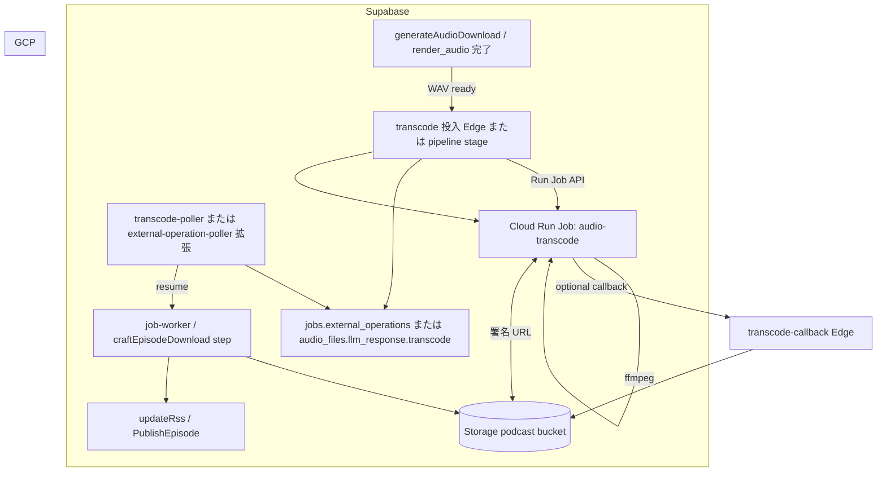

# 音声 transcoding（Cloud Run Jobs）

Gemini Batch TTS の出力は PCM 連結後 **WAV** として Supabase Storage に置く。配信用に **AAC（m4a コンテナ）** へ変換する処理は Edge Functions 上では CPU・時間制限のため実行しない。**Google Cloud Run Jobs** 上の ffmpeg コンテナに委譲し、Supabase 側は **投入・完了検知・メタデータ更新** だけを担う。

## 目的と非目的

| 目的 | 非目的 |
|------|--------|
| Storage 上の WAV を m4a（または設定可能な形式）に変換する | TTS ベンダー（Gemini）の差し替え |
| Edge の wall clock / CPU 制限から transcoding を切り離す | 変換 API（Transloadit 等）の採用 |
| legacy（pgflow）と events（`jobs`）の両方に載せられる共通の「外部実行」形 | 初版からチャンク並列 transcoding（後続フェーズ） |
| RSS の `enclosure` に正しい `type` と `length` を載せられるようにする | GCP 以外の ffmpeg ホストの詳細設計 |

## 現状

```text
ingest → generateScript → generateAudioStart (Gemini Batch)
      → download-monitor → generateAudioDownload
            → JSONL 取得 → PCM 結合 → WAV → Storage `audio/{episodeId}.wav`
      → updateRss (enclosure type = mime_type, length = 0 固定)
```

- WAV 取得は `@podcaster/gemini-batch-tts` が **ストリーム指向**（legacy `downloadGeneratedAudio` は Storage へ readable upload）。
- events 経路の `render_audio` は **WAV 全体を `readFile`** しており、長尺ではメモリリスクがある（transcode 導入前にストリーム化を推奨）。
- `podcast_config` の `tts.response_format`（`config.toml`）は **Gemini 未接続**。

## 目標アーキテクチャ



### 選定理由（Cloud Run Jobs）

| 要件 | Jobs の適合 |
|------|-------------|
| ffmpeg バイナリ | カスタム Docker イメージ |
| 1 エピソード数分〜十数分 | タスク timeout 最大 **168 h**（音声のみなら 10〜30 分で十分） |
| スケールゼロ | 実行時のみ課金 |
| 再試行 | `--max-retries` / タスク再試行 |
| 将来のチャンク並列 | 同一 Job の **taskCount / parallelism** で拡張可能 |

HTTP **Service** で同期 encode する方式は、Edge・Kong のタイムアウトと相性が悪い。**Jobs + ポーラー** は既存の Gemini Batch（`waiting_external` + `external-operation-poller`）と同型にできる。

## コンポーネント

### 1. Cloud Run Job `audio-transcode`

**リポジトリ配置（実装フェーズ）:** `services/audio-transcode/`（Dockerfile + エントリシェルまたは小さな Node/Bun ラッパー）。

**1 タスク = 1 エピソード（初版）**

1. 環境変数または JSON ファイルからジョブ入力を読む。
2. `INPUT_URL`（HTTP GET、Supabase **署名付き読み取り URL**）から WAV を **ストリーム**で `/tmp/in.wav` へ（または pipe）。
3. ffmpeg で出力（既定例）:
   - コンテナ: `-c:a aac -b:a 128k -movflags +faststart`
   - 出力: `/tmp/out.m4a`
4. `OUTPUT_URL`（署名付き **PUT** または Supabase Storage の upload URL）へストリーム upload。
5. 終了コード 0。失敗時は stderr を Cloud Logging に残し非 0。

**リソース目安（初版）**

| 設定 | 値 | 根拠 |
|------|-----|------|
| CPU | 2 vCPU | ffmpeg 単スレッド寄りだが余裕 |
| Memory | 1〜2 GiB | ストリーム I/O なら 14 MB 級 WAV で十分 |
| task timeout | 900 s（15 min） | 5 分話 ~14 MB + encode + 転送 |
| max retries | 1 | 再実行は Supabase 側 idempotency で制御 |

**GCP 配置**

- **リージョン:** Supabase プロジェクトに近いリージョン（例: 東京 `asia-northeast1`）。Storage はインターネット経由のため完全同居は不要だが、RTT を抑える。
- **実行 SA:** `podcaster-audio-transcode@...` — Cloud Run Job 実行専用。**Supabase 鍵は載せない**（署名 URL のみ）。
- **Artifact Registry:** イメージ `.../audio-transcode:latest`。

### 2. Supabase：投入（Submit）

**トリガー:** WAV が Storage に存在し、`audio_files.status = ready`（legacy）または `render_audio` 相当の完了直後。

**設定（`podcast_config` 新規キー）**

| キー | 例 | 意味 |
|------|-----|------|
| `audio.delivery.format` | `m4a` / `wav` | `wav` なら transcode スキップ（移行用） |
| `audio.transcode.enabled` | `true` | マスタースイッチ |
| `audio.transcode.bitrate_kbps` | `128` | ffmpeg `-b:a` |
| `audio.transcode.container` | `m4a` | 出力拡張子と MIME |
| `gcp.project_id` | `...` | Run API 用 |
| `gcp.region` | `asia-northeast1` | Job のリージョン |
| `gcp.run.job_name` | `audio-transcode` | 完全修飾名の短縮 |

**legacy パス:** `downloadGeneratedAudio` 成功後、WAV upload 完了 → **transcode 投入** → 完了まで episode を `audio_transcoding`（新 status）または `audio_files` に `transcode` メタデータのみ保持。初版は **episode status を増やさず** `audio_files.llm_response.transcode` に状態を載せてもよい（マイグレーション最小）。

**events パス:** `render_audio` 成功後に同じ投入関数を呼ぶ。Job 型 `transcode_audio` を追加する案もあるが、初版は **共通ライブラリ `submitAudioTranscode()`** を legacy / events 両方から呼ぶ。

**Run Job API 呼び出し（Edge から）**

- 認証: GCP **サービスアカウント JSON** を Supabase Secret（`GCP_SERVICE_ACCOUNT_JSON`）に保存し、OAuth2 access token を取得して `run.googleapis.com` を呼ぶ。または **Workload Identity Federation**（Supabase Edge が OIDC を持たないため、初版は SA JSON が現実的）。
- `overrides.containerOverrides[0].env` に渡す:
  - `INPUT_URL` — `createSignedUrl(storage_path, 3600)` 読み取り
  - `OUTPUT_PATH` — 論理パス `audio/{episodeId}.m4a`（Job 内で upload 先決定）
  - `OUTPUT_UPLOAD_URL` — 署名付き upload（upsert）URL、または upload 用に Edge が **service role で upload せず Job に任せる** 場合は **短期 service role を Secret に置かず**、Supabase Storage REST の signed upload URL を発行
  - `EPISODE_ID`, `AUDIO_FILE_ID`, `CORRELATION_ID`

**外部操作の記録（events 整合）**

`jobs.external_operations` に Gemini Batch と同様の行を追加する:

| 列 | 値 |
|----|-----|
| `operation_name` | Cloud Run execution name（`projects/.../executions/...`） |
| `state` | `EXECUTION_RUNNING` / `EXECUTION_SUCCEEDED` / `EXECUTION_FAILED` |
| `next_poll_at` | 30 s 後 |

legacy では `audio_files.llm_response.transcode.execution` に同型 JSON を保存し、**専用 poller** または **poller 拡張**で Cloud Run Executions API をポール。

### 3. Supabase：完了検知（Poll）

**方式 A（推奨・初版）:** 既存 `external-operation-poller` を拡張し、`operation_name` が `projects/` で始まる場合は **Cloud Run Executions API** をポール。

**方式 B:** Job コンテナの最後に `POST /functions/v1/transcode-callback`（共有秘密 `TRANSCODE_CALLBACK_SECRET`）。Edge が `audio_files` 更新。ポーリング不要だが、**コールバック失敗時の整合**に poller をバックアップとして残す。

**成功時の DB / Storage 更新**

1. `audio_files.storage_path` → `audio/{episodeId}.m4a`
2. `audio_files.mime_type` → `audio/mp4`
3. 旧 WAV: 削除するか **`audio/{episodeId}.wav` を残す**（初版は **残す** — ロールバック容易。GC は後続）。
4. `episodes.audio_url` / ingest 時プレースホルダが `.wav` 固定なら **拡張子追随**（マイグレーションまたは更新時に上書き）。
5. `duration_ms` — WAV ヘッダまたは ffprobe 出力を Job が `TRANSCODE_RESULT_JSON` で返す（callback 時）または Edge が download して計算。
6. legacy: episode `audio_ready` のまま RSS へ。transcode 中は **RSS に載せない**（`audio_ready` は transcode 完了後のみ）か、`delivery.format=wav` のとき従来どおり。

**RSS**

- `buildRssFeed` の `enclosure length="0"` を **`audio_files.byte_size` または Storage metadata** で埋める（to-be doc と一致）。
- `type` は `mime_type` をそのまま使用。

### 4. pgflow / タイムアウト

| ステップ | 現行 timeout | transcode 後 |
|----------|--------------|--------------|
| `generateAudioDownload` | 120 s | WAV まで（変更なし） |
| transcode 待ち | — | **Edge 外**（ExternalOperation） |
| `updateRss` | 120 s | transcode 完了後に実行 |

新 step `transcodeAudio` を `craftEpisodeDownload` に挟む案:

```text
generateAudioDownload → transcodeAudio (submit only, 数秒) → [poll] → finalizeAudio → updateRss
```

初版実装コストを抑えるなら **`generateAudioDownload` 内で submit まで行い、完了は poller が検知したら `start_flow` で `updateRss` のみ** も可（download step を二段にしない）。

## セキュリティ

| 原則 | 実装 |
|------|------|
| GCP SA は Supabase に書き込まない（初版） | 署名 URL のみ Job に渡す |
| 署名 URL TTL | 15〜60 分（Job timeout より長く） |
| upload 先パス | Job env で固定 `audio/{episodeId}.m4a` — 任意パス upload 不可 |
| Edge → GCP | SA JSON は Secret のみ。ログに URL クエリ（token）を出さない |
| Callback | `Authorization: Bearer` 共有秘密、body に episode_id + execution_name |

## 冪等性と失敗

- **同一 episode で execution が RUNNING:** 新規 Run Job しない（`llm_response.transcode.execution` を参照）。
- **Succeeded 後の再 submit:** storage_path が既に `.m4a` なら no-op。
- **Failed:** episode `audio_transcode_failed` または `audio_files.error` にメッセージ。CLI `requeue` で WAV から transcode 再投入。
- **Partial upload:** 出力は upsert。失敗時は WAV が正本のまま。

## 実装フェーズ

### Phase 0 — インフラ（GCP）

1. Artifact Registry + Cloud Run Job 定義（terraform または `gcloud` 手順を `services/audio-transcode/README.md` に記載）。
2. 実行 SA + `run.jobs.run` / `run.executions.get`（poller 用 SA は Edge Secret に紐づく SA と同一でも可）。
3. 手動: 公開 WAV 署名 URL で Job を 1 回 execute → m4a が upload されることを確認。

### Phase 1 — legacy パイプライン

1. `services/audio-transcode` コンテナ。
2. `_shared/transcode/` — `submitCloudRunTranscode()`, `pollCloudRunExecution()`.
3. `downloadGeneratedAudio` 末尾で `delivery.format != wav` なら submit。
4. `external-operation-poller` 拡張または `transcode-poller` Edge Function + cron。
5. 完了ハンドラで `audio_files` 更新 → `craftEpisodeDownload` / monitor から RSS へ（既存 `updateRss`）。
6. `podcast_config` seed + migration（キー追加のみ、テーブル変更なしでも可）。

### Phase 2 — events パイプライン

1. `render_audio` の `readFile` を **ストリーム upload** に変更。
2. `render_audio` 完了後に同じ transcode submit。
3. （任意）`JobType` `transcode_audio` に分離し ProductionPolicy から明示。

### Phase 3 — 最適化

1. **Cloud Run Job task 並列:** TTS チャンクごとに staging WAV → task index → ADTS/m4a concat を 1 Job 内で実行（超長尺の wall clock 分散）。
2. WAV ライフサイクル（transcode 成功 7 日後削除）。
3. Workload Identity Federation で SA JSON 撤去。

## 監視

- Cloud Logging: Job executionId、ffmpeg コマンド、exit code。
- `processing_logs` に `stage=transcode`、duration_ms。
- メトリクス: 失敗率、execution 時間 p95、Storage egress（Supabase ↔ GCP）。

## コスト概算（目安）

| 項目 | 5 分エピソード / 回 |
|------|---------------------|
| Cloud Run Job（2 vCPU × 1〜2 min） | 従量（小） |
| Supabase Storage egress → GCP | ~14 MB / 回 |
| GCP ingress | 多くは無料 |
| ffmpeg CPU | Job 課金に含む |

ポッドキャスト本数が少ない間は **固定費ほぼゼロ**（Jobs 未実行時）。

## 関連ドキュメント

- [podcast-domain-model-tobe.md](./podcast-domain-model-tobe.md) — §4.3 実行時間上限、`ExternalOperation` パターン
- [podcast-domain-model-migration.md](./podcast-domain-model-migration.md) — events 移行
- [CLAUDE.md](../../CLAUDE.md) — Edge / pgflow コマンド

## 未決事項（実装前に決める）

1. episode **status** に `audio_transcoding` を足すか、`audio_files` のみで表すか。
2. transcode 完了まで **auto-publish / RSS** を止めるか（推奨: **止める**）。
3. GCP プロジェクト ID・リージョンの **本番値** を `podcast_config` に置くか Secret のみか。
4. Callback（方式 B）を初版から入れるか、Poll のみか（推奨: **Poll のみ初版**、Callback は Phase 3）。
