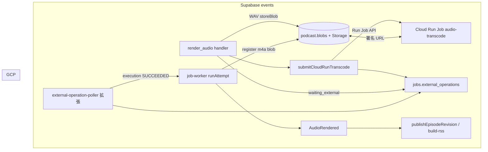

# 音声 transcoding（Cloud Run Jobs）

**前提:** 制作パイプラインは **events モード**（`jobs` / `job-worker` / `external-operation-poller` / `ProductionPolicy` / `publishEpisodeRevision`）のみを対象とする。legacy pgflow（`craftEpisodeSubmit` / `craftEpisodeDownload` / `audio_files` ライフサイクル）への対応は設計・実装ともに行わない。

Gemini Batch TTS の出力は PCM 連結後 **WAV** として `podcast.blobs` に登録される。配信用 **AAC（m4a コンテナ）** への変換は Edge Functions 上では CPU・時間制限のため実行しない。**Google Cloud Run Jobs** 上の ffmpeg コンテナに委譲し、Supabase 側は **投入・完了検知・Blob 更新** だけを担う。

## 目的と非目的

| 目的 | 非目的 |
|------|--------|
| WAV Blob を m4a（または設定可能な形式）に変換し、**配信用 Blob** として登録する | TTS ベンダー（Gemini）の差し替え |
| Edge の wall clock / CPU 制限から transcoding を切り離す | 変換 API（Transloadit 等）の採用 |
| 既存の **ExternalOperation + poller + `waiting_external`** パターンに載せる | legacy pgflow / `pipeline-stages` の音声 RSS 経路 |
| RSS の `enclosure` に正しい `type` と **`length`（`podcast.blobs.byte_size`）** を載せる | 初版からチャンク並列 transcoding（後続フェーズ） |
| | GCP 以外の ffmpeg ホストの詳細設計 |

## 現状（events）

```text
ProductionPolicy → requestJob(render_audio)
  → submit Gemini Batch → external_operations (batch) → waiting_external
  → external-operation-poller → job-worker (resume)
  → downloadBatchWav → storeBlob → jobs/.../audio.wav (podcast.blobs, mime audio/wav)
  → job succeeded → AudioRendered (blob_id, duration_ms 等)
  → ProductionPolicy → auto_publish → buildRssFeedXml (enclosure length = blobs.byte_size)
```

| 箇所 | 現状 | transcode 導入時の注意 |
|------|------|------------------------|
| `render_audio` | WAV を **`Deno.readFile` 丸読み**して `storeBlob` | 長尺はメモリリスク。ストリーム upload 化時は **`byte_size` を必ず確定**する（後述） |
| `storeBlob` | `ReadableStream` 入力時 **`byte_size = 0`** | events RSS は `byte_size` 依存のため **0 のまま publish しない** |
| RSS | `_adapters/feed/build-rss.ts` — `length="${ep.audioByteSize}"` | `publish-episode.ts` が **`podcast.blobs.byte_size`** を読む。legacy の `pipeline-stages.buildRssFeed`（`length="0"` 固定）は **使わない** |
| 公開タイミング | `AudioRendered` 後に `auto_publish` | **m4a Blob が確定するまで `render_audio` を succeeded にしない**（WAV のまま公開されない） |

## 目標アーキテクチャ



### 選定理由（Cloud Run Jobs）

| 要件 | Jobs の適合 |
|------|-------------|
| ffmpeg バイナリ | カスタム Docker イメージ |
| 1 エピソード数分〜十数分 | タスク timeout 最大 **168 h**（音声のみなら 10〜30 分で十分） |
| スケールゼロ | 実行時のみ課金 |
| 再試行 | `--max-retries` / タスク再試行 |
| 将来のチャンク並列 | 同一 Job の **taskCount / parallelism** で拡張可能 |

HTTP **Service** で同期 encode する方式は Edge・Kong のタイムアウトと相性が悪い。**Jobs + poller** は Gemini Batch と同型にできる。

## コンポーネント

### 1. Cloud Run Job `audio-transcode`

**リポジトリ配置（実装フェーズ）:** `services/audio-transcode/`（Dockerfile + エントリシェル）。

**1 タスク = 1 エピソード（初版）**

1. 環境変数からジョブ入力を読む。
2. `INPUT_URL`（Supabase **署名付き読み取り URL**）から WAV をストリームで取得。
3. ffmpeg（既定）: `-c:a aac -b:a 128k -movflags +faststart` → `/tmp/out.m4a`
4. `OUTPUT_UPLOAD_URL`（署名付き upload）へ m4a を upload。
5. 標準出力または小さな結果 JSON に **`OUTPUT_BYTE_SIZE`**、**`DURATION_MS`**（ffprobe）を載せ、Edge が poller 再開後に読む（初版は poller が Storage **HEAD/metadata** で `byte_size` を取ってもよい）。

**リソース目安（初版）**

| 設定 | 値 |
|------|-----|
| CPU | 2 vCPU |
| Memory | 1〜2 GiB |
| task timeout | 900 s |
| max retries | 1 |

**GCP:** リージョンは Supabase に近い場所（例: `asia-northeast1`）。Job 実行 SA に Supabase 鍵は載せない。

### 2. Supabase：`render_audio` 内の transcode フェーズ

**トリガー:** Gemini Batch 完了後、WAV を `storeBlob` した直後。`podcast_config` で transcode が有効なときのみ。

**設定（`podcast_config`）**

| キー | 例 | 意味 |
|------|-----|------|
| `audio.delivery.format` | `m4a` / `wav` | `wav` なら transcode スキップ（デバッグ用） |
| `audio.transcode.enabled` | `true` | マスタースイッチ |
| `audio.transcode.bitrate_kbps` | `128` | ffmpeg `-b:a` |
| `audio.transcode.container` | `m4a` | 出力 MIME `audio/mp4` |
| `gcp.project_id` | `...` | Run API |
| `gcp.region` | `asia-northeast1` | Job リージョン |
| `gcp.run.job_name` | `audio-transcode` | Job 名 |

**`render_audio` の状態遷移（transcode 有効時）**

1. 既存どおり Gemini Batch → WAV `storeBlob`（**staging**: `job.output.wav_blob_id` / `storage_path` を job output に保持）。
2. `submitCloudRunTranscode()` — Run Job API、`INPUT_URL` = WAV の署名 GET、`OUTPUT_UPLOAD_URL` = 同一 job 配下または `jobs/.../audio.m4a` への署名 PUT。
3. **`jobs.external_operations` に 2 件目**を insert（Batch 行は `completed_at` 済み）:

| 列 | 値 |
|----|-----|
| `operation_name` | Execution リソース名（`projects/.../executions/...`） |
| `state` | `EXECUTION_RUNNING` 等 |
| `next_poll_at` | +30 s |

4. **`job.output.transcode`** に `{ execution, wav_blob_id, output_storage_path }` を保存。
5. handler は **`waiting_external` を返す**（この時点では `AudioRendered` を出さない）。

**Run Job API（Edge）**

- Secret: `GCP_SERVICE_ACCOUNT_JSON` → OAuth2 → `run.googleapis.com`
- env: `INPUT_URL`, `OUTPUT_UPLOAD_URL`, `BITRATE_KBPS`, `JOB_ID`, `ATTEMPT_ID`

### 3. Poller：`external-operation-poller` 拡張

**判別ルール（Gemini vs Cloud Run）**

| `operation_name` の形 | ポール先 |
|------------------------|----------|
| `batches/...` または Gemini batch 名 | 既存 `pollBatch` |
| **`projects/` で始まる** Execution フルリソース名 | **Cloud Run Executions API** `GET .../executions/{id}` |

同一 `attempt_id` に Batch 完了行と transcode 行が並ぶ。ポーラーは **`completed_at IS NULL`** の行だけ処理するため、Batch 完了後は transcode 行だけが残る。

**Execution 成功時**

1. `external_operations.completed_at` を設定。
2. `jobs.status` を `running` に戻し **`startRunJobFlow(job_id)`**（既存 Batch 成功時と同型）。
3. `render_audio` 再入場: `job.output.transcode` あり → finalize:
   - Storage 上の m4a から **`byte_size` / `duration_ms`** を確定（HEAD または Job ログ）。
   - **`registerBlob`**（または既存 path の `podcast.blobs` 行を update）— **`mime_type: audio/mp4`**。
   - （任意）staging WAV Blob は残すか、`storage_path` を差し替え（初版は **WAV Blob 行は残し、m4a を正の `blob_id` として job output**）。
4. `render_audio` **`outcome: succeeded`** — `blob_id` / `storage_path` / `mime_type` / `byte_size` / `duration_ms` は **m4a 側**。
5. `job-worker` → **`AudioRendered`** → `ProductionPolicy` → **`auto_publish`**（従来どおり）。

**Execution 失敗時:** job `failed`、Production 側で再試行ポリシー（`pnpm cli requeue` 等、events 経路）。

**方式 B（Callback）:** Job 末尾から `transcode-callback` Edge — 初版は **Poll のみ**。Phase 3 で検討。

### 4. RSS と Blob（events のみ）

| 項目 | 正本 |
|------|------|
| enclosure `url` | `podcast.blobs.storage_path` → 公開 URL |
| enclosure `type` | `podcast.blobs.mime_type`（m4a → `audio/mp4`） |
| enclosure **`length`** | **`podcast.blobs.byte_size`**（`build-rss.ts` ← `publish-episode.ts`） |

transcode 完了前に **`AudioRendered` を出さない** ため、**WAV（または byte_size=0 の Blob）が RSS に載る経路はない**。

**`storeBlob` ストリーム化（実装時）**

- WAV 保存を `ReadableStream` に切り替える場合、upload **完了後**に Storage metadata または ffprobe でサイズを取り、**`podcast.blobs.byte_size` を正しい値で insert/update** する。
- transcode スキップ（`delivery.format=wav`）でも **`byte_size` 必須**。

## セキュリティ

| 原則 | 実装 |
|------|------|
| Job に Supabase service role を載せない | 署名 URL のみ |
| 署名 URL TTL | Job timeout より長く（15〜60 分） |
| upload 先 | env で固定（`jobs/{jobId}/{attemptId}/audio.m4a` 等） |
| GCP SA JSON | Supabase Secret のみ |

## 冪等性と失敗

- **同一 job で Execution が RUNNING:** 再 submit しない（`job.output.transcode.execution`）。
- **Succeeded 後:** `mime_type` が既に `audio/mp4` なら finalize no-op。
- **Failed:** job `failed`。WAV staging Blob は正本として再 transcode 可能。
- **Partial upload:** m4a は upsert。失敗時は WAV のみ残る。

## 実装フェーズ

### Phase 0 — GCP

1. `services/audio-transcode` + Artifact Registry + Cloud Run Job。
2. SA + `run.jobs.run` / `run.executions.get`。
3. 手動: 署名 URL で 1 回 execute → m4a upload 確認。

### Phase 1 — events 統合

1. `_shared/transcode/` — `submitCloudRunTranscode`, `pollCloudRunExecution`, `finalizeTranscodedAudioBlob`.
2. `render_audio` — WAV 後 transcode submit + `waiting_external`。
3. `external-operation-poller` — `projects/` 分岐。
4. `podcast_config` seed + 必要なら migration（config キーのみ）。
5. ローカル `pipeline.mode=events` + モック Gemini で ingest → **m4a Blob** → `feed.xml` の length 確認。

### Phase 2 — 品質・運用

1. `render_audio` の **`readFile` 廃止** → ストリーム upload + **`byte_size` 確定**（transcode なし path も含む）。
2. WAV staging Blob の GC 方針（m4a 成功後 N 日）。
3. Workload Identity Federation（SA JSON 撤去）。

### Phase 3 — 最適化

1. Cloud Run Job **task 並列**（超長尺の wall clock 分散）。
2. （任意）Callback 補助。

## 監視

- Cloud Logging: executionId、ffmpeg exit code。
- `jobs.job_attempts` / external_operations の state 遷移。
- publish 後 RSS の `enclosure length` が 0 でないこと（スモーク）。

## 関連ドキュメント

- [podcast-domain-model-tobe.md](./podcast-domain-model-tobe.md) — §4.3、`ExternalOperation`
- [podcast-domain-model-migration.md](./podcast-domain-model-migration.md) — events 移行（完了前提）
- [CLAUDE.md](../../CLAUDE.md) — `pnpm pipeline:status`、`external-operation-poller`

## 未決事項

1. m4a の Storage パス: **`jobs/.../audio.m4a`** のままか、公開用 **`audio/{episodeId}.m4a`** に寄せるか（RSS URL 方針）。
2. GCP プロジェクト/リージョンを **`podcast_config` に置くか Secret のみか**。
3. staging WAV を **同 job 配下に残す期間**（Phase 2 GC）。
