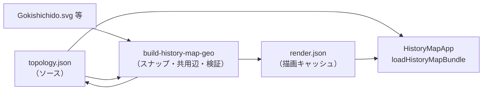

# 歴史マップ地図ジオメトリ（ToBe）

受験用歴史マップの**地図形状・道／国境界**を表すデータの設計。イベント本文などは knowledges `content/juken/history-map/`、**ジオメトリは podcaster**（現行: `apps/web/data/juken/history-map/geo.json`）。

現行は Voronoi（`provinces` の種点）＋粗い／密な `land` リング配列。ToBe では **トポロジをソース・オブ・トゥルース** とし、描画用データはビルドで生成する。

---

## 1. 目標と非目標

### 目標

- 五畿七道・旧国を **意図したポリゴン（エリア）** で表す（Voronoi を廃止）。
- **頂点・辺の共用**でメンテ可能にする（点に ID と意味＝所属エリア／辺の役割）。
- 道の境界を明確なルールで導出する。
- 海岸と道境など **描画上の区別**をエッジ属性で表現する。
- ランタイムは **描画キャッシュ**を読むだけでよい。

### 非目標

- JSON を人手で直接編集するワークフロー（編集は SVG / ビルドツール前提）。
- 海を面（エリア）としてモデル化する（初期は **海はエリアにしない**）。
- 世界中の任意 GIS へ一般化（日本・五畿七道スケールに最適化）。

---

## 2. 合意済みの認識（抜けなしチェック）

| 項目 | 合意内容 |
|------|----------|
| 輪郭の向き | エリアは境界の **結線順** で閉じる。辺は無向で1レコード、ループ上では向き（`a→b` / `b→a`）を明示する。 |
| トポロジ生成 | 頻繁には行わない。Gokishichido 等からの生成は重くてよい。 |
| 二層構成 | **ソース（トポロジ）** ＋ **描画キャッシュ**（ビルド生成、リポジトリにコミット可）。 |
| 道の境界 | 道 `R` に属するエリアだけを見たとき、境界エッジのうち **R 内で参照回数が 1** の辺を、その道の枠とする（グローバルな「1エリアだけ」とは異なる）。 |
| 海 | エリアにしない。海岸辺は陸側エリアのみが参照 → R 内参照 1 → 道枠に含まれる。 |
| 道境 vs 海岸（描画） | トポロジ上はどちらも道枠の候補になりうる。**描画用に `role` を区別**する（後述）。 |
| 穴・島 | エリアは **外輪＋任意個の内輪（穴）** を持てる。複数離れた輪は **別エリア** または同一エリアの複数ループとして扱う（国が飛地のときは国 ID に複数外輪）。 |

未解決として **意図的に残していない**もの: 上記以外に ToBe 実装時に決めるのは主にファイル分割名・ビルド CLI の置き場のみ。

---

## 3. レイヤー構成



- **開発時のソース・オブ・トゥルース**: `topology.json`（名称は実装時に確定可）。
- **配信／ランタイム**: `topology.json` のうち軽量参照 ＋ `render.json`（または `geo.json` 内の `render` セクション）。
- 現行の `events` / `wars` / `taxonomy` / `figures` との結合は既存 `loadHistoryMapBundle` と同様。

---

## 4. ソース形式 `topology.json`

### 4.1 座標

- 全頂点は **経度・緯度**（WGS84 相当の小数）。地図像素へは既存 `project(lng, lat)` を使う。
- スナップ: ビルド時に距離閾値で同一頂点をマージし、`points[]` のインデックスを安定化する（閾値はメタに記録）。

### 4.2 型（概念）

```ts
type HistoryMapTopology = {
  meta: {
    version: number;
    source?: string; // 例: Gokishichido.svg URL / リビジョン
    snapEpsDeg?: number;
  };

  /** 頂点 [lng, lat] */
  points: [number, number][];

  /**
   * 無向辺。points[a]—points[b]。慣例: a < b で保存。
   */
  edges: [number, number][];

  areas: HistoryMapArea[];
  regions: HistoryMapRegionDef[];
};

type HistoryMapArea = {
  /** 安定 ID（例: 旧国名ローマ字 or 日本語 slug） */
  id: string;
  /** 道 ID（regions[].id と一致） */
  regionId: string;
  /** 表示名（国名） */
  label: string;
  /**
   * 外輪・穴。各ループは辺の有向トラバーサル。
   * forward: true なら edges[e] を (a→b)、false なら (b→a) として歩く。
   */
  loops: { edges: { e: number; forward: boolean }[] }[];
};

type HistoryMapRegionDef = {
  id: string; // 例: "tokai"
  name: string; // 例: "東海道"
  /** 所属エリア ID のリスト */
  areaIds: string[];
  /** 塗り色（既存 REGION_FILL_COLORS 互換） */
  fill?: string;
};
```

### 4.3 不変条件（ビルドで検証）

1. 各ループは閉じている（辺列の点列が途切れない）。
2. 各無向辺は最大2エリアにだけ属する（平面分割。交差はビルドで解消 or エラー）。
3. ループの向きは外輪・内輪で一貫（外輪は CCW など、実装で1ルールに固定）。
4. `regionId` と `regions[].areaIds` の双方向が一致。
5. 海はエリアにしないため、「片側だけエリア」の辺が海岸候補になる。

---

## 5. 道の境界（論理ルール）

道 `R` に対し:

1. `R` に属する全エリアの全ループ上の辺 `e` を列挙する。
2. **R 内での参照回数** `countR(e)` を数える（同じエリアの外輪・穴で2回出ることは通常ないが、あれば検証エラー）。
3. `countR(e) === 1` の辺を **道 R の境界エッジ**とする。
4. 境界エッジをグラフ上で連結し、閉じたポリライン（複数成分あり得る）に並べる。

性質:

- **道内の国境**（2国とも `R`）: `countR(e)=2` → 道枠に **含めない**。
- **道間の国境**: 各道から見ると `countR(e)=1` → **両方の道の枠に含まれる**。
- **海岸**: 海をエリアにしないため `countR(e)=1` → 道枠に **含まれる**。

---

## 6. エッジの描画ロール（`role`）

トポロジ上は §5 で同じ集合に入りうるが、スタイル用に分類する。ビルド時に各 `edgeId` に付与（または `render` 側のみ保持）。

| `role` | 定義（ビルド導出） | 典型スタイル |
|--------|-------------------|--------------|
| `coast` | 辺の反対側に陸エリアがない（海／外部） | 岸线、`land` クリップ境界 |
| `region-border` | 反対側に陸エリアがあり、その `regionId ≠ R`（かつ当該辺は `R` の道枠） | 道境破線 |
| `province-border` | 反対側が同一 `regionId` の別エリア（`countR(e)=2`） | 国境内破線（ズーム時） |

「反対側」の判定: 辺に隣接する2面のうち、評価中のエリアから見たもう一方（無ければ `coast`）。

---

## 7. 描画キャッシュ `render.json`

ランタイム向け。座標は **地図空間（`project` 後）** でも **lng/lat** でもよいが、**1形式に統一**（推奨: lng/lat で保持し描画直前に `project`、現行 `landPolygons` と揃える）。

```ts
type HistoryMapRenderCache = {
  meta: { topologyVersion: number; builtAt?: string };

  /** 全国クリップ用（海岸に沿った land マスク）。複数リング */
  land: string[]; // 現行同様 "lng,lat lng,lat ..."

  /** 道ごとの塗り（エリア外輪を project した点列） */
  regionFills: { regionId: string; areaId: string; color: string; points: string }[];

  /** 道ごと・役割ごとに連結済み SVG path の d 属性断片、または点列 */
  paths: {
    regionId: string;
    coast?: string; // path d
    regionBorder?: string;
    provinceBorder?: string;
  }[];

  labels: {
    areaId: string;
    lng: number;
    lat: number;
  }[];

  regionLabels: {
    regionId: string;
    lng: number;
    lat: number;
  }[];
};
```

- Voronoi・`computeBoundaries` の種点境界は **廃止**。
- キャッシュは **再生成可能**なので、トポロジ変更時は必ずビルドで更新。

---

## 8. ビルドパイプライン

### 入力

1. `topology.json`（手維持 or 前段生成）
2. オプション: [Gokishichido.svg](https://upload.wikimedia.org/wikipedia/commons/8/8e/Gokishichido.svg) ＋ 国名ラベル対応表

### 処理（新規 or 既存スクリプト拡張）

| 段階 | 内容 |
|------|------|
| 取り込み | SVG パス → 国ポリゴン（lng/lat へ仿射 fit、現行 `juken_history_map_goki.py` と同等） |
| スナップ | 頂点マージ、`points` / `edges` 化 |
| 面構成 | 国 = `area`、道 = `regionId` |
| 検証 | §4.3 の不変条件 |
| 導出 | §5 道枠、§6 `role` |
| 出力 | `topology.json` 更新、`render.json`（または `geo.json` 統合）生成 |

### CLI（案）

```bash
pnpm juken:history-map-geo build \
  --topology apps/web/data/juken/history-map/topology.json \
  --goki path/to/Gokishichido.svg \
  --out-render apps/web/data/juken/history-map/render.json
```

`refine` / `resample` のみの運用は **過渡期**。ToBe では `build` が正規。

---

## 9. ランタイム読み込み

```ts
type HistoryMapBundle = {
  // 既存
  meta: HistoryMapMeta;
  events: HistoryEvent[];
  wars: Record<string, WarOverlay>;
  taxonomy: HistoryMapTaxonomy;
  figures: Record<string, HistoryFigure>;

  // ToBe
  topology?: HistoryMapTopology;
  render: HistoryMapRenderCache;
};
```

- `HistoryMapApp`: `render.land` でクリップ、`render.regionFills` で塗り、`render.paths` で境界線。
- イベント座標（`lng/lat`）は従来どおり `project`。

---

## 10. 移行方針

1. **スキーマ追加**: `topology.json` / `render.json` を導入し、現行 `geo.json` と並走。
2. **ビルド**: Gokishichido から初回 `topology` 生成（共用辺まで）。
3. **Web**: `render` 使用パスを追加し、Voronoi パスを削除。
4. **削除**: `geo.provinces` 種点 Voronoi、`land` のみの巨大リング運用、`computeBoundaries`。

`juken-history-map-check`: `topology` または `render.land` + ラベル整合の検証に更新。

---

## 11. 現行との対応

| 現行 | ToBe |
|------|------|
| `geo.land: string[]` | `render.land`（海岸クリップ、ビルド導出） |
| `geo.provinces`（種点） | 廃止 → `topology.areas` + `labels` |
| `computeBoundaries` / Voronoi | 廃止 → `topology` + `render.paths` |
| `geo.regions`（任意 SVG 座標輪） | `topology.regions` + `render.regionFills` |

---

## 12. 参照

- 座標変換: `apps/web/lib/juken/history-map/geo.ts`（`project`）
- 現行ローダ: `apps/web/lib/juken/history-map/load.ts`
- 過渡期 SVG 取り込み: `scripts/lib/juken_history_map_goki.py`, `scripts/juken-history-map-refine-coast.py`
- 知識コンテンツ分割: [AGENTS.md](../../AGENTS.md)（History map split）