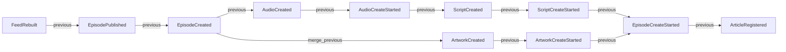

# ドメインイベント — テーブル定義

**方針**: 汎用 `craft_domain_events` は使わない。**イベント種別ごとに専用テーブル**（1 イベント = 1 行 = 1 エンティティ）。

**リンク**: 別表のエッジは持たない。**後続イベント行が `previous_event_kind` + `previous_event_id` で直前イベントを参照**する（後方リンク）。必要な箇所は **型付き FK 列**（`previous_script_created_event_id` 等）も併記し、`previous_*` と一致させる。

DDL: [podcast-craft-domain-events-schema.sql](./podcast-craft-domain-events-schema.sql)

---

## 共通列

| 列 | 説明 |
|----|------|
| `id`, `occurred_at`, `actor`, `correlation_id` | 全 `*_events` 表 |
| `previous_event_kind` | 直前イベントの kind（snake、`_events` なし）。`article_registered_events` のみ NULL |
| `previous_event_id` | 直前イベント行の PK |
| `merge_previous_event_kind` / `merge_previous_event_id` | **`episode_edit_ended_events` のみ** — 音声枝とアートワーク枝の DAG 合流 |

鎖の向き: **新しい行 → 古い行**（`SELECT ... WHERE id = :previous_event_id` で 1 手戻る）。

---

## テーブル一覧

（23 イベント + 成果物 + 投影。`craft_event_links` は **廃止**。）

### Ingest

| テーブル | 後方リンク |
|----------|------------|
| `article_registered_events` | なし（起点） |
| `episode_created_events` | `article_registered_event_id`（= `previous_*`） |

### Edit 開始〜終了・公開

各表に `previous_event_kind` / `previous_event_id`。音声 TTS 鎖など固定順序は型付き FK 付き（SQL 参照）。

---

## 直前イベントの期待値（フル edit の例）

| イベント表 | 典型的な `previous_event_kind` | 備考 |
|------------|-------------------------------|------|
| `episode_created_events` | `article_registered` | 型付き FK |
| `episode_edit_started_events` | `episode_created` | 型付き FK |
| `script_created_events` | `episode_edit_started` または `script_edit_started` | XOR 型付き FK |
| `tts_submitted_events` | `script_created` | 型付き FK |
| `tts_job_succeeded_events` / `tts_job_failed_events` | `tts_submitted` | 型付き FK |
| `episode_audio_created_events` | `tts_job_succeeded` | 型付き FK |
| `artwork_created_events` / `artwork_skipped_events` | `script_created` または `episode_edit_started` | 並列枝 |
| `episode_edit_ended_events` | 音声枝の末尾（例: `episode_audio_created`） | `merge_previous_*` にアートワーク枝 |
| `episode_published_events` | `episode_edit_ended` 等（outcome に応じる） | 型付き FK は migration で種別ごとに追加可 |
| `feed_rebuilt_events` | `episode_published` | 型付き FK |

再生成 Edit（`script_edit_started` / `audio_edit_started` / `artwork_edit_started`）は、トリガー元（直前の `episode_published` や `*_edit_ended` 等）を `previous_*` に記録する。

---

## 成果物 ↔ イベント

| リソース | 作成イベント FK |
|----------|-----------------|
| `script_drafts` | `script_created_event_id` |
| `tts_jobs` | `tts_submitted_event_id` |
| `episode_audios` | `episode_audio_created_event_id` |
| `episode_artworks` | `artwork_created_event_id` または `artwork_skipped_event_id` |

---

## ER 図（フル edit・PascalCase）

図上のエンティティ名は **ドメイン上の PascalCase**。DDL の `*_events` 表との対応は下表。TTS 中間（`TtsSubmitted` / `TtsJobSucceeded`）は図では `AudioCreateStarted` → `AudioCreated` に畳んでいる。

| ER（PascalCase） | 主な SQL 表 |
|------------------|-------------|
| `ArticleRegistered` | `article_registered_events` |
| `EpisodeCreateStarted` | `episode_edit_started_events`（先行: `episode_created_events`） |
| `ScriptCreateStarted` | 台本生成フェーズ開始（再生成: `script_edit_started_events`） |
| `ScriptCreated` | `script_created_events` |
| `AudioCreateStarted` | `tts_submitted_events`（+ `tts_job_succeeded_events`） |
| `AudioCreated` | `episode_audio_created_events` |
| `ArtworkCreateStarted` | `artwork_edit_started_events` または artwork 生成開始 |
| `ArtworkCreated` | `artwork_created_events` |
| `EpisodeCreated` | `episode_edit_ended_events` |
| `EpisodePublished` | `episode_published_events` |
| `FeedRebuilt` | `feed_rebuilt_events` |
| `Script` | `script_drafts` |
| `Audio` | `episode_audios` |
| `Artwork` | `episode_artworks` |
| `EpisodePublication` | `episode_publications` |

関係ラベル `previous` / `merge_previous` は **後続行の列**（後方リンク）。`creates` / `projects` は成果物・投影。

```mermaid
erDiagram
  ArticleRegistered {
    uuid id PK
    timestamptz occurred_at
    text actor
    uuid correlation_id
    uuid article_id FK
    text content_path
    text content_sha
    text ingest_route
  }
  EpisodeCreateStarted {
    uuid id PK
    timestamptz occurred_at
    text actor
    uuid correlation_id
    text previous_event_kind
    uuid previous_event_id
    uuid edit_id FK
    uuid episode_id FK
    uuid workflow_run_id
  }
  ScriptCreateStarted {
    uuid id PK
    timestamptz occurred_at
    text actor
    uuid correlation_id
    text previous_event_kind
    uuid previous_event_id
    uuid edit_id FK
    uuid episode_id FK
  }
  ScriptCreated {
    uuid id PK
    timestamptz occurred_at
    text actor
    uuid correlation_id
    text previous_event_kind
    uuid previous_event_id
    uuid edit_id FK
    uuid episode_id FK
    uuid script_draft_id FK
    text title
    text description
  }
  AudioCreateStarted {
    uuid id PK
    timestamptz occurred_at
    text actor
    uuid correlation_id
    text previous_event_kind
    uuid previous_event_id
    uuid edit_id FK
    uuid episode_id FK
    uuid tts_job_id FK
    uuid script_draft_id FK
    text batch_name
  }
  AudioCreated {
    uuid id PK
    timestamptz occurred_at
    text actor
    uuid correlation_id
    text previous_event_kind
    uuid previous_event_id
    uuid edit_id FK
    uuid episode_id FK
    uuid episode_audio_id FK
    uuid tts_job_id FK
    text storage_path
    text mime_type
  }
  ArtworkCreateStarted {
    uuid id PK
    timestamptz occurred_at
    text actor
    uuid correlation_id
    text previous_event_kind
    uuid previous_event_id
    uuid edit_id FK
    uuid episode_id FK
    uuid input_script_draft_id FK
  }
  ArtworkCreated {
    uuid id PK
    timestamptz occurred_at
    text actor
    uuid correlation_id
    text previous_event_kind
    uuid previous_event_id
    uuid edit_id FK
    uuid episode_id FK
    uuid episode_artwork_id FK
    uuid script_draft_id FK
    text storage_path
    text mime_type
  }
  EpisodeCreated {
    uuid id PK
    timestamptz occurred_at
    text actor
    uuid correlation_id
    text previous_event_kind
    uuid previous_event_id
    text merge_previous_event_kind
    uuid merge_previous_event_id
    uuid edit_id FK
    uuid episode_id FK
  }
  EpisodePublished {
    uuid id PK
    timestamptz occurred_at
    text actor
    uuid correlation_id
    text previous_event_kind
    uuid previous_event_id
    uuid episode_id FK
    uuid edit_id FK
    text outcome_kind
    uuid feed_snapshot_id FK
    text publish_reason
  }
  FeedRebuilt {
    uuid id PK
    timestamptz occurred_at
    text actor
    uuid correlation_id
    text previous_event_kind
    uuid previous_event_id
    uuid feed_snapshot_id FK
    int episode_count
    uuid trigger_episode_id FK
  }
  Script {
    uuid id PK
    uuid episode_id FK
    uuid edit_id FK
    text content
    text outcome
    jsonb llm_usage
    uuid script_created_event_id FK
    timestamptz created_at
  }
  Audio {
    uuid id PK
    uuid episode_id FK
    uuid edit_id FK
    uuid script_draft_id FK
    uuid tts_job_id FK
    text storage_path
    text mime_type
    bigint byte_size
    uuid episode_audio_created_event_id FK
    timestamptz created_at
  }
  Artwork {
    uuid id PK
    uuid episode_id FK
    uuid edit_id FK
    uuid script_draft_id FK
    text storage_path
    text mime_type
    text outcome
    uuid artwork_created_event_id FK
    timestamptz created_at
  }
  EpisodePublication {
    uuid id PK
    uuid episode_id FK
    uuid edit_id FK
    text outcome_kind
    uuid feed_snapshot_id FK
    text publish_reason
    uuid episode_published_event_id FK
    timestamptz published_at
  }

  ArticleRegistered ||--o{ EpisodeCreateStarted : previous
  EpisodeCreateStarted ||--o{ ScriptCreateStarted : previous
  ScriptCreateStarted ||--o{ ScriptCreated : previous
  ScriptCreated ||--o{ AudioCreateStarted : previous
  AudioCreateStarted ||--o{ AudioCreated : previous

  EpisodeCreateStarted ||--o{ ArtworkCreateStarted : previous
  ArtworkCreateStarted ||--o{ ArtworkCreated : previous

  AudioCreated ||--o{ EpisodeCreated : previous
  ArtworkCreated ||--o{ EpisodeCreated : merge_previous

  EpisodeCreated ||--o{ EpisodePublished : previous
  EpisodePublished ||--o{ FeedRebuilt : previous

  ScriptCreated ||--|| Script : creates
  AudioCreated ||--|| Audio : creates
  ArtworkCreated ||--|| Artwork : creates
  EpisodePublished ||--o{ EpisodePublication : projects
```

---

## フル edit の鎖（PascalCase・後方リンク）

矢印は **後続イベントが指す直前**（行の `previous_*` / `merge_previous_*`）。

---

## 廃止したもの

| 旧 | 新 |
|----|-----|
| `craft_domain_events` | 種別ごと `*_events` 表 |
| `craft_domain_event_resources` | event / resource 表の直接 FK |
| `craft_domain_event_links` / `craft_event_links` | 各イベント行の **`previous_event_*`** |

---

## 参照

- [edit-sessions](./podcast-craft-edit-sessions.md)
- [podcast-craft-domain-events-schema.sql](./podcast-craft-domain-events-schema.sql)
