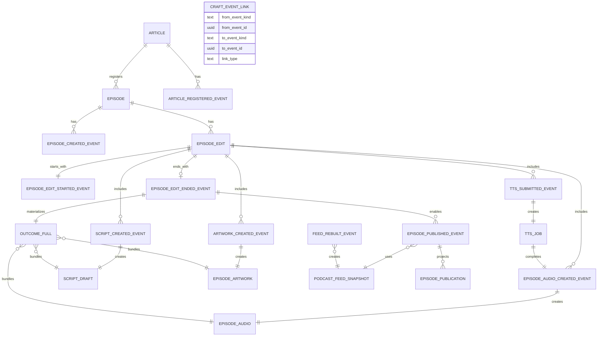
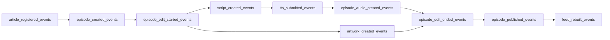

# ドメインイベント — テーブル定義

**方針**: 汎用 `craft_domain_events`（1 行 = 任意 event_type）は使わない。**イベント種別ごとに専用テーブル**（1 イベント = 1 行 = 1 エンティティ）。

DDL: [podcast-craft-domain-events-schema.sql](./podcast-craft-domain-events-schema.sql)

---

## テーブル一覧（23 イベント + リンク + 成果物 + 投影）

### セッション

| テーブル | 役割 |
|----------|------|
| `episode_edits` | Edit セッション。`start_event_kind` / `start_event_id` で開始イベントを多態参照 |

### Ingest

| テーブル | 主要列 |
|----------|--------|
| `article_registered_events` | `article_id`, `content_path`, `content_sha`, `ingest_route` |
| `episode_created_events` | `episode_id`, `article_id` |

### Edit 開始

| テーブル | 主要列 |
|----------|--------|
| `episode_edit_started_events` | `edit_id`, `episode_id`, `workflow_run_id` |
| `script_edit_started_events` | `edit_id`, `episode_id` |
| `audio_edit_started_events` | `edit_id`, `input_script_draft_id` |
| `artwork_edit_started_events` | `edit_id`, `input_script_draft_id` |

### Edit 中

| テーブル | 主要列 |
|----------|--------|
| `script_created_events` | `script_draft_id`, `title`, `description` |
| `script_generation_failed_events` | `error` |
| `tts_submitted_events` | `tts_job_id`, `script_draft_id`, `batch_name` |
| `tts_job_succeeded_events` | `tts_job_id`, `batch_name` |
| `tts_job_failed_events` | `tts_job_id`, `error` |
| `episode_audio_created_events` | `episode_audio_id`, `tts_job_id`, `storage_path`, `mime_type` |
| `episode_audio_storage_failed_events` | `tts_job_id`, `error` |
| `artwork_created_events` | `episode_artwork_id`, `script_draft_id`, `storage_path` |
| `artwork_skipped_events` | `placeholder_artwork_id`, `reason` |
| `artwork_generation_failed_events` | `error` |

### Edit 終了

| テーブル | Outcome 表 |
|----------|------------|
| `episode_edit_ended_events` | `episode_edit_outcomes_full` |
| `script_edit_ended_events` | `episode_edit_outcomes_script` |
| `audio_edit_ended_events` | `episode_edit_outcomes_audio` |
| `artwork_edit_ended_events` | `episode_edit_outcomes_artwork` |

### 公開

| テーブル | 主要列 |
|----------|--------|
| `episode_published_events` | `edit_id`, `outcome_kind`, `feed_snapshot_id`, `publish_reason` |
| `feed_rebuilt_events` | `feed_snapshot_id`, `episode_count`, `trigger_episode_id` |
| `episode_unpublished_events` | `reason`（将来） |

### リレーション・成果物・投影

| テーブル | 役割 |
|----------|------|
| `craft_event_links` | イベント間エッジ（`from_event_kind` + `from_event_id` → 多態） |
| `script_drafts` / `tts_jobs` / `episode_audios` / `episode_artworks` | リソース（作成元イベント id を FK） |
| `episode_edit_outcomes_*` | End の sealed 結果 |
| `podcast_feed_snapshots` / `episode_publications` | Feed / 掲載投影 |

各 `*_events` 表共通: `id`, `occurred_at`, `actor`, `correlation_id`, および `edit_id` / `episode_id`（該当時）。

---

## イベント間リンク — `craft_event_links`

| 列 | 説明 |
|----|------|
| `from_event_kind` | 始点表の snake 名（例: `script_created` → 表 `script_created_events`） |
| `from_event_id` | 始点行 PK |
| `to_event_kind` | 終点表 |
| `to_event_id` | 終点行 PK |
| `link_type` | `precedes` / `caused_by` / `completes` / `spawned_edit` / `publishes_outcome` / `rebuilds_feed` |

**kind 文字列**（`from_event_kind` / `to_event_kind`）:

`article_registered`, `episode_created`, `episode_edit_started`, `script_edit_started`, `audio_edit_started`, `artwork_edit_started`, `script_created`, `script_generation_failed`, `tts_submitted`, `tts_job_succeeded`, `tts_job_failed`, `episode_audio_created`, `episode_audio_storage_failed`, `artwork_created`, `artwork_skipped`, `artwork_generation_failed`, `episode_edit_ended`, `script_edit_ended`, `audio_edit_ended`, `artwork_edit_ended`, `episode_published`, `feed_rebuilt`, `episode_unpublished`

---

## 成果物 ↔ イベント（専用 FK。汎用 junction なし）

| リソース | 作成イベント FK |
|----------|-----------------|
| `script_drafts` | `script_created_event_id` → `script_created_events` |
| `tts_jobs` | `tts_submitted_event_id` → `tts_submitted_events` |
| `episode_audios` | `episode_audio_created_event_id` → `episode_audio_created_events` |
| `episode_artworks` | `artwork_created_event_id` または `artwork_skipped_event_id` |

イベント行側にもリソース id 列（例: `script_created_events.script_draft_id`）。同一トランザクション insert 時は **DEFERRABLE FK** で循環を解く。

---

## ER 図（イベント種別 + リソース）

フル edit 用の **Script / Audio / Artwork 別 Edit** は同型の `SCRIPT_EDIT_STARTED_EVENT` 等を省略（図の簡略化）。リンク行は `craft_event_links` にのみ存在し、図では `CRAFT_EVENT_LINK` エンティティで表す。

---

## フル edit のリンク例

矢印は `craft_event_links`（`precedes` / `completes` / `publishes_outcome` / `rebuilds_feed`）の意味。表名は `_events` サフィックス付き。

---

## 廃止したもの

| 旧 | 新 |
|----|-----|
| `craft_domain_events` + `event_type` + `payload` | 種別ごと `*_events` 表 |
| `craft_domain_event_resources` | 各 event / resource 表の **直接 FK** |
| `craft_domain_event_links` | `craft_event_links`（多態 kind + id） |

---

## 参照

- [edit-sessions](./podcast-craft-edit-sessions.md)
- [podcast-craft-domain-events-schema.sql](./podcast-craft-domain-events-schema.sql)
