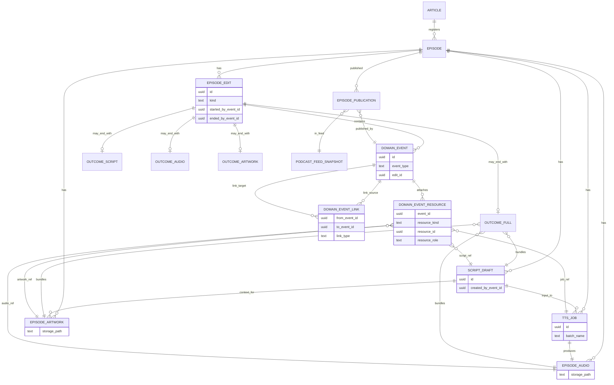
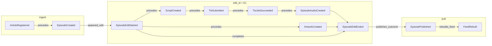

# ドメインイベント — テーブル定義

to-be の **Craft 境界** ドメインイベントを一覧する。実行可能 DDL は **[podcast-craft-domain-events-schema.sql](./podcast-craft-domain-events-schema.sql)**。

運用テレメトリ（`processing_logs`）と Job Execution（`craft_workflow_runs` / `craft_step_runs`）は **ドメインイベントではない** — [target-model](./podcast-craft-target-model.md) の B/C 層。

---

## テーブル一覧

| テーブル | 役割 | 更新 |
|----------|------|------|
| `episode_edits` | Edit セッション | Started で INSERT、`status` / `ended_at` / `*_by_event_id` の UPDATE |
| `craft_domain_events` | 全ドメインイベント | INSERT のみ |
| `craft_domain_event_links` | **イベント間**有向エッジ | INSERT のみ |
| `craft_domain_event_resources` | **イベント ↔ リソース** | INSERT のみ |
| `script_drafts` / `tts_jobs` / `episode_audios` / `episode_artworks` | 成果物 | INSERT（`tts_jobs` は phase UPDATE のみ） |
| `episode_edit_outcomes_*` | Edit End の sealed 結果 | INSERT のみ |
| `podcast_feed_snapshots` / `episode_publications` | 公開投影 | INSERT のみ |

既存 `articles` / `episodes` は ingest 境界（identity）。DDL 全文: [schema.sql](./podcast-craft-domain-events-schema.sql)。

---

## イベント間リレーション — `craft_domain_event_links`

| 列 | 説明 |
|----|------|
| `from_event_id` | 始点 |
| `to_event_id` | 終点 |
| `link_type` | 下表 |

| link_type | 意味 | 例 |
|-----------|------|-----|
| `precedes` | 同一 edit 内で to が後 | ScriptCreated → TtsSubmitted |
| `caused_by` | to は from の直接結果 | TtsSubmitted → EpisodeAudioCreated（経由ジョブ成功後） |
| `completes` | End が Start を閉じる | EpisodeEditStarted → EpisodeEditEnded |
| `spawned_edit` | 新 edit セッション開始 | EpisodeCreated → EpisodeEditStarted |
| `publishes_outcome` | Publish が End 成果を掲載 | EpisodeEditEnded → EpisodePublished |
| `rebuilds_feed` | Feed 再生成が Publish と対 | EpisodePublished → FeedRebuilt |

セッション内の **precedes チェーン** と **completes** で Edit DAG を復元できる。`edit_id` は冗長だがクエリ用にイベント列にも持つ。

---

## イベント ↔ リソース — `craft_domain_event_resources`

| 列 | 説明 |
|----|------|
| `event_id` | |
| `resource_kind` | `article` / `episode` / `edit` / `script_draft` / `tts_job` / `episode_audio` / `episode_artwork` / `feed_snapshot` / `publication` |
| `resource_id` | 各表の PK |
| `resource_role` | `creates` / `uses_input` / `updates` / `materializes` / `references` |

| イベント | resource_role | resource_kind |
|----------|---------------|---------------|
| ScriptCreated | creates | script_draft |
| TtsSubmitted | creates | tts_job |
| TtsSubmitted | uses_input | script_draft |
| TtsJobSucceeded | updates | tts_job |
| EpisodeAudioCreated | creates | episode_audio |
| ArtworkCreated | creates | episode_artwork |
| ArtworkSkipped | creates | episode_artwork（placeholder） |
| *EditEnded | materializes | edit（outcome 行は edit_id PK） |
| EpisodePublished | references | publication, feed_snapshot |
| FeedRebuilt | creates | feed_snapshot |

---

## 成果物リソース（抜粋）

| 表 | 主要 FK | 生成イベント |
|----|---------|--------------|
| `script_drafts` | episode_id, edit_id, `created_by_event_id` | ScriptCreated |
| `tts_jobs` | script_draft_id, `submitted_by_event_id` | TtsSubmitted |
| `episode_audios` | tts_job_id, script_draft_id, `created_by_event_id` | EpisodeAudioCreated |
| `episode_artworks` | script_draft_id, `created_by_event_id` | ArtworkCreated / Skipped |

`episode_edits.started_by_event_id` / `ended_by_event_id` がセッションの Start/End イベントを指す。

---

## ER 図（イベント + リソース）



図中の `DOMAIN_*` は DDL 上の `craft_domain_*` / `episode_*` に対応する（Mermaid の予約語回避のため短名）。

---

## イベント列 + リンク（フル edit 例）



実線は `craft_domain_event_links` に INSERT するエッジ。`ScriptCreated` と `ArtworkCreated` はどちらも `EES` から `precedes`（並列枝）。

---

## `craft_domain_events`

| 列 | 型 | 説明 |
|----|-----|------|
| `id` | uuid PK | |
| `sequence_no` | bigint identity | 全体順序 |
| `event_type` | text | 下表 CHECK |
| `occurred_at` | timestamptz | |
| `article_id` | uuid FK | ingest 系 |
| `episode_id` | uuid FK | |
| `edit_id` | uuid FK | Edit セッション内イベント |
| `actor` | text | system / operator / ingest / workflow |
| `correlation_id` | uuid | ワークフロー相関 |
| `payload` | jsonb | 型ごと契約（SQL ファイル末尾コメント） |

---

## イベント型一覧

### Ingest / Identity

| event_type | いつ | payload 必須キー |
|------------|------|-------------------|
| `ArticleRegistered` | ingest | `content_path?`, `content_sha?`, `ingest_route?` |
| `EpisodeCreated` | ingest で episode INSERT 後 | — |

### Edit 開始

| event_type | kind | payload |
|------------|------|---------|
| `EpisodeEditStarted` | episode | `trigger`, `workflow_run_id?` |
| `ScriptEditStarted` | script | `trigger` |
| `AudioEditStarted` | audio | `trigger`, `input_script_draft_id` |
| `ArtworkEditStarted` | artwork | `trigger`, `input_script_draft_id` |

### Edit 中 — 台本

| event_type | payload |
|------------|---------|
| `ScriptCreated` | `script_draft_id`, `title`, `description` |
| `ScriptGenerationFailed` | `error`, `script_draft_id?` |

### Edit 中 — 音声

| event_type | payload |
|------------|---------|
| `TtsSubmitted` | `tts_job_id`, `batch_name`, `script_draft_id` |
| `TtsJobSucceeded` | `tts_job_id`, `batch_name` |
| `TtsJobFailed` | `tts_job_id`, `error` |
| `EpisodeAudioCreated` | `episode_audio_id`, `tts_job_id`, `storage_path`, `mime_type` |
| `EpisodeAudioStorageFailed` | `tts_job_id`, `error` |

### Edit 中 — アートワーク

| event_type | payload |
|------------|---------|
| `ArtworkCreated` | `episode_artwork_id`, `storage_path`, `mime_type` |
| `ArtworkSkipped` | `reason`, `placeholder_artwork_id` |
| `ArtworkGenerationFailed` | `error` |

### Edit 終了

| event_type | outcome 表 | payload |
|------------|--------------|---------|
| `EpisodeEditEnded` | `episode_edit_outcomes_full` | `outcome_kind: full` |
| `ScriptEditEnded` | `episode_edit_outcomes_script` | `outcome_kind: script` |
| `AudioEditEnded` | `episode_edit_outcomes_audio` | `outcome_kind: audio` |
| `ArtworkEditEnded` | `episode_edit_outcomes_artwork` | `outcome_kind: artwork` |

End 処理: 同一トランザクションで **outcome 行 INSERT** + `episode_edits.status = ended` + 本イベント INSERT（`domain_event_id` 相互参照）。

### 公開

| event_type | 投影 | payload |
|------------|------|---------|
| `EpisodePublished` | `episode_publications` | `outcome_kind`, `publish_reason`, `feed_snapshot_id` |
| `FeedRebuilt` | `podcast_feed_snapshots` | `episode_count`, `trigger_episode_id?` |

| event_type | 備考 |
|------------|------|
| `EpisodeUnpublished` | 将来。payload: `reason`, `superseded_by_publication_id?` |

---

## Outcome 表（NOT NULL）

| 表 | 列（すべて NOT NULL  unless noted） |
|----|-------------------------------------|
| `episode_edit_outcomes_script` | edit_id PK, episode_id, script_draft_id, title, description, domain_event_id |
| `episode_edit_outcomes_audio` | edit_id PK, episode_id, script_draft_id, episode_audio_id, domain_event_id |
| `episode_edit_outcomes_artwork` | edit_id PK, episode_id, script_draft_id, episode_artwork_id, domain_event_id |
| `episode_edit_outcomes_full` | edit_id PK, episode_id, script_draft_id, episode_audio_id, episode_artwork_id, title, description, artwork_skipped, domain_event_id |

---

## 典型イベント列（再掲）

```text
EpisodeEditStarted → ScriptCreated → TtsSubmitted → EpisodeAudioCreated
  → ArtworkCreated | ArtworkSkipped → EpisodeEditEnded → EpisodePublished + FeedRebuilt

AudioEditStarted → TtsSubmitted → EpisodeAudioCreated → AudioEditEnded → EpisodePublished
```

---

## 参照

- [edit-sessions](./podcast-craft-edit-sessions.md)
- [podcast-craft-domain-events-schema.sql](./podcast-craft-domain-events-schema.sql)
