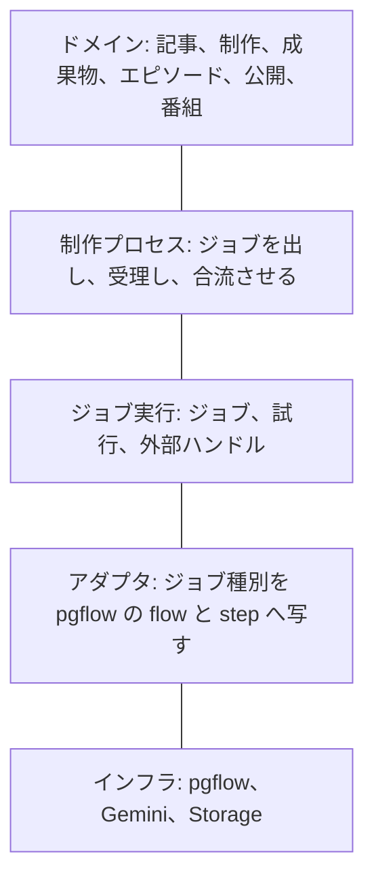
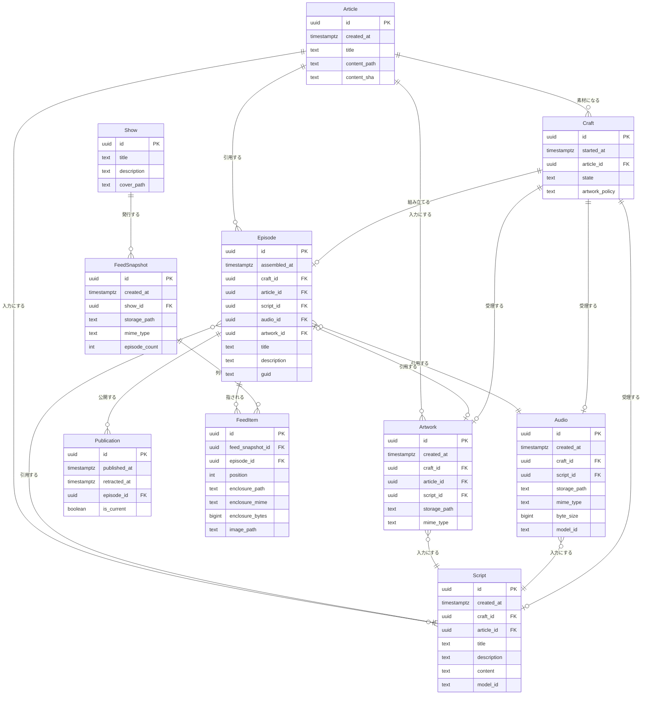
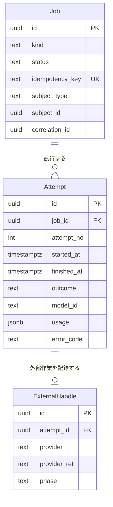

# ポッドキャスト制作のドメインモデル（ToBe）

この文書は、制作の言葉と、その下に置くジョブ実行の境界を決める ToBe の案である。移行手順は範囲外である。

現行の配信では、ingest が `episodes` 行を作り、`craftEpisodeSubmit`（台本・音声の投入・エピソード画像）と `craftEpisodeDownload`（音声の回収・`feed.xml` の更新）が `episodes.status` を進める。完成したエピソードが表すのは、組み立ての結果だけである。

## 1. モデルの置き方

書きモデルは集約である。ドメインイベントは、集約を更新した同じ処理で追記する通知であり、ER の関係には使わない。正本は集約の状態である。工程の途中経過はジョブ実行に残り、制作に残るのは受理した結果だけである。

因果はイベントの `causation_id`（0または1）と、一連の制作を束ねる `correlation_id` に置く。ER の述語は構成と参照だけにする。

`workflow_run_id` や Gemini の batch name は、アダプタがジョブ試行との対応として記録する。

依存の向きは次のとおりである。制作プロセスがドメイン集約とジョブのポートの両方を使う。アダプタがポートを実装する。ドメイン集約からジョブへの参照は無い。

ジョブ実行は、ドメインの下に同じ粒度で置く支援モデルである。エンティティと事実で書く。LLM 呼び出しはその中の実行器である。フィードの再構築は決定的な描画であり、音声は投入だけがモデル呼び出しで、回収はファイルの取得である。

## 2. 元の図の基数と述語

記号は Mermaid の `||--o{` を「左が1、右が0以上」として読んだ。

| 元の線 | 記号の読み | 改める基数と述語 |
| --- | --- | --- |
| `ArticleRegistered` → `Article` `registers` | 登録1回が記事を複数生む | 登録1回は記事1件を指す。同じ `content_path` と `content_sha` の再投入は新しい記事を作らない |
| `ArticleRegistered` → `EpisodeCreateStarted` `previous` | 登録1件から制作開始が複数 | 記事1に制作は0以上。配信対象外は0。因果は `causation_id` に置く |
| `EpisodeCreateStarted` → `ScriptCreateStarted` `previous` | 制作1から台本開始が複数 | 制作が受理する台本は0または1。やり直しの回数はジョブの試行 |
| `ScriptCreateStarted` → `ScriptCreated` `previous` | 開始1から完成が複数 | ジョブ1つの成功は台本1。失敗時の記録先は試行 |
| `ScriptCreated` → `AudioCreateStarted` `previous` | 台本1から音声開始が複数 | 受理した台本を入力に、その制作が受理する音声は0または1 |
| `AudioCreateStarted` → `AudioCreated` `previous` | 開始1から音声が複数 | 音声ジョブの成功は音声1 |
| `EpisodeCreateStarted` → `ArtworkCreateStarted` `previous` | 制作1からアートワーク開始が複数 | 方針が省略なら0。必須ならジョブ1、受理は0または1 |
| `ArtworkCreateStarted` → `ArtworkCreated` `previous` | 開始1から完成が複数 | 成功はアートワーク1 |
| `AudioCreated` → `EpisodeCreated` `previous` | 音声1が複数の組み立てに先行する | 制作1がエピソードを0または1組み立てる |
| `ArtworkCreated` → `EpisodeCreated` `merge_previous` | アートワークが必須の合流先を複数持つ | アートワークは省略できる。合流条件は制作の状態に書く |
| `EpisodeCreated` → `EpisodePublished` `previous` | 組み立て1から公開が複数 | エピソード1に公開は0以上。同時に current な公開は1 |
| `EpisodeCreated` → `Episode` `creates` | 組み立てイベントがエピソードを複数生む | 組み立て1につきエピソード1。述語は組み立てる |
| `EpisodePublished` → `FeedRebuilt` `previous` | 公開1から再構築が複数 | 公開1が再構築ジョブを1つ要求する。再試行は同じジョブの試行。成功のたびにスナップショット1。中身は番組全体 |
| `ScriptCreated` → `Script` `creates` | 完成と台本が1対1 | 成功時はこの基数。台本行を挿入するのは受理が確定したときだけ |
| `AudioCreated` → `Audio` `creates` | 完成と音声が1対1 | 同上 |
| `ArtworkCreated` → `Artwork` `creates` | 完成とアートワークが1対1 | 同上。入力参照は記事だけでは足りない |
| `EpisodePublished` → `EpisodePublication` `projects` | 公開イベントが投影行を複数生む | 公開は書きモデルの記録。1回の公開が1行 |
| `Article` → `Episode` `generates` | 記事とエピソードが常に1対1 | 記事1にエピソードは0以上。組み立てる主体は制作 |
| `Episode` → `Script` `contains` | エピソードが台本を必須で内包する | 引用する。台本は組み立てより前にある |
| `Episode` → `Audio` `contains` | エピソードが音声を必須で内包する | 引用する。必須 |
| `Episode` → `Artwork` `contains` | アートワークが必須 | 引用する。0または1 |
| `FeedRebuilt` → `FeedSnapshot` `creates` | 再構築が必ずスナップショットを生む | 成功した再構築だけが1対1。失敗時はスナップショット行を挿入しない |
| `FeedEpisode` ↔ `FeedSnapshot` 多対多 `relates` | 中間行が複数のスナップショットに属する | スナップショット1に項目が0以上。項目はスナップショット1つに属する |
| `FeedEpisode` ↔ `Episode` 多対多 `relates` | 中間行が複数のエピソードに属する | 項目はエピソード1つを指す。エピソードは複数のスナップショットに現れる |
| `EpisodePublication` → `Episode` `publishs` | 公開とエピソードが常に1対1 | エピソード1に公開は0以上 |

`AudioCreated` は `audio_id` だけで、開始した試行も台本も指していない。`EpisodeCreated` は音声・アートワーク・制作のどれも指していない。`EpisodePublished` が持つのが `episode_create_id` だけで、`episode_id` が無い。因果を外部キーで辿る形では、この切れ目から先の系列が復元できない。

`Script.outcome` の意味は未定である。台本行は成立した本文を表す。成否はジョブ試行に置く。

開始を表す `*Started` はジョブの事実である。開始・再試行・タイムアウトの記録先はジョブ実行である。ドメインが受け取るのは、受理と、ジョブの最終失敗である。

## 3. コンテキスト

制作がコアである。言葉は記事・制作・台本・音声・アートワーク・エピソード・公開・番組・フィードである。

ジョブ実行は支援モデルである。言葉はジョブ・試行・外部ハンドルである。

記事の登録は上流の統合である。Git 上の Markdoc が本文の正であり、制作は `content_path` と `content_sha` でリビジョンを識別する。`ingest_route` と `actor` は登録イベントの属性である。

## 4. 制作コンテキスト

### 4.1 構造

`FeedItem` は元の `FeedEpisode` である。関連そのものなので、スナップショット側もエピソード側も1対多である。

### 4.2 記事

同一性は `content_path` と `content_sha` である。同じ path でも sha が変われば別リビジョンになる。本文は Git に置き、この集約には題名と所在だけを書く。題名はフロントマターから写す。RSS の `podcaster:articleTitle` と、アートワークのプロンプトが記事題名を使う。

### 4.3 制作

制作は、1つの記事リビジョンからエピソードを1つ組み立てるまでの一貫性境界である。再生成は新しい制作にする。進行中の制作がある記事では、その制作が `assembled`・`failed`・`cancelled` のいずれかになるまで次を始めない。

状態は次のとおり。

| 状態 | 意味 |
| --- | --- |
| `drafting` | 台本が未受理 |
| `rendering` | 台本は受理済み。音声とアートワーク方針が未充足 |
| `assembled` | エピソードを1つ出した。以降この制作は更新しない |
| `failed` | 必須ジョブが最終失敗した。エピソードは無い |
| `cancelled` | 人手で打ち切った。エピソードは無い |

不変条件は次のとおり。

- 台本・音声・アートワーク・エピソードの `craft_id` は、それぞれ一意である。受理した成果は制作につき高々1つになる。
- 音声の `script_id` は、その制作が受理した台本と一致する。台本とエピソードの `article_id` は、制作の記事と一致する。
- `artwork_policy` は `required` または `omitted` である。`omitted` は未完了と区別する。現行の `image.enabled` が偽のときが `omitted` であり、アートワークのジョブは作らない。
- `required` のとき、音声の受理とアートワークの受理が揃ってから組み立てる。`omitted` のとき、音声の受理だけで組み立てる。
- 組み立ては1回である。
- 台本・音声・アートワークの行を挿入するのは、受理が確定したときだけである。

成果物の挿入と制作の状態更新は同一トランザクションで行う。挿入後の成果物は不変であり、エピソードとフィードは id で参照する。制作の行に書くのは記事・状態・方針である。受理した成果物は、一意な `craft_id` から辿る。本文とバイト列は成果物側に書く。

方針（台本のモデル、TTS、話者、アートワークの要否、題名と説明の上限）は、制作の開始時に番組の現行方針から値としてコピーする。進行中の制作は、後からの `podcast_config` 変更で意味を変えない。

### 4.4 台本、音声、アートワーク

台本は対話本文、生成された題名、説明で構成する。現行は題名を20字、説明を100字で切って `episodes` に書いている。この上限は制作方針の値にする。

音声は受理した台本を入力にする。`byte_size` は RSS の `enclosure length` に使う。現行の `buildRssFeed` は `length="0"` を固定で出している。このモデルの音声属性は `byte_size` までとする。再生時間は現行の RSS が出力していない。

アートワークの入力は、記事の抜粋と、受理した台本の題名・説明である。現行の `buildEpisodeImagePrompt` がこの三つを使っている。参照は `article_id` と `script_id` の両方にする。番組のカバー画像（`cover.png`）は番組の属性である。

`model_id` は、その成果物を作ったモデルの識別子だけを写す。プロバイダの生レスポンス、トークン使用量、話者の抽選結果、失敗時の応答は試行に残す。現行の `scripts.llm_response` と `audio_files.llm_response` の移し先は試行である。

話者の割り当ては、音声ジョブの初回試行で決め、同じジョブの再試行は同じ割り当てを使う。引き直すのは新しい制作だけである。現行は投入時に選び、`tts_selection` として音声行に残し、回収時にそれを読む。

### 4.5 エピソードと公開

エピソードは組み立て済みの合成である。工程の状態は制作にある。`guid` は不変で、現行どおりエピソード id を使う。題名と説明は組み立て時に台本から写す。

公開はエピソードの記録である。`is_current` が真の行は、エピソードにつき同時に1つである。撤回は `retracted_at` を入れ、current を外す。公開と撤回を分けておくと、フィードから外す操作を後から足せる。

公開のトランザクションが書くのは公開記録だけである。現行の `runUpdateRssStage` は、`feed.xml` のアップロードと `published` への更新を同じ段階で行っている。アップロードに失敗すると `rss_failed` になり、音声ができていることと公開の意思が一つの status に重なる。ToBe では公開を先に記録し、フィードの描画失敗は再構築ジョブの失敗にする。公開記録は残る。

### 4.6 番組とフィード

フィードは、番組が発行する不変のスナップショットである。

番組の属性は題名・説明・カバーである。現行の `podcast.title`、`podcast.description`、`podcast.cover_url` がこれに当たる。最新スナップショットの公開名が `feed.xml` である。論理上の正はスナップショット列であり、`feed.xml` はその時点の最新を指す名前である。

項目は、その時点の enclosure（path、mime、bytes）とエピソード画像の path を写す。後から音声ファイルを差し替えても、過去のスナップショットの意味は変わらない。

再構築が描くのは、current な公開があるエピソードの一覧である。トリガになった1本には限定しない。現行の `buildRssFeed` は `audio_ready`・`published`・`rss_failed` をまとめて描く。ToBe の列挙対象は current な公開だけである。

空の番組なら項目は0件である。`episode_count` は項目数と一致する。

## 5. ドメインイベント

追記する通知は次のとおりである。共通属性は `event_id`、`occurred_at`、対象集約の id、`correlation_id`、`causation_id`、任意の `actor` である。`actor` を載せるのは人手の再実行だけである。

| イベント | 起きたこと |
| --- | --- |
| `ArticleIngested` | 上流が記事リビジョンを登録した。制作が購読する |
| `CraftStarted` | 制作を開始した |
| `ScriptAccepted` | 台本を受理した |
| `AudioAccepted` | 音声を受理した |
| `ArtworkAccepted` | アートワークを受理した |
| `ArtworkOmitted` | 方針によりアートワークを作らないと決めた |
| `EpisodeAssembled` | エピソードを組み立てた |
| `CraftFailed` | 必須ジョブの最終失敗で制作が失敗した |
| `CraftCancelled` | 制作を打ち切った |
| `EpisodePublished` | 公開を記録した |
| `EpisodeRetracted` | 公開を撤回した |
| `FeedRebuilt` | スナップショットを発行した |
| `FeedRebuildFailed` | 再構築ジョブが最終失敗した。公開は残る |

`ScriptCreateStarted` のような開始の記録先は、ジョブ試行である。

## 6. ジョブ実行

### 6.1 構造

`subject_id` は制作 id や番組 id を指す。対応はジョブの `correlation_id` と `subject_*` で表す。制作からジョブへの外部キーは置かない。

ジョブの状態は `queued`・`running`・`succeeded`・`failed`・`cancelled` である。試行が0件なのは、まだワーカーが取っていない `queued` の間だけである。

`idempotency_key` が同じ再投入は、同じジョブを返す。再試行は試行を足す。新しい制作は新しいキーになる。

| 種別 | 冪等キー |
| --- | --- |
| `generate_script` | `generate_script:{craft_id}` |
| `synthesize_audio` | `synthesize_audio:{craft_id}:{script_id}` |
| `compose_artwork` | `compose_artwork:{craft_id}:{script_id}` |
| `rebuild_feed` | `rebuild_feed:{show_id}:{trigger_event_id}` |

最大試行・タイムアウト・待ち時間はジョブの方針である。ドメインの制作が受け取るのは、最終的な成功か失敗だけである。途中の試行の記録先はジョブ実行である。

外部ハンドルが付くのは、完了をその場で受け取れない作業だけである。音声の Gemini Batch がそれである。`provider_ref` が現行の `audio_files.batch_name` に当たる。`phase` は `submitted`・`ready`・`collected`・`failed` である。回収を繰り返す監視はアダプタのスケジューラである。

台本を TTS 用に切るチャンクの置き場は、音声ジョブの内部である。

ポートは二つである。

- `dispatch(spec)` が `job_id` を返す。
- 完了は `JobFinished` としてプロセスへ戻る。中身は `job_id` と、成果の参照か失敗である。

プロバイダの生レスポンスは試行に残す。成果物へは `model_id` だけを写す。

### 6.2 実行器

| ジョブ種別 | 実行器 | 完了の形 | 現行の置き場所 |
| --- | --- | --- | --- |
| `generate_script` | 要求応答のモデル呼び出し | その試行の中で台本が返る | `craftEpisodeSubmit` の `generateScript` |
| `synthesize_audio` | 非同期バッチの後にファイル取得 | ドメインから見るとジョブ1つ。アダプタが投入と回収に分ける | `generateAudioStart` と、別フローの `generateAudioDownload` |
| `compose_artwork` | 要求応答のモデル呼び出し | 画像バイトが返る。方針が省略のときはジョブを作らない | `generateEpisodeImage` |
| `rebuild_feed` | 決定的な描画 | `FeedSnapshot` を1つ書く | `updateRss` のアップロード部分 |

音声ジョブはドメインから見て1つである。アダプタが投入と回収のフェーズに分け、現行の二つの flow に写す。分ける理由は、Edge Function がバッチ完了まで待てないことである。

| フェーズ | 写像先 |
| --- | --- |
| 台本 | `craftEpisodeSubmit` / `generateScript` |
| 音声の投入 | `craftEpisodeSubmit` / `generateAudioStart` |
| 音声の回収 | `craftEpisodeDownload` / `generateAudioDownload` |
| アートワーク | `craftEpisodeSubmit` / `generateEpisodeImage` |
| フィード描画 | `updateRss` から公開ステータス更新を外した描画 |

## 7. 制作プロセス

プロセスは集約の外に置く。ドメインのコマンドとジョブの完了を翻訳する。状態の正は制作と番組にある。

コマンドは次のとおりである。`StartCraft`、`AcceptScript`、`AcceptAudio`、`AcceptArtwork`、`OmitArtwork`、`AssembleEpisode`、`FailCraft`、`CancelCraft`、`PublishEpisode`、`RetractEpisode`、`RecordFeedSnapshot`、`FailFeedRebuild`。

進行は次のとおり。

1. `ArticleIngested` が配信対象なら `StartCraft` し、`generate_script` を出す。対象外の記事ではジョブを出さない。
2. 台本ジョブが成功したら `AcceptScript` する。続けて `synthesize_audio` を出す。方針が `required` なら `compose_artwork` も出す。`omitted` なら `OmitArtwork` する。
3. 音声が受理され、アートワークが受理または省略されたら `AssembleEpisode` する。音声とアートワークが並行して完了しても、組み立ての状態更新は一度だけ成功する。
4. 公開コマンドは `PublishEpisode` のあと、`rebuild_feed` を出す。ジョブの入力は番組の current な公開一覧である。
5. フィードジョブが成功したら `RecordFeedSnapshot` する。
6. 台本・音声・必須アートワークが最終失敗したら `FailCraft` する。このときエピソードは組み立てない。フィードジョブの失敗は `FailFeedRebuild` とする。制作の状態は変えない。

再生成は新しい制作である。古いエピソードは残る。フィードに載せる方は、古い公開を撤回してから新しいエピソードを公開することで決める。

現行の `startFrom` は、不足しているジョブだけを再 `dispatch` する指定として扱う。`script` は台本から、`audio` は受理済み台本に対する音声、`image` は受理済み台本に対するアートワーク、`rss` は `rebuild_feed` である。受理が済んでいない成果物へは飛ばない。

受理の確定とジョブの投入は、アウトボックスで繋ぐ。制作が台本を受理した記録と、音声ジョブの存在が揃った状態だけを正とする。処理ログ（`processing_logs`）は試行の観測であり、記録先はジョブ実行である。

## 8. この案で足したもの

元の図に無く、制作を閉じるために置くものは次のとおり。

- 失敗と打ち切り。現行の `script_failed` と `rss_failed` の受け皿になる。
- 番組と、開始時にコピーする制作方針。`podcast_config` の置き場は番組の現行方針である。
- エピソードの題名・説明・`guid`。台本生成が題名と説明を返し、RSS の item はそれを出している。
- 音声の `byte_size` と、項目へ写した enclosure。現行の `length="0"` を実サイズに替えるための属性である。
- アートワークの省略と未完了の区別、および台本への参照。
- 公開とフィード描画の分離。
- ジョブ、試行、外部ハンドル。LLM は要求応答と非同期バッチの二つの実行器としてこの中に入る。
- 制作プロセスとアウトボックス。ドメインとジョブの縫い目であり、どちらの ER にも属さない。
