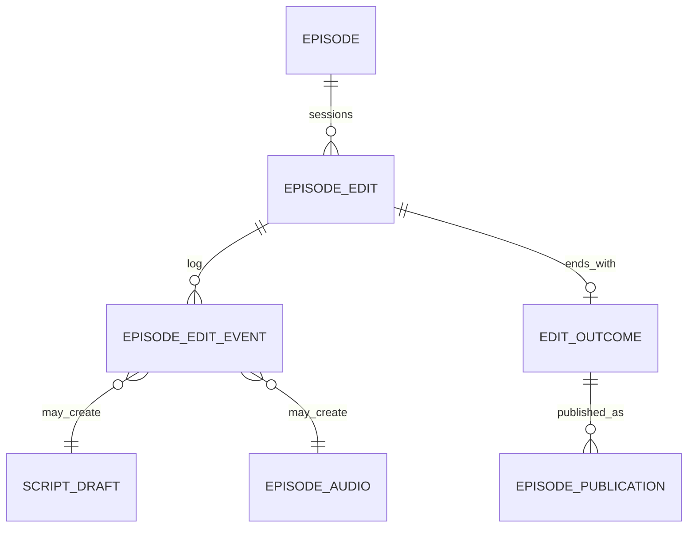

# エピソード編集 — Edit セッションとイベント列

[制作 DAG](./podcast-craft-production-dag.md) の **Composition / ProductionHead** を、**編集セッション（Edit）の Start → 中間イベント → End → Publish** に置き換える案。中間成果物レコードに **NULL スロットを置かない** ため、束ねは「編集完了時の 1 回だけ」確定する。

## なぜ Composition をやめるか

`episode_compositions` は `episode_audio_id NULL 可` のように **未完成の束ね** が表に残りうる。DAG 並列（音声 ∥ アートワーク）を `trigger_node` で表すのも、**1 行が「どの編集の結果か」** とズレやすい。

**Edit セッション**なら:

- **Start** で編集種別と入口を固定
- セッション内イベントだけが成果物を生む
- **End** でその種別に必要な参照が **すべて非 NULL** の **Outcome** を 1 件だけ INSERT
- **Publish** は End で確定した Outcome（または edit_id）を指す

---

## 編集種別（再生成の入口ごと）

| 種別 | Start イベント | 終端イベント | End が保証する Outcome |
|------|----------------|--------------|------------------------|
| フル（ingest 初回など） | `EpisodeEditStarted` | `EpisodeEditEnded` | script + audio + artwork（artwork スキップ時は別イベントで明示） |
| 台本のみ | `ScriptEditStarted` | `ScriptEditEnded` | script + title/description |
| 音声のみ | `AudioEditStarted` | `AudioEditEnded` | 入力 script 参照 + **新 audio** |
| アートワークのみ | `ArtworkEditStarted` | `ArtworkEditEnded` | 文脈 script 参照 + **新 artwork** |

Publish は共通: **`EpisodePublished`**（End の後、Outcome を指す）。Publish のために Edit End は増やさない（[Publication 直交](./podcast-craft-target-model.md) どおり）。

```text
EpisodeEditStarted
  → ScriptCreated
  → (TtsSubmitted → EpisodeAudioCreated   ∥  ArtworkCreated)  … 実装は並列、End は両方完了後
  → EpisodeEditEnded   -- outcome 行: 全フィールド NOT NULL（スキップは SkipArtwork イベント）
  → EpisodePublished   -- optional / 別 UC

AudioEditStarted
  → TtsSubmitted → EpisodeAudioCreated
  → AudioEditEnded     -- outcome: source_script_id + episode_audio_id
  → EpisodePublished
```

---

## イベント列（append-only）

1 セッション = 同じ `edit_id`（UUID）。

| イベント | ペイロード（例） |
|----------|------------------|
| `*EditStarted` | edit_id, episode_id, kind, trigger (ingest/manual), input_script_id?（音声のみ時） |
| `ScriptCreated` | edit_id, script_draft_id, title, description |
| `TtsSubmitted` | edit_id, tts_job_id |
| `EpisodeAudioCreated` | edit_id, episode_audio_id, tts_job_id |
| `ArtworkCreated` | edit_id, episode_artwork_id |
| `ArtworkSkipped` | edit_id, reason（非致命・設定 off）— NULL artwork を使わない |
| `*EditEnded` | edit_id → **outcome_id** へリンク |
| `EpisodePublished` | edit_id または outcome_id, feed_snapshot_id |

**ドメインイベント表**（`craft_domain_events`）と **編集イベント表**（`episode_edit_events`）を同一にしても、Start/End を必須マーカーにしてもよい。

---

## Outcome（NULL なし — 種別ごとにテーブル or  discriminated）

End の時点で **1 行 INSERT**。未完成 Outcome 行は作らない。

### `episode_edit_outcomes_full`

```text
edit_id PK, episode_id
script_draft_id      NOT NULL
episode_audio_id     NOT NULL
episode_artwork_id   NOT NULL   -- スキップ時は ArtworkSkipped + プレースホルダ artwork「channel default」行を指す等、NULL 禁止ポリシーに合わせる
title, description   NOT NULL
ended_at
```

### `episode_edit_outcomes_script`

```text
edit_id PK
script_draft_id, title, description  NOT NULL
```

### `episode_edit_outcomes_audio`

```text
edit_id PK
script_draft_id      NOT NULL   -- セッション入力（採用 script）
episode_audio_id     NOT NULL
```

### `episode_edit_outcomes_artwork`

```text
edit_id PK
script_draft_id      NOT NULL   -- 文脈（プロンプト用）
episode_artwork_id   NOT NULL
```

**Publish** は `episode_publications(outcome_id, kind)` または full/audio 用 outcome だけ publish 可能、などルール化。

---

## 並列（Script 後の音声 ∥ アートワーク）

イベントログは時系列で interleave されてよい。**EpisodeEditEnded** はドメインルールで:

- 必須: `ScriptCreated` 済み、audio チェーン完了
- artwork: `ArtworkCreated` または `ArtworkSkipped` のどちらか必須

End ハンドラが条件を満たすまで `EpisodeEditEnded` を発行しない（Job Execution が両 step 完了を待つ — 現 pgflow Submit と同型）。

---

## 現行 DAG・Job Execution との対応

| DAG ノード | Edit イベント |
|------------|---------------|
| 台本 | ScriptCreated |
| TTS 投入 | TtsSubmitted |
| 音声 Storage | EpisodeAudioCreated |
| 画像 | ArtworkCreated / ArtworkSkipped |
| Submit フロー完了 | （full edit）EpisodeEditEnded |
| Download 完了 | full / audio edit の End 条件の一部 |
| Publish | EpisodePublished |
| Feed | FeedRebuilt（チャンネル） |

**WorkflowRun** は `edit_id` を carry。Adapter は step 成功ごとに **イベント INSERT** + End 条件を評価。

---

## ProductionHead / Composition からの移行

| 旧 | 新 |
|----|-----|
| `episode_production_heads` | 廃止 — 「いま」は **進行中 edit**（Started 未 End）から導出 |
| `episode_compositions` | 廃止 — **Edit Outcome**（End 時 1 件） |
| `CommitComposition` | `*EditEnded` + outcome INSERT |
| Publish(composition_id) | Publish(outcome_id) または publish(edit_id) |

**進行中 edit** クエリ: `edit_id WHERE episode_id = ? AND NOT EXISTS (EditEnded for edit_id)` が 0〜1 件。

**掲載中**: 最新 `EpisodePublished` → outcome → artifacts。

---

## ユースケース × イベント列

| UC | イベント列 |
|----|------------|
| ingest 初回 | EpisodeEditStarted → … → EpisodeEditEnded → EpisodePublished |
| regenerate-script | ScriptEditStarted → ScriptCreated → ScriptEditEnded（Publish なし可） |
| regenerate-audio | AudioEditStarted → … → AudioEditEnded → EpisodePublished |
| regenerate-image | ArtworkEditStarted → … → ArtworkEditEnded → EpisodePublished |
| feed のみ | EpisodePublished（同一 outcome_id 可）+ FeedRebuilt |

regenerate-script が音声まで連鎖する現行挙動は **EpisodeEditStarted（full）** または **ScriptEditEnded 後に AudioEditStarted を自動連結** のどちらかを product 判断。

---

## ER（概念）



---

## 参照

- [podcast-craft-target-model.md](./podcast-craft-target-model.md) — Publication 直交（Publish は End 後）
- [podcast-craft-production-dag.md](./podcast-craft-production-dag.md) — ノード依存（End 条件）
