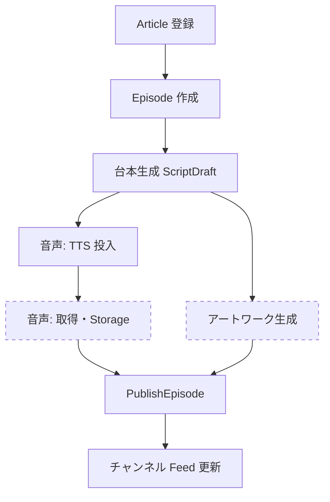
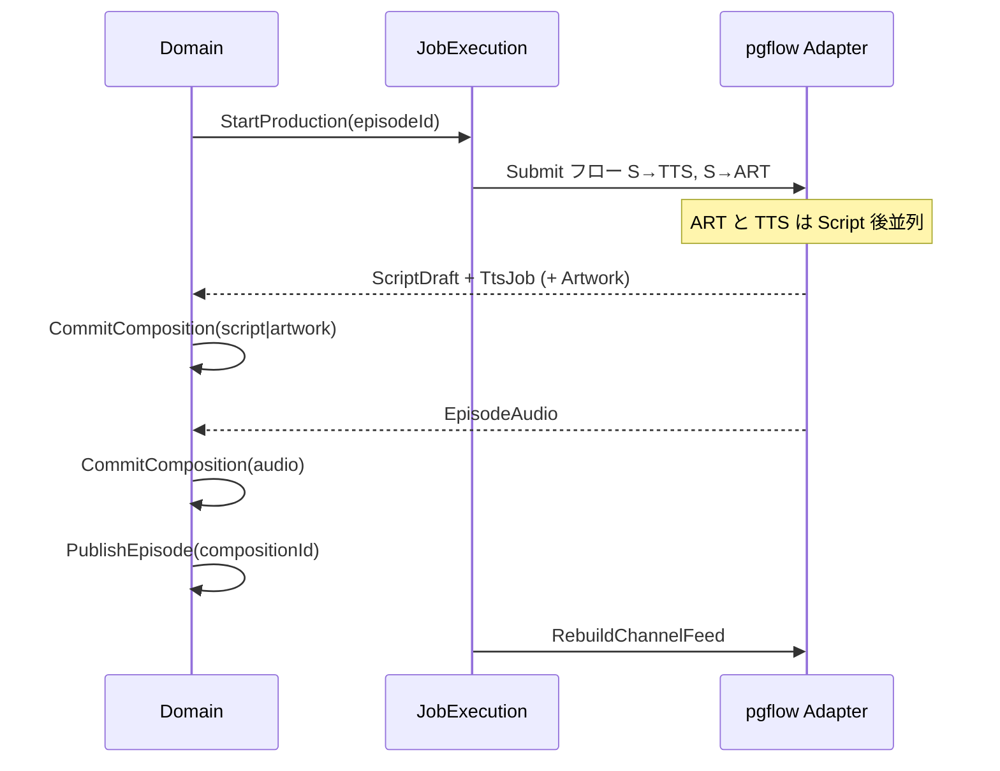

# ポッドキャスト制作 DAG — ドメインモデル

[目標ドメイン](./podcast-craft-target-model.md) の制作フローを DAG で記述する。**成果物の束ねは [Edit セッション](./podcast-craft-edit-sessions.md)**（Composition 案は置換済み）。

## 制作パイプライン（DAG）



| ノード | 依存 | 成果物 | 備考 |
|--------|------|--------|------|
| Article 登録 | — | `Article` | ingest 境界 |
| Episode 作成 | Article | `Episode`（identity） | 1 article から 1 本起こすのが通常 |
| 台本生成 | Episode | `ScriptDraft` | 成功で title/description も決まる |
| TTS 投入 | ScriptDraft ready | `TtsJob` | Submit フロー |
| 音声完成 | TtsJob succeeded | `EpisodeAudio` | Download フロー / monitor |
| アートワーク | 台本後（実装: Script ステップ後） | `EpisodeArtwork` | **音声と並列**。失敗は非致命 |
| PublishEpisode | **EpisodeAudio ready**（必須）、Artwork 任意 | `EpisodePublication` | **Composition を指すだけ**。revision を増やさない |
| Feed 更新 | Publish（または再掲） | `FeedSnapshot` | **チャンネル**単位。全掲載 episode の composition から XML |

実装マッピング（インフラ）:

- Submit フロー: `S → TTS` と `S → ART` が同じ親依存
- Download フロー: `DL → P → F` に近い（`updateRss` が Publish + Feed を兼ねている現状）

---

## 線形 revision が苦手な理由

`revision_no` を 1 本の整数列にすると、**並列枝**（音声完成 vs 画像完成）の順序で番号だけが入れ替わり、「版の意味」が読みにくい。

| 起きること | 線形 revision の問題 |
|------------|------------------------|
| 音声が先に完成 | rev N = script+audio、artwork なし |
| その後 artwork 完成 | rev N+1 = script+audio+artwork |
| 順序が逆 | rev N と N+1 の **中身の差分** が枝ごとにバラバラ |
| Publish | どの rev を指すかは良いが、**rev 自体が「どのノードが変わったか」** を表していない |

**改良**: revision を **DAG のノード出力の束ね（Composition）** として定義し、各 **Artifact 系譜** は別に追記する。

---

## ドメイン言語

| 用語 | 意味 |
|------|------|
| **Episode** | 不変 identity（guid） |
| **Artifact** | 追記のみの生成結果（ScriptDraft / TtsJob / EpisodeAudio / EpisodeArtwork） |
| **ProductionHead** | 制作中の「各スロット最新」参照（mutable・1 episode 1 行）。Cursor より狭い |
| **EpisodeComposition** | 不変の束ね = `{ script_id, audio_id?, artwork_id?, title, description }` + `trigger_node` |
| **EpisodePublication** | 不変の掲載 = `{ composition_id, feed_snapshot_id, published_at }` |
| **FeedSnapshot** | チャンネル RSS ファイルの 1 世代 |

**Publish** は Composition を選ぶ。**Composition** は Artifact が付いたときに増える（Publish では増やさない — [設計判断](./podcast-craft-target-model.md) どおり）。

---

## 集約境界

```text
┌─────────────────────────────────────────────────────────┐
│ EpisodeProduction（1 episode あたり 1 プロセス）           │
│  根: Episode id                                         │
│  ProductionHead（mutable）— 各 artifact スロット           │
│  Artifacts*（append）                                    │
│  Compositions*（append）— HEAD のスナップショット          │
└───────────────────────────┬─────────────────────────────┘
                            │ PublishEpisode(compositionId)
                            ▼
┌─────────────────────────────────────────────────────────┐
│ PodcastChannel（公開）                                   │
│  Publications*（episode ごと append）                    │
│  FeedSnapshots*（チャンネル append）                     │
└─────────────────────────────────────────────────────────┘
```

- **Article** は ingest 集約。Episode 作成で参照を受け渡すだけ。
- **DAG の実行状態**（どのノードが running か）は **Job Execution**（WorkflowRun / StepRun）または **TtsJob.phase** に置く。Composition には載せない。

---

## ProductionHead + Composition（revision の置き換え）

### ProductionHead（mutable・最小）

```text
episode_production_heads
  episode_id PK
  script_draft_id      NULL
  episode_audio_id     NULL
  episode_artwork_id   NULL
  title, description   -- 台本生成で更新
  updated_at
```

- 台本完成 → `script_draft_id` + title/description 更新 → **`CommitComposition(trigger: script)`**
- 音声完成 → `episode_audio_id` 更新 → **`CommitComposition(trigger: audio)`**
- 画像完成 → `episode_artwork_id` 更新 → **`CommitComposition(trigger: artwork)`**

並列完成は **HEAD 更新 → Commit** の順序だけが違う。Composition 行はそれぞれ **その時点の HEAD のコピー**（不変）。

### EpisodeComposition（immutable・旧 episode_revisions）

```text
episode_compositions
  id, episode_id, composition_no  -- 表示用連番はよいが意味は「束ねの版」
  script_draft_id
  episode_audio_id     NULL 可
  episode_artwork_id   NULL 可
  title, description
  trigger_node         script | audio | artwork | initial
  created_at
```

- **`trigger_node`** — DAG 上どの枝がこの束ねを生んだか（線形 cause の代わり）。
- Publish 可能条件（ドメインルール）: `episode_audio_id IS NOT NULL` かつ script あり。artwork NULL 可。

### 読み取り

| 用途 | 参照 |
|------|------|
| 制作 HEAD | `episode_production_heads` |
| 最新の束ね | `MAX(composition_no)` または最新 `created_at` |
| 公開中 | 最新 `episode_publications` → **`composition_id`**（revision_id 列名は migration でリネーム可） |
| DAG 進捗 | WorkflowRun + TtsJob（Head / Composition とは別） |

---

## ユースケース × DAG ノード

| ドメイン命令 | 触るノード | HEAD | Composition | Publication |
|--------------|------------|------|-------------|-------------|
| `RegisterArticle` + `CreateEpisode` | A → E | initial | `initial` 1 件 | — |
| `GenerateScript` | S | script + title | Commit(script) | — |
| `SubmitTts` / `CompleteTts` | TTS → DL | audio | Commit(audio) | — |
| `GenerateArtwork` | ART | artwork | Commit(artwork) | — |
| `PublishEpisode` | P | 触らない | 触らない | INSERT（**composition_id 明示**） |
| `RepublishFeedOnly` | F | 触らない | 触らない | 同 composition で publication 追加 or Feed のみ |

再生成 UC は **単一ノード部分グラフ** の再実行:

- 台本のみ → S から（HEAD: 新 script、audio/art は方針でクリア or 継続）
- 音声のみ → TTS→DL（script は HEAD から）
- 画像のみ → ART

Intent モデルと [craft Job Execution](./podcast-craft-target-model.md) の Planner が **部分 DAG** を選ぶ。

---

## DAG と Job Execution の対応

ドメイン **ノード** ↔ 実行 **step_key**（Adapter が pgflow に写像）:

| DAG ノード | step_key | pgflow（現状） |
|------------|----------|----------------|
| 台本 | `GenerateScript` | craftEpisodeSubmit.generateScript |
| TTS 投入 | `SubmitTts` | generateAudioStart |
| 音声完成 | `CompleteTts` | craftEpisodeDownload.generateAudioDownload |
| アートワーク | `GenerateArtwork` | generateEpisodeImage |
| Publish | `PublishEpisode` | （ドメイン UC。現状は updateRss 内で episode status 更新） |
| Feed | `RebuildChannelFeed` | updateRss |

**2 本の pgflow フロー**はインフラ分割。ドメイン上は **1 本の EpisodeProductionDAG** で、Download 部分は非同期 continuation としてモデル化する。



---

## Publication との接続（確定方針）

- `episode_publications.revision_id` → **`composition_id`** にリネーム（概念合わせ）。
- Publish は **既存 Composition を指す** — Publish のために Composition を増やさない。
- 中身変更後の公開: 該当 Artifact → CommitComposition → **その composition_id で Publish**。

---

## 移行メモ

1. `episode_revisions` を `episode_compositions` + `trigger_node` に改名・拡張。
2. `episode_production_heads` を新設し、ステージ成功時は HEAD 更新 → CommitComposition に置換。
3. `episode_publications.revision_id` → `composition_id`。
4. ドキュメント・コードから **線形 revision だけで DAG を表現する**記述を削除。

---

## 参照

- [podcast-craft-target-model.md](./podcast-craft-target-model.md) — Publication 直交、Job Execution
- [craft-episode-submit.ts](../../supabase/flows/craft-episode-submit.ts) — Script 後の並列枝
- [craft-episode-download.ts](../../supabase/flows/craft-episode-download.ts) — CompleteTts → Feed
