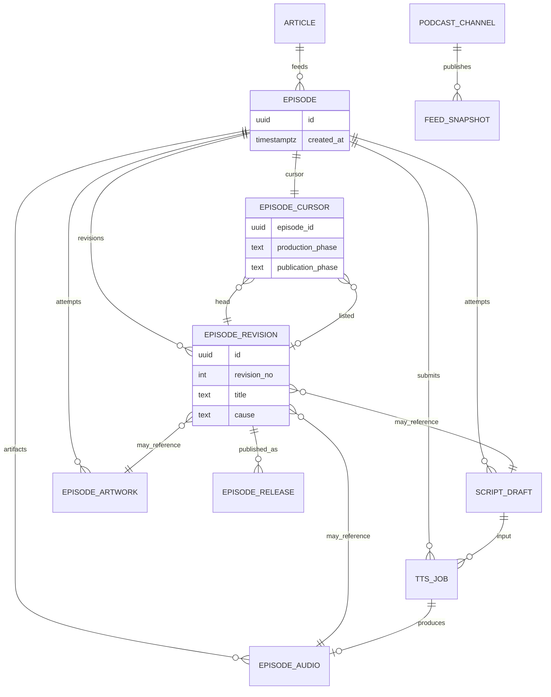

# ポッドキャスト制作 — 目標ドメインモデル

[現状整理](./podcast-craft-domain.md) の続き。**エンティティ分解**、**ドメインイベント**、**ジョブ実行レイヤー**を、PostgreSQL / pgflow の上に載せる前提で定義する。本章は to-be である。マイグレーションは段階的に行う。

## 現状モデルが甘い理由

| 症状 | 例 | 問題 |
|------|-----|------|
| Episode が成果物を抱え込む | `image_url`、`audio_url`、制作 `status`、公開 `published_at` | 集約が肥大化し、再生成・公開のルールが列更新に散在 |
| 1 テーブルにジョブと成果物 | `audio_files` が pending（バッチ）と ready（WAV）を兼ねる | TTS ジョブのライフサイクルと「配信用音声」が同じ行 |
| 「イベント」が混線 | `scripts` / `audio_files` の insert、`processing_logs` | ドメイン上の出来事・試行履歴・運用ログが区別されていない |
| オーケストレーション漏れ | Edge / CLI が直接 `pgflow.start_flow` + `startFrom` | ユースケースが pgflow DSL と PostgreSQL extension に結合 |

Web は RSS と同様 **`audio_files.storage_path` を正**としつつ、REST ではまだ `episodes.audio_url` を読む箇所がある（ingest 時に仮パスを入れるだけ）。**公開 URL の正本は Audio 成果物側に寄せる**のが to-be の方向。

---

## 境界の再定義（4 + 1 層）

```text
  [Application]  ユースケース命令（RegenerateArtwork など）
        │
  [Domain]       集約・ドメインイベント・WorkOrder
        │
  [Job Execution]  WorkflowRun / StepRun（ドメインが所有する実行記録）
        │
  [Job Runner Port]  インターフェースのみ（pgflow 非依存）
        │
  [Infrastructure]  PgflowAdapter, pg_cron → PollTts, EdgeWorker
```

- **pgflow / pgmq / pg_cron** はインフラの「ジョブ実行エンジン」に降格する。
- ドメインは `WorkflowKind.SubmitProduction` のような **意図**だけ知り、`craftEpisodeSubmit` という slug は Adapter が解決する。

---

## Episode のイミュータブル化

### 何が「イミュータブルでない」か

現行 `episodes` は 1 行を何度も `UPDATE` する。

- 台本後に `title` / `description` / `status`
- 画像・音声・公開で `image_url` / 間接的に音声 / `published_at` / `status`

to-be の前稿も **`current_*` ポインタと phase を Episode 行に載せる** 形で、本質的には可変レコードのままだった。

**直し方**: Episode を **身份（Identity）だけの不変レコード** にし、表示内容と成果物の組み合わせは **リビジョン（追記のみ）** に逃がす。可変なのは **カーソル 1 行**（どのリビジョンを「下書き」「掲載中」とみなすか）と **制作進行** だけに限定する。

### 3 分割モデル

| 概念 | テーブル案 | 更新 | 役割 |
|------|------------|------|------|
| **EpisodeIdentity** | `episodes` | **INSERT のみ**（以降 UPDATE 禁止） | `id`, `article_id`, `created_at`。RSS `<guid>` はこの `id` 固定 |
| **EpisodeRevision** | `episode_revisions` | **INSERT のみ** | ある時点の「エピソードの中身」のスナップショット |
| **EpisodeCursor** | `episode_cursors` | UPDATE 可（1 行 / episode） | 下書き HEAD・掲載中リビジョン・phase だけ |

成果物（ScriptDraft / EpisodeAudio / EpisodeArtwork / TtsJob）も **INSERT のみ** とし、リビジョン行がそれらの id を **参照で束ねる**。

```text
episodes (immutable)
  id, article_id, created_at

episode_revisions (immutable, append)
  id, episode_id, revision_no
  title, description
  script_draft_id, episode_audio_id, episode_artwork_id  -- すべて NULL 可（段階的に埋まる）
  created_at, cause  -- initial | script_regenerated | audio_regenerated | artwork_regenerated | manual_edit

episode_cursors (mutable, 1 row per episode)
  episode_id PK
  head_revision_id          -- 制作上の最新スナップショット
  listed_revision_id NULL   -- RSS / Web が参照するスナップショット（未公開なら NULL）
  production_phase
  publication_phase         -- draft | listed | withdrawn
```

**ルール**

1. タイトル変更・台本差し替え・音声差し替え・画像差し替え → すべて **`episode_revisions` に新行** + `head_revision_id` 更新。旧リビジョンは残る。
2. `listed_revision_id` は **公開（または feed 再掲）の意思決定** のときだけ更新。音声だけ差し替えて再公開 → 新リビジョン + `listed_revision_id` を新 id に。
3. `production_phase` はカーソルだけが持つ。TtsJob の poll 状態は **TtsJob 行**（または WorkflowRun）側。Episode 行に `audio_running` を書かない。
4. アプリケーションは **`UPDATE episodes SET ...` を禁止**（DB トリガまたはリポジトリで防御）。

### リビジョンをいつ切るか

| トリガ | 新 `EpisodeRevision` | `cause` | 備考 |
|--------|----------------------|---------|------|
| ingest 直後 | 空スナップショット（タイトル仮） | `initial` | revision 0 |
| 台本 ready | title/description + `script_draft_id` | `script_regenerated` | 音声 id は前 revision を継承可 |
| 音声 ready | `episode_audio_id` 更新 | `audio_regenerated` | 台本・画像 id は head からコピー |
| 画像 ready | `episode_artwork_id` 更新 | `artwork_regenerated` | 失敗時は revision を切らない |
| feed 掲載 | `listed_revision_id := head_revision_id` | （イベント `EpisodeListedInFeed`） | `EpisodeRelease` 行を追加（後述） |

「台本だけ変えたが音声は古いまま」は **head revision 上で script だけ差し替えた行** として表現する（`episode_audio_id` を前 revision からコピー）。現行に無い UC も、この形なら自然。

### 公開履歴（オプションだが RSS と相性が良い）

```text
episode_releases (immutable, append)
  id, episode_id, revision_id, feed_snapshot_id, listed_at
```

1 回の `RepublishFeed` ごとに **Release 行** を残す。`feed.xml` は FeedSnapshot 世代で上書きされても、「いつ revision 2 が載ったか」が追える。

### 読み取りモデル

| 用途 | 参照 |
|------|------|
| TUI「現在の下書き」 | `episode_cursors.head_revision_id` → `episode_revisions` |
| Web / プレイヤー（公開分） | `listed_revision_id` → join Audio / Artwork |
| RSS item | `guid = episodes.id`、enclosure/image/title は **listed revision** から |
| 履歴・監査 | 全 `episode_revisions` |

### 現行 `episodes` からの移行イメージ

1. `episodes` を identity 列だけ残す（データは 1 行 1 episode のまま）。
2. 既存行の title/description/image/audio を **revision 1** として backfill。
3. `episode_cursors` に head = listed = revision 1、phase は現 `status` から写す。
4. ステージコードの `UPDATE episodes SET title...` を **`CommitEpisodeRevision` ユースケース** に置換。

### イミュータブル Episode と Job Execution 層

- WorkflowRun は **EpisodeIdentity** に紐づく。phase 更新は **Cursor** のみ。
- ステップ成功時: 成果物 INSERT →（必要なら）Revision INSERT → Cursor 更新 → DomainEvent INSERT。
- pgflow は引き続きインフラ。Episode の不変性とは独立。

---

## エンティティ分解（to-be）

### EpisodeIdentity（`episodes` — 不変）

| 属性 | 説明 |
|------|------|
| `id` | 不変。RSS guid |
| `article_id` | ingest スナップショット |
| `created_at` | 生成時刻 |

**ここに title / status / image / audio は置かない。**

### EpisodeRevision / EpisodeCursor

上記「3 分割モデル」参照。集約の **論理根** は Identity + Cursor。Revision は集約内の不変子エンティティ群。

### エンティティ: ScriptDraft（現 `scripts` の再定義）

台本 **1 回分の生成試行**。追記のみ。

| 属性 | 説明 |
|------|------|
| `episode_id` | 親 |
| `content` | Host/CoHost 台本 |
| `outcome` | `ready` / `failed` |
| `llm_usage`, `llm_response` | プロバイダメタ |
| `requested_by` | `ingest` / `manual` / `workflow_run_id` |

TTS は **head revision** が指す `script_draft_id`（または制作中の最新 ready 台本）を入力とする。

### エンティティ: EpisodeArtwork（新規 — 現 `image_url` の昇格）

画像は Episode の列ではなく **独立エンティティ**。

| 属性 | 説明 |
|------|------|
| `id`, `episode_id` | |
| `storage_path`, `mime_type` | Storage `podcast` バケット |
| `outcome` | `ready` / `failed` / `skipped` |
| `llm_usage`, `llm_response` | 画像 LLM |
| `created_at` | 試行履歴 |

再生成は Artwork 行を INSERT → 新 **EpisodeRevision**（`episode_artwork_id` 差し替え）→ Cursor の `head_revision_id` 更新。

### エンティティ: TtsJob（現 `audio_files` の pending 側を分離）

Gemini バッチ **ジョブ** 専用。完成 WAV とは別寿命。

| 属性 | 説明 |
|------|------|
| `id`, `episode_id`, `script_id` | 入力台本 |
| `batch_name` | 外部ジョブ ID（ユニーク） |
| `phase` | `submitted` / `running` / `succeeded` / `failed` / `cancelled` |
| `poll_state` | 最終 poll（現 `llm_response.batch` の正規化） |
| `tts_selection` | 声・トーン（JSON 可） |

download-monitor は **TtsJob** をスキャンし、完了時にドメインサービス `CompleteTtsJob` を呼ぶ（内部で EpisodeAudio 作成）。

### エンティティ: EpisodeAudio（現 `audio_files` の ready 側 + URL）

**配信可能な音声成果物**。公開 URL はここから導出する。

| 属性 | 説明 |
|------|------|
| `id`, `episode_id`, `script_id`, `tts_job_id` | 系譜 |
| `storage_path`, `mime_type` | 正本（現 `storage_path`） |
| `byte_size` | 任意 |
| `outcome` | `ready` / `failed` |

`public_url` は DB 列に持たず、`SUPABASE_URL + storage_path` で組み立てる。Web/RSS は **listed revision** が指す `episode_audio_id` を join。**`episodes.audio_url` は廃止**。

pending 中は EpisodeAudio 行が無く、TtsJob のみ存在する — ジョブと成果物の混線を解消。

### 集約 2: PodcastChannel（公開）

| エンティティ | 説明 |
|--------------|------|
| **FeedSnapshot** | `feed.xml` の世代（`generated_at`, storage path） |
| **EpisodeListing** | チャンネルに載せる 1 item（guid = episode id、**revision_id** 固定参照） |

`updateRss` は FeedSnapshot 追加 + `listed_revision_id` が指す revision から item を組み立て + `episode_releases` 行追加。Cursor の `publication_phase = listed`。

### その他（変更なしに近い）

- **Article** — IngestSnapshot のまま
- **PodcastConfig** — 設定コンテキスト

---

## ER（目標・概念）



---

## ドメインイベントの分解

3 種類を **別テーブル／別名前空間** で扱う。混ぜない。

### A. ドメインイベント（`craft_domain_events` 想定）

ビジネス上意味のある出来事。append-only。投影（read model）や Publication の更新トリガに使う。

| イベント型 | 発生タイミング | 主なペイロード |
|------------|----------------|----------------|
| `EpisodeCreated` | ingest | episode_id, article_id |
| `ScriptGenerationCompleted` | 台本 ready | script_draft_id, title, description |
| `ScriptGenerationFailed` | 台本 failed | error |
| `ArtworkGenerationCompleted` | 画像 ready | artwork_id, storage_path |
| `ArtworkGenerationFailed` | 画像 failed（非致命） | error |
| `TtsJobSubmitted` | batch 投入 | tts_job_id, batch_name |
| `TtsJobSucceeded` | batch 成功 | tts_job_id |
| `TtsJobFailed` | batch 失敗 | tts_job_id, error |
| `EpisodeAudioStored` | WAV upload 完了 | episode_audio_id, storage_path |
| `EpisodeListedInFeed` | RSS item に載った | feed_snapshot_id |
| `FeedRebuilt` | feed.xml 更新 | feed_snapshot_id, episode_count |

`scripts` / `episode_artworks` の行は **イベントの結果としての状態**であり、イベントそのものではない（二重記録を避けるなら、将来はイベントソーシング寄りにもできるが、第 1 段階は **イベント + 状態テーブル併存** で十分）。

### B. ワークフローステップ記録（`craft_step_runs` — Job Execution 層）

| 属性 | 説明 |
|------|------|
| `workflow_run_id` | 下記 |
| `step_key` | ドメイン定義: `GenerateScript`, `SubmitTts`, `FetchTtsOutput`, `GenerateArtwork`, `RebuildFeed` |
| `status` | pending / running / succeeded / failed / skipped |
| `external_ref` | pgflow task id など（任意） |

pgflow の `pgflow.runs` は **インフラの実行 ID**。ドメインは `craft_workflow_runs` を正とし、`pgflow_run_id` は Adapter が埋める。

### C. 運用テレメトリ（現 `processing_logs` の位置づけ）

ステージの duration・成功失敗ログ。**ドメインルールには使わない**。監査・TUI 用のまま維持。queue_name レガシーは徐々に `step_key` に寄せる。

---

## ジョブ実行レイヤー（Craft Job Execution）

### ドメイン側の型（TypeScript / 疑似）

```typescript
// ユースケースが pgflow を知らない
type ProductionIntent =
  | { kind: "StartFromIngest"; episodeId: string }
  | { kind: "RegenerateScript"; episodeId: string; refreshAudio: boolean; refreshArtwork: boolean }
  | { kind: "RegenerateAudio"; episodeId: string; republish: boolean }
  | { kind: "RegenerateArtwork"; episodeId: string; republish: boolean }
  | { kind: "RepublishFeed"; episodeId: string }
  | { kind: "PollPendingTts" }; // cron 用

interface JobExecutionService {
  enqueue(intent: ProductionIntent): Promise<CraftWorkflowRunId>;
}

interface WorkflowRunnerPort {
  start(run: CraftWorkflowRun): Promise<ExternalRunHandle>;
}
```

### テーブル（public スキーマ — 提案）

```sql
-- ドメインが所有する実行単位
create table craft_workflow_runs (
  id uuid primary key,
  episode_id uuid references episodes(id),
  intent jsonb not null,
  status text not null,
  pgflow_run_id uuid null,
  created_at timestamptz not null default now()
);

create table craft_step_runs (
  id uuid primary key,
  workflow_run_id uuid not null references craft_workflow_runs(id),
  step_key text not null,
  status text not null,
  started_at timestamptz,
  finished_at timestamptz,
  error text
);
```

### Adapter: PgflowWorkflowRunner

| ドメイン `step_key` | 現 pgflow step | 備考 |
|---------------------|----------------|------|
| `GenerateScript` | craftEpisodeSubmit.generateScript | |
| `SubmitTts` | generateAudioStart | |
| `GenerateArtwork` | generateEpisodeImage | |
| `FetchTtsOutput` | craftEpisodeDownload.generateAudioDownload | monitor が WorkflowRun を起動 |
| `RebuildFeed` | updateRss | |

**Intent → 実行計画** はドメインの `WorkflowPlanner` が決める（例: `RegenerateArtwork` + `republish: true` なら Artwork ステップの後に RebuildFeed を同じ WorkflowRun に含める）。pgflow の `startFrom` 行列は Adapter 内に閉じ込める。

### cron（download-monitor）の位置

to-be では monitor は pgflow を直接叩かず、

1. `PollPendingTts` intent で `JobExecutionService.enqueue`
2. Planner が `FetchTtsOutput`（必要なら `RebuildFeed`）をスケジュール
3. Adapter が pgflow Download フローを起動

Episode の `audio_downloading` ロックは **TtsJob** または **WorkflowRun** の排他に移す。

---

## ユースケース → 触るエンティティ（to-be）

| 命令 | 主に更新 | 発行イベント（例） |
|------|----------|-------------------|
| StartFromIngest | EpisodeIdentity, Revision 0, Cursor, ScriptDraft, … | EpisodeCreated |
| RegenerateScriptOnly | ScriptDraft + **新 Revision**（audio/art  id 継承） | ScriptGenerationCompleted |
| RegenerateAudio | TtsJob → EpisodeAudio + **新 Revision** | EpisodeAudioStored |
| RegenerateArtwork | Artwork + **新 Revision** | ArtworkGenerationCompleted |
| RepublishFeed | listed_revision 更新, FeedSnapshot, EpisodeRelease | FeedRebuilt |

---

## 移行フェーズ（推奨）

0. **Phase 0 — Identity + Revision**: `episode_revisions` / `episode_cursors` 導入。`episodes` への title/status UPDATE を廃止し backfill。
1. **Phase A — 成果物テーブル**: `episode_artworks` / `episode_audios`、`image_url` / ready な `audio_files` を移行。
2. **Phase B — TtsJob 分離**: pending を `tts_jobs` へ。
3. **Phase C — Job Execution**: `craft_workflow_runs`、pgflow Adapter。
4. **Phase D — ドメインイベント + episode_releases**。

各 Phase は独立 PR にし、**既存 migration は編集しない**（リポジトリ規約どおり新規 migration のみ）。

---

## 参照

- 現状 UC・CLI: [podcast-craft-domain.md](./podcast-craft-domain.md)
- ステージ実装: [pipeline-stages.ts](../../supabase/functions/_shared/pipeline-stages.ts)
- pgflow Worker: [craft-episode-worker/index.ts](../../supabase/functions/craft-episode-worker/index.ts)
