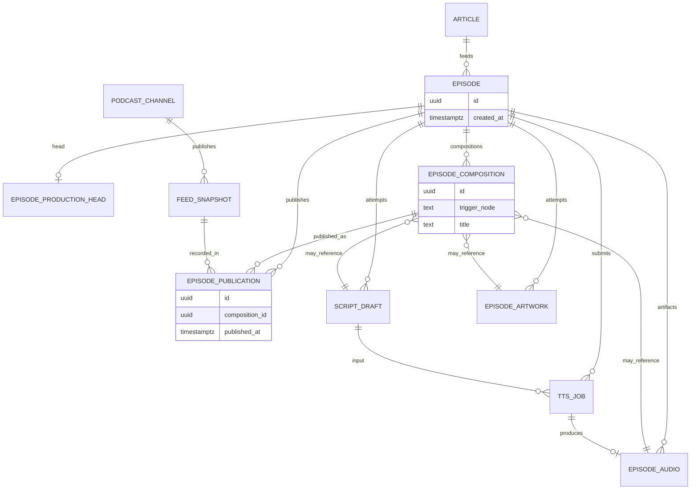

# ポッドキャスト制作 — 目標ドメインモデル

[現状整理](./podcast-craft-domain.md) の続き。**エンティティ分解**、**ドメインイベント**、**ジョブ実行レイヤー**を、PostgreSQL / pgflow の上に載せる前提で定義する。本章は to-be である。マイグレーションは段階的に行う。

## 現状モデルが甘い理由

| 症状 | 例 | 問題 |
|------|-----|------|
| Episode が成果物を抱え込む | `image_url`、`audio_url`、制作 `status`、公開 `published_at` | 集約が肥大化し、再生成・公開のルールが列更新に散在 |
| 1 テーブルにジョブと成果物 | `audio_files` が pending（バッチ）と ready（WAV）を兼ねる | TTS ジョブのライフサイクルと「配信用音声」が同じ行 |
| 「イベント」が混線 | `scripts` / `audio_files` の insert、`processing_logs` | ドメイン上の出来事・試行履歴・運用ログが区別されていない |
| オーケストレーション漏れ | Edge / CLI が直接 `pgflow.start_flow` + `startFrom` | ユースケースが pgflow DSL と PostgreSQL extension に結合 |

Web は RSS と同様 **`audio_files.storage_path` を正**としつつ、REST ではまだ `episodes.audio_url` を読む箇所がある（ingest 時に仮パスを入れるだけ）。**公開 URL の正本は Audio 成果物側に寄せる**のが to-be の方向。

---

## 境界の再定義（4 + 1 層）

```text
  [Application]  ユースケース命令（RegenerateArtwork など）
        │
  [Domain]       集約・ドメインイベント・WorkOrder
        │
  [Job Execution]  WorkflowRun / StepRun（ドメインが所有する実行記録）
        │
  [Job Runner Port]  インターフェースのみ（pgflow 非依存）
        │
  [Infrastructure]  PgflowAdapter, pg_cron → PollTts, EdgeWorker
```

- **pgflow / pgmq / pg_cron** はインフラの「ジョブ実行エンジン」に降格する。
- ドメインは `WorkflowKind.SubmitProduction` のような **意図**だけ知り、`craftEpisodeSubmit` という slug は Adapter が解決する。

---

## Episode のイミュータブル化

### 何が「イミュータブルでない」か

現行 `episodes` は 1 行を何度も `UPDATE` する。

- 台本後に `title` / `description` / `status`
- 画像・音声・公開で `image_url` / 間接的に音声 / `published_at` / `status`

to-be の前稿も **`current_*` ポインタと phase を Episode 行に載せる** 形で、本質的には可変レコードのままだった。

**直し方**: Episode は **Identity のみ不変**。制作は **Edit セッション**（`*EditStarted` → 中間イベント → `*EditEnded` → 任意で `EpisodePublished`）。Outcome は End 時に **NULL なし** で 1 件。詳細は **[podcast-craft-edit-sessions.md](./podcast-craft-edit-sessions.md)**。

DAG ノード対応は [production-dag](./podcast-craft-production-dag.md)。Composition / ProductionHead は **Edit モデルに置換**。

### Composition + Publication（Cursor なし）

| 概念 | テーブル案 | 更新 | 役割 |
|------|------------|------|------|
| **EpisodeIdentity** | `episodes` | INSERT のみ | `id`, `article_id`, `created_at` |
| **ProductionHead** | `episode_production_heads` | UPDATE（スロットのみ） | script / audio / artwork / title の最新参照 |
| **EpisodeComposition** | `episode_compositions` | INSERT のみ | DAG ノード完了時の **束ねスナップショット**（`trigger_node`） |
| **EpisodePublication** | `episode_publications` | INSERT のみ | **composition_id** を指す掲載イベント |

```text
episodes (immutable)

episode_production_heads (mutable, 1 row / episode)
  script_draft_id, episode_audio_id, episode_artwork_id, title, description

episode_compositions (immutable)
  id, episode_id, composition_no
  script_draft_id, episode_audio_id, episode_artwork_id
  title, description, trigger_node, created_at

episode_publications (immutable)
  id, episode_id, composition_id
  feed_snapshot_id, published_at
```

**制作 HEAD（束ね）** = 最新 `episode_compositions` または **ProductionHead**（運用上は HEAD 表 + Commit で composition 増殖）。

**公開エピソード** = 最新 `episode_publications` → **composition_id**。

```sql
SELECT c.*
FROM episode_publications pub
JOIN episode_compositions c ON c.id = pub.composition_id
WHERE pub.episode_id = $1
ORDER BY pub.published_at DESC
LIMIT 1;
```

RSS / Web の「配信に出す版」は **必ずこの join** から取る。`episodes.published_at` や `status = published` は廃止。

### EpisodePublished が担うこと（旧 Cursor / status の置き換え）

| 旧 | 新 |
|----|-----|
| `listed_revision_id` UPDATE | `INSERT episode_publications (composition_id, …)` |
| `publication_phase = listed` | publication が 1 件以上存在 |
| `updateRss` 成功で `status = published` | **`PublishEpisode` ユースケース** が publication + FeedSnapshot を INSERT |
| 音声再生成後の再公開 | CommitComposition(audio) → **PublishEpisode(compositionId)** |
| 画像だけ変えて feed 反映 | CommitComposition(artwork) → **PublishEpisode(compositionId)** |

**ドメインイベント** `EpisodePublished` と **永続行** `episode_publications` は同じ出来事（イベントテーブルと publication テーブルを 1 つにしてもよい）。

### Cursor は本当に不要か

| 関心 | Cursor なしで足りるか |
|------|------------------------|
| 掲載中 | **足りる** — 最新 publication → composition |
| 制作 HEAD | **足りる** — production_heads または最新 composition |
| 未公開か | **足りる** — publication 0 件 |
| `script_running` / … | **TtsJob / WorkflowRun** から導出。Composition はコミット済みのみ |

制作フェーズは次のいずれか。

1. **導出（推奨・Cursor 不要）**: 未完了 `craft_workflow_runs`、pending `tts_jobs`、failed 成果物の有無から TUI/CLI 用ビューを組む。
2. **縮退キャッシュ（任意）**: `episode_production_state(episode_id, phase)` の 1 列 UPDATE。Cursor より責務が狭く、Publication とは分離。

**結論**: **公開の意味での Cursor（listed / publication_phase）は `EpisodePublished` で削除できる。** 制作 UI 用 phase だけ、導出か最小キャッシュを選ぶ。

### 設計判断（確定）— Composition と Publication の直交

**Composition** と **Publication** は別タイムライン。公開のために composition を無理に増やさない（Publish は **既存 composition_id を指す**）。

| ストリーム | いつ増えるか | やらないこと |
|------------|--------------|--------------|
| `episode_compositions` | DAG ノード完了時 **`CommitComposition(trigger_node)`** | `trigger_node: publish` は使わない |
| `episode_publications` | 掲載宣言 | composition の UPDATE / 公開専用 composition |

**`PublishEpisode` 契約**

```typescript
PublishEpisode({
  episodeId,
  compositionId,    // 必須
  feedSnapshotId,
  reason?: "first_list" | "after_content_change" | "feed_rebuild_only",
});
```

- 中身変更 → Artifact + HEAD 更新 → **`CommitComposition`** → 必要なら **`PublishEpisode(compositionId)`**
- feed だけ → **`PublishEpisode`** のみ（同 composition_id 可）

1 行ルール: **Composition は制作 DAG の差分束ね。Publication は掲載の履歴だけ。**

### Composition をいつ切るか（DAG ノード単位）

| DAG ノード | HEAD 更新 | Composition |
|------------|-----------|-------------|
| Episode 作成 | initial | `trigger_node: initial` |
| 台本 ready | script, title | `script` |
| 音声 ready | audio | `audio` |
| アートワーク ready | artwork | `artwork` |
| **Publish** | 触らない | **増やさない** |

並列（音声 ∥ アートワーク）は **完成順に Commit** され、composition 行に `trigger_node` が残る。詳細 DAG は [production-dag](./podcast-craft-production-dag.md)。

`RepublishFeed` は **同じ composition_id** で publication を再度 INSERT してよい。

### 読み取りモデル

| 用途 | 参照 |
|------|------|
| TUI「制作中の最新」 | `episode_production_heads` または最新 `episode_compositions` |
| Web / RSS | 最新 `episode_publications` → composition |
| 公開履歴 | 全 `episode_publications` |
| guid | 常に `episodes.id` |

### 現行 `episodes` からの移行イメージ

1. `episodes` を identity のみに。
2. 現行 1 行 → composition 1 + production head。
3. 公開済み → `episode_publications` backfill（`composition_id`）。
4. ステージを **HEAD 更新 + CommitComposition** + **PublishEpisode** に置換。

### Job Execution 層との関係

- `RebuildFeed` 成功 → **`PublishEpisode(compositionId)`** + FeedSnapshot。
- WorkflowRun は EpisodeIdentity に紐づく。phase 用 Cursor は持たない。

---

## エンティティ分解（to-be）

### EpisodeIdentity（`episodes` — 不変）

| 属性 | 説明 |
|------|------|
| `id` | 不変。RSS guid |
| `article_id` | ingest スナップショット |
| `created_at` | 生成時刻 |

**ここに title / status / image / audio は置かない。**

### EpisodeComposition / EpisodePublication

- **Composition** — Artifact の束ね。DAG ノード完了で Commit。→ [production-dag](./podcast-craft-production-dag.md)
- **Publication** — `composition_id` を指す掲載イベント。

### エンティティ: ScriptDraft（現 `scripts` の再定義）

台本 **1 回分の生成試行**。追記のみ。

| 属性 | 説明 |
|------|------|
| `episode_id` | 親 |
| `content` | Host/CoHost 台本 |
| `outcome` | `ready` / `failed` |
| `llm_usage`, `llm_response` | プロバイダメタ |
| `requested_by` | `ingest` / `manual` / `workflow_run_id` |

TTS は **production head** の `script_draft_id` を入力とする。

### エンティティ: EpisodeArtwork（新規 — 現 `image_url` の昇格）

画像は Episode の列ではなく **独立エンティティ**。

| 属性 | 説明 |
|------|------|
| `id`, `episode_id` | |
| `storage_path`, `mime_type` | Storage `podcast` バケット |
| `outcome` | `ready` / `failed` / `skipped` |
| `llm_usage`, `llm_response` | 画像 LLM |
| `created_at` | 試行履歴 |

再生成は Artwork INSERT → HEAD 更新 → **CommitComposition(artwork)** → 公開時 **PublishEpisode**。

### エンティティ: TtsJob（現 `audio_files` の pending 側を分離）

Gemini バッチ **ジョブ** 専用。完成 WAV とは別寿命。

| 属性 | 説明 |
|------|------|
| `id`, `episode_id`, `script_id` | 入力台本 |
| `batch_name` | 外部ジョブ ID（ユニーク） |
| `phase` | `submitted` / `running` / `succeeded` / `failed` / `cancelled` |
| `poll_state` | 最終 poll（現 `llm_response.batch` の正規化） |
| `tts_selection` | 声・トーン（JSON 可） |

download-monitor は **TtsJob** をスキャンし、完了時にドメインサービス `CompleteTtsJob` を呼ぶ（内部で EpisodeAudio 作成）。

### エンティティ: EpisodeAudio（現 `audio_files` の ready 側 + URL）

**配信可能な音声成果物**。公開 URL はここから導出する。

| 属性 | 説明 |
|------|------|
| `id`, `episode_id`, `script_id`, `tts_job_id` | 系譜 |
| `storage_path`, `mime_type` | 正本（現 `storage_path`） |
| `byte_size` | 任意 |
| `outcome` | `ready` / `failed` |

Web/RSS は **掲載 composition** が指す `episode_audio_id` を join。

pending 中は EpisodeAudio 行が無く、TtsJob のみ存在する — ジョブと成果物の混線を解消。

### 集約 2: PodcastChannel（公開）

| エンティティ | 説明 |
|--------------|------|
| **FeedSnapshot** | `feed.xml` の世代 |
| **EpisodePublication** | `composition_id` + feed 世代 |

`updateRss` 成功 = **PublishEpisode(compositionId)** + FeedSnapshot。item は各 episode の最新 publication → composition から組み立て。

### その他（変更なしに近い）

- **Article** — IngestSnapshot のまま
- **PodcastConfig** — 設定コンテキスト

---

## ER（目標・概念）



---

## ドメインイベントの分解

3 種類を **別テーブル／別名前空間** で扱う。混ぜない。

### A. ドメインイベント（`craft_domain_events` 想定）

ビジネス上意味のある出来事。append-only。投影（read model）や Publication の更新トリガに使う。

| イベント型 | 発生タイミング | 主なペイロード |
|------------|----------------|----------------|
| `EpisodeCreated` | ingest | episode_id, article_id |
| `ScriptGenerationCompleted` | 台本 ready | script_draft_id, title, description |
| `ScriptGenerationFailed` | 台本 failed | error |
| `ArtworkGenerationCompleted` | 画像 ready | artwork_id, storage_path |
| `ArtworkGenerationFailed` | 画像 failed（非致命） | error |
| `TtsJobSubmitted` | batch 投入 | tts_job_id, batch_name |
| `TtsJobSucceeded` | batch 成功 | tts_job_id |
| `TtsJobFailed` | batch 失敗 | tts_job_id, error |
| `EpisodeAudioStored` | WAV upload 完了 | episode_audio_id, storage_path |
| `EpisodePublished` | publication INSERT | episode_id, composition_id, feed_snapshot_id |
| `FeedRebuilt` | feed.xml 更新 | feed_snapshot_id, episode_count |

`scripts` / `episode_artworks` の行は **イベントの結果としての状態**であり、イベントそのものではない（二重記録を避けるなら、将来はイベントソーシング寄りにもできるが、第 1 段階は **イベント + 状態テーブル併存** で十分）。

### B. ワークフローステップ記録（`craft_step_runs` — Job Execution 層）

| 属性 | 説明 |
|------|------|
| `workflow_run_id` | 下記 |
| `step_key` | ドメイン定義: `GenerateScript`, `SubmitTts`, `FetchTtsOutput`, `GenerateArtwork`, `RebuildFeed` |
| `status` | pending / running / succeeded / failed / skipped |
| `external_ref` | pgflow task id など（任意） |

pgflow の `pgflow.runs` は **インフラの実行 ID**。ドメインは `craft_workflow_runs` を正とし、`pgflow_run_id` は Adapter が埋める。

### C. 運用テレメトリ（現 `processing_logs` の位置づけ）

ステージの duration・成功失敗ログ。**ドメインルールには使わない**。監査・TUI 用のまま維持。queue_name レガシーは徐々に `step_key` に寄せる。

---

## ジョブ実行レイヤー（Craft Job Execution）

### ドメイン側の型（TypeScript / 疑似）

```typescript
// ユースケースが pgflow を知らない
type ProductionIntent =
  | { kind: "StartFromIngest"; episodeId: string }
  | { kind: "RegenerateScript"; episodeId: string; refreshAudio: boolean; refreshArtwork: boolean }
  | { kind: "RegenerateAudio"; episodeId: string; republish: boolean }
  | { kind: "RegenerateArtwork"; episodeId: string; republish: boolean }
  | { kind: "RepublishFeed"; episodeId: string }
  | { kind: "PollPendingTts" }; // cron 用

interface JobExecutionService {
  enqueue(intent: ProductionIntent): Promise<CraftWorkflowRunId>;
}

interface WorkflowRunnerPort {
  start(run: CraftWorkflowRun): Promise<ExternalRunHandle>;
}
```

### テーブル（public スキーマ — 提案）

```sql
-- ドメインが所有する実行単位
create table craft_workflow_runs (
  id uuid primary key,
  episode_id uuid references episodes(id),
  intent jsonb not null,
  status text not null,
  pgflow_run_id uuid null,
  created_at timestamptz not null default now()
);

create table craft_step_runs (
  id uuid primary key,
  workflow_run_id uuid not null references craft_workflow_runs(id),
  step_key text not null,
  status text not null,
  started_at timestamptz,
  finished_at timestamptz,
  error text
);
```

### Adapter: PgflowWorkflowRunner

| ドメイン `step_key` | 現 pgflow step | 備考 |
|---------------------|----------------|------|
| `GenerateScript` | craftEpisodeSubmit.generateScript | |
| `SubmitTts` | generateAudioStart | |
| `GenerateArtwork` | generateEpisodeImage | |
| `FetchTtsOutput` | craftEpisodeDownload.generateAudioDownload | monitor が WorkflowRun を起動 |
| `RebuildFeed` | updateRss | |

**Intent → 実行計画** はドメインの `WorkflowPlanner` が決める（例: `RegenerateArtwork` + `republish: true` なら Artwork ステップの後に RebuildFeed を同じ WorkflowRun に含める）。pgflow の `startFrom` 行列は Adapter 内に閉じ込める。

### cron（download-monitor）の位置

to-be では monitor は pgflow を直接叩かず、

1. `PollPendingTts` intent で `JobExecutionService.enqueue`
2. Planner が `FetchTtsOutput`（必要なら `RebuildFeed`）をスケジュール
3. Adapter が pgflow Download フローを起動

Episode の `audio_downloading` ロックは **TtsJob** または **WorkflowRun** の排他に移す。

---

## ユースケース → 触るエンティティ（to-be）

| 命令 | 主に更新 | 発行イベント（例） |
|------|----------|-------------------|
| StartFromIngest | EpisodeIdentity, Revision 0, Cursor, ScriptDraft, … | EpisodeCreated |
| RegenerateScriptOnly | ScriptDraft + **新 Revision**（audio/art  id 継承） | ScriptGenerationCompleted |
| RegenerateAudio | TtsJob → EpisodeAudio + **新 Revision** | EpisodeAudioStored |
| RegenerateArtwork | Artwork + **新 Revision** | ArtworkGenerationCompleted |
| RepublishFeed | FeedSnapshot + Publication（同 composition 可） | EpisodePublished, FeedRebuilt |

---

## 移行フェーズ（推奨）

0. **Phase 0 — Identity + Composition + Publication**: [production-dag](./podcast-craft-production-dag.md) に沿い heads / compositions / publications を導入。
1. **Phase A — 成果物テーブル**: `episode_artworks` / `episode_audios`。
2. **Phase B — TtsJob 分離**。
3. **Phase C — Job Execution**。
4. **Phase D — craft_domain_events**（`EpisodePublished` は publication 行と一体化可）。

各 Phase は独立 PR にし、**既存 migration は編集しない**（リポジトリ規約どおり新規 migration のみ）。

---

## 参照

- 現状 UC・CLI: [podcast-craft-domain.md](./podcast-craft-domain.md)
- ステージ実装: [pipeline-stages.ts](../../supabase/functions/_shared/pipeline-stages.ts)
- pgflow Worker: [craft-episode-worker/index.ts](../../supabase/functions/craft-episode-worker/index.ts)
