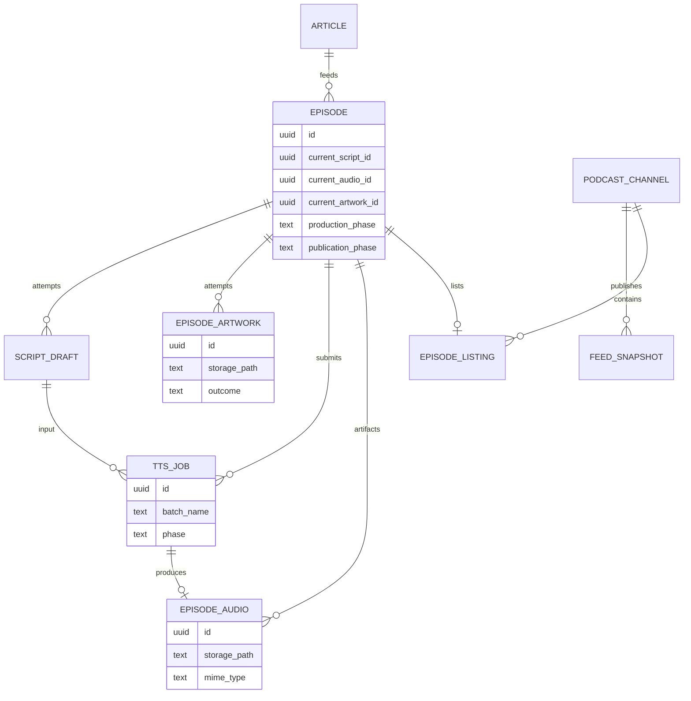

# ポッドキャスト制作 — 目標ドメインモデル

[現状整理](./podcast-craft-domain.md) の続き。**エンティティ分解**、**ドメインイベント**、**ジョブ実行レイヤー**を、PostgreSQL / pgflow の上に載せる前提で定義する。本章は to-be である。マイグレーションは段階的に行う。

## 現状モデルが甘い理由

| 症状 | 例 | 問題 |
|------|-----|------|
| Episode が成果物を抱え込む | `image_url`、`audio_url`、制作 `status`、公開 `published_at` | 集約が肥大化し、再生成・公開のルールが列更新に散在 |
| 1 テーブルにジョブと成果物 | `audio_files` が pending（バッチ）と ready（WAV）を兼ねる | TTS ジョブのライフサイクルと「配信用音声」が同じ行 |
| 「イベント」が混線 | `scripts` / `audio_files` の insert、`processing_logs` | ドメイン上の出来事・試行履歴・運用ログが区別されていない |
| オーケストレーション漏れ | Edge / CLI が直接 `pgflow.start_flow` + `startFrom` | ユースケースが pgflow DSL と PostgreSQL extension に結合 |

Web は RSS と同様 **`audio_files.storage_path` を正**としつつ、REST ではまだ `episodes.audio_url` を読む箇所がある（ingest 時に仮パスを入れるだけ）。**公開 URL の正本は Audio 成果物側に寄せる**のが to-be の方向。

---

## 境界の再定義（4 + 1 層）

```text
  [Application]  ユースケース命令（RegenerateArtwork など）
        │
  [Domain]       集約・ドメインイベント・WorkOrder
        │
  [Job Execution]  WorkflowRun / StepRun（ドメインが所有する実行記録）
        │
  [Job Runner Port]  インターフェースのみ（pgflow 非依存）
        │
  [Infrastructure]  PgflowAdapter, pg_cron → PollTts, EdgeWorker
```

- **pgflow / pgmq / pg_cron** はインフラの「ジョブ実行エンジン」に降格する。
- ドメインは `WorkflowKind.SubmitProduction` のような **意図**だけ知り、`craftEpisodeSubmit` という slug は Adapter が解決する。

---

## エンティティ分解（to-be）

### 集約 1: Episode（制作の根 — スリム化）

Episode は「1 本のポッドキャスト項目の身份」と **現在どの成果物を指すか** だけを持つ。

| 属性 | 説明 |
|------|------|
| `id` | 不変 |
| `article_id` | 入力スナップショットへの参照 |
| `title`, `description` | 表示用（台本生成で更新 — 将来は Script から投影してもよい） |
| `production_phase` | 台本・音声制作の粗いフェーズ（`ingested` … `audio_ready` など） |
| `publication_phase` | `draft` / `listed` / `withdrawn` など（制作 phase から分離） |
| `current_script_id` | 採用中台本 |
| `current_audio_id` | 採用中音声成果物 |
| `current_artwork_id` | 採用中カバー画像 |

**削除・非推奨（段階的）**: `episodes.image_url` → `episode_artworks` へ、`episodes.audio_url` → `episode_audios` へ。`episodes.status` の公開意味は `publication_phase` へ移す。

### エンティティ: ScriptDraft（現 `scripts` の再定義）

台本 **1 回分の生成試行**。追記のみ。

| 属性 | 説明 |
|------|------|
| `episode_id` | 親 |
| `content` | Host/CoHost 台本 |
| `outcome` | `ready` / `failed` |
| `llm_usage`, `llm_response` | プロバイダメタ |
| `requested_by` | `ingest` / `manual` / `workflow_run_id` |

TTS は常に **採用中 ScriptDraft**（`current_script_id`）を入力とする。`order by created_at desc` をやめる。

### エンティティ: EpisodeArtwork（新規 — 現 `image_url` の昇格）

画像は Episode の列ではなく **独立エンティティ**。

| 属性 | 説明 |
|------|------|
| `id`, `episode_id` | |
| `storage_path`, `mime_type` | Storage `podcast` バケット |
| `outcome` | `ready` / `failed` / `skipped` |
| `llm_usage`, `llm_response` | 画像 LLM |
| `created_at` | 試行履歴 |

Episode は `current_artwork_id` のみ保持。RSS / Web は **採用中 Artwork** の path を参照。再生成は新行 insert → `current_artwork_id` 更新。

### エンティティ: TtsJob（現 `audio_files` の pending 側を分離）

Gemini バッチ **ジョブ** 専用。完成 WAV とは別寿命。

| 属性 | 説明 |
|------|------|
| `id`, `episode_id`, `script_id` | 入力台本 |
| `batch_name` | 外部ジョブ ID（ユニーク） |
| `phase` | `submitted` / `running` / `succeeded` / `failed` / `cancelled` |
| `poll_state` | 最終 poll（現 `llm_response.batch` の正規化） |
| `tts_selection` | 声・トーン（JSON 可） |

download-monitor は **TtsJob** をスキャンし、完了時にドメインサービス `CompleteTtsJob` を呼ぶ（内部で EpisodeAudio 作成）。

### エンティティ: EpisodeAudio（現 `audio_files` の ready 側 + URL）

**配信可能な音声成果物**。公開 URL はここから導出する。

| 属性 | 説明 |
|------|------|
| `id`, `episode_id`, `script_id`, `tts_job_id` | 系譜 |
| `storage_path`, `mime_type` | 正本（現 `storage_path`） |
| `byte_size` | 任意 |
| `outcome` | `ready` / `failed` |

`public_url` は DB 列に持たず、`SUPABASE_URL + storage_path` で組み立てる（必要なら materialized view や API 層）。**`episodes.audio_url` は廃止**し、Web/RSS は `current_audio_id` → EpisodeAudio を join。

pending 中は EpisodeAudio 行が無く、TtsJob のみ存在する — ジョブと成果物の混線を解消。

### 集約 2: PodcastChannel（公開）

| エンティティ | 説明 |
|--------------|------|
| **FeedSnapshot** | `feed.xml` の世代（`generated_at`, storage path） |
| **EpisodeListing** | チャンネルに載せる 1 item（guid = episode id、参照: current_audio_id, current_artwork_id, title, description, pub_date） |

`updateRss` は **FeedSnapshot を 1 件追加（または上書き世代管理）** + 対象 Episode の `publication_phase = listed`。制作 phase を `published` に書き換えない。

### その他（変更なしに近い）

- **Article** — IngestSnapshot のまま
- **PodcastConfig** — 設定コンテキスト

---

## ER（目標・概念）



---

## ドメインイベントの分解

3 種類を **別テーブル／別名前空間** で扱う。混ぜない。

### A. ドメインイベント（`craft_domain_events` 想定）

ビジネス上意味のある出来事。append-only。投影（read model）や Publication の更新トリガに使う。

| イベント型 | 発生タイミング | 主なペイロード |
|------------|----------------|----------------|
| `EpisodeCreated` | ingest | episode_id, article_id |
| `ScriptGenerationCompleted` | 台本 ready | script_draft_id, title, description |
| `ScriptGenerationFailed` | 台本 failed | error |
| `ArtworkGenerationCompleted` | 画像 ready | artwork_id, storage_path |
| `ArtworkGenerationFailed` | 画像 failed（非致命） | error |
| `TtsJobSubmitted` | batch 投入 | tts_job_id, batch_name |
| `TtsJobSucceeded` | batch 成功 | tts_job_id |
| `TtsJobFailed` | batch 失敗 | tts_job_id, error |
| `EpisodeAudioStored` | WAV upload 完了 | episode_audio_id, storage_path |
| `EpisodeListedInFeed` | RSS item に載った | feed_snapshot_id |
| `FeedRebuilt` | feed.xml 更新 | feed_snapshot_id, episode_count |

`scripts` / `episode_artworks` の行は **イベントの結果としての状態**であり、イベントそのものではない（二重記録を避けるなら、将来はイベントソーシング寄りにもできるが、第 1 段階は **イベント + 状態テーブル併存** で十分）。

### B. ワークフローステップ記録（`craft_step_runs` — Job Execution 層）

| 属性 | 説明 |
|------|------|
| `workflow_run_id` | 下記 |
| `step_key` | ドメイン定義: `GenerateScript`, `SubmitTts`, `FetchTtsOutput`, `GenerateArtwork`, `RebuildFeed` |
| `status` | pending / running / succeeded / failed / skipped |
| `external_ref` | pgflow task id など（任意） |

pgflow の `pgflow.runs` は **インフラの実行 ID**。ドメインは `craft_workflow_runs` を正とし、`pgflow_run_id` は Adapter が埋める。

### C. 運用テレメトリ（現 `processing_logs` の位置づけ）

ステージの duration・成功失敗ログ。**ドメインルールには使わない**。監査・TUI 用のまま維持。queue_name レガシーは徐々に `step_key` に寄せる。

---

## ジョブ実行レイヤー（Craft Job Execution）

### ドメイン側の型（TypeScript / 疑似）

```typescript
// ユースケースが pgflow を知らない
type ProductionIntent =
  | { kind: "StartFromIngest"; episodeId: string }
  | { kind: "RegenerateScript"; episodeId: string; refreshAudio: boolean; refreshArtwork: boolean }
  | { kind: "RegenerateAudio"; episodeId: string; republish: boolean }
  | { kind: "RegenerateArtwork"; episodeId: string; republish: boolean }
  | { kind: "RepublishFeed"; episodeId: string }
  | { kind: "PollPendingTts" }; // cron 用

interface JobExecutionService {
  enqueue(intent: ProductionIntent): Promise<CraftWorkflowRunId>;
}

interface WorkflowRunnerPort {
  start(run: CraftWorkflowRun): Promise<ExternalRunHandle>;
}
```

### テーブル（public スキーマ — 提案）

```sql
-- ドメインが所有する実行単位
create table craft_workflow_runs (
  id uuid primary key,
  episode_id uuid references episodes(id),
  intent jsonb not null,
  status text not null,
  pgflow_run_id uuid null,
  created_at timestamptz not null default now()
);

create table craft_step_runs (
  id uuid primary key,
  workflow_run_id uuid not null references craft_workflow_runs(id),
  step_key text not null,
  status text not null,
  started_at timestamptz,
  finished_at timestamptz,
  error text
);
```

### Adapter: PgflowWorkflowRunner

| ドメイン `step_key` | 現 pgflow step | 備考 |
|---------------------|----------------|------|
| `GenerateScript` | craftEpisodeSubmit.generateScript | |
| `SubmitTts` | generateAudioStart | |
| `GenerateArtwork` | generateEpisodeImage | |
| `FetchTtsOutput` | craftEpisodeDownload.generateAudioDownload | monitor が WorkflowRun を起動 |
| `RebuildFeed` | updateRss | |

**Intent → 実行計画** はドメインの `WorkflowPlanner` が決める（例: `RegenerateArtwork` + `republish: true` なら Artwork ステップの後に RebuildFeed を同じ WorkflowRun に含める）。pgflow の `startFrom` 行列は Adapter 内に閉じ込める。

### cron（download-monitor）の位置

to-be では monitor は pgflow を直接叩かず、

1. `PollPendingTts` intent で `JobExecutionService.enqueue`
2. Planner が `FetchTtsOutput`（必要なら `RebuildFeed`）をスケジュール
3. Adapter が pgflow Download フローを起動

Episode の `audio_downloading` ロックは **TtsJob** または **WorkflowRun** の排他に移す。

---

## ユースケース → 触るエンティティ（to-be）

| 命令 | 主に更新 | 発行イベント（例） |
|------|----------|-------------------|
| StartFromIngest | Episode, ScriptDraft, TtsJob, Artwork?, WorkflowRun | EpisodeCreated → Script… → TtsJobSubmitted |
| RegenerateScriptOnly | ScriptDraft, current_script_id | ScriptGenerationCompleted（Audio は触らない） |
| RegenerateAudio | TtsJob → EpisodeAudio, current_audio_id | TtsJobSubmitted → EpisodeAudioStored |
| RegenerateArtwork | EpisodeArtwork, current_artwork_id | ArtworkGenerationCompleted |
| RepublishFeed | FeedSnapshot, EpisodeListing | FeedRebuilt, EpisodeListedInFeed |

---

## 移行フェーズ（推奨）

1. **Phase A — 読み取りの二重化**: `episode_artworks` / `episode_audios` テーブル追加、`image_url` / ready な `audio_files` を同期。Web/RSS join を切替。
2. **Phase B — TtsJob 分離**: pending `audio_files` を `tts_jobs` へ移行。monitor / pipeline-stages を TtsJob リポジトリ経由に。
3. **Phase C — status 分離**: `production_phase` / `publication_phase` 追加、`episodes.status` 廃止。
4. **Phase D — Job Execution**: `craft_workflow_runs` 導入、CLI/TUI/ingest が `JobExecutionService` のみ呼ぶ。pgflow は Adapter 内。
5. **Phase E — ドメインイベント**: `craft_domain_events` 追加（最初は主要 5 種だけ）。`processing_logs` はテレメトリ専用のまま。

各 Phase は独立 PR にし、**既存 migration は編集しない**（リポジトリ規約どおり新規 migration のみ）。

---

## 参照

- 現状 UC・CLI: [podcast-craft-domain.md](./podcast-craft-domain.md)
- ステージ実装: [pipeline-stages.ts](../../supabase/functions/_shared/pipeline-stages.ts)
- pgflow Worker: [craft-episode-worker/index.ts](../../supabase/functions/craft-episode-worker/index.ts)
