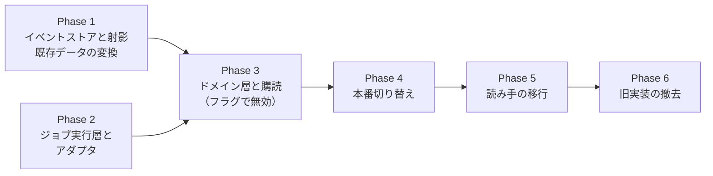

# ポッドキャスト制作 ToBe への移行計画

[podcast-domain-model-tobe.md](./podcast-domain-model-tobe.md) の設計へ、現行の pgflow パイプラインから移るための作業計画である。設計の再定義はせず、実装順・PR の境界・受け入れ条件・戻し方を決める。

---

## 1. いまの実装

| 部品 | 現状 | ToBe での行き先 |
|------|------|-----------------|
| `ingest` Edge Function | `articles` と `episodes` を insert し、`craftEpisodeSubmit` を起動する。`content_path` が重複すると 409 | `ArticleRegistered`（+ 初回のみ `EpisodeOpened`）と `ProductionRequested` を追記する。再 ingest は新しい `ArticleRevision` になる |
| `craftEpisodeSubmit` / `craftEpisodeDownload` | 台本 → 音声投入・画像、download-monitor 経由で音声取得 → RSS。`startFrom` で step を飛ばす | 汎用の 1 ステップフロー `runJob` と ProductionPolicy に置き換え |
| `_shared/pipeline-stages.ts` | 各 stage が Gemini 呼び出し・Storage 書き込み・`episodes.status` 更新・`processing_logs` 記録をまとめて行う | ジョブハンドラ（`write_script` など）と Gemini / Storage アダプタに分割。状態更新はイベントと射影に移す |
| `download-monitor` + cron | `audio_files.status = pending` の行を探し、download フローを起動 | `ExternalOperation` のポーラー |
| `episodes` / `scripts` / `audio_files` / `articles` | 状態を上書きする正本 | イベントからの射影（`podcast` スキーマ）。移行中は互換射影として旧表も更新する |
| `processing_logs` | stage ごとの成功・失敗 | `JobAttempt`。TUI 向けに互換ビューを残す |
| `podcast_config` | 番組情報・モデル・声・プロンプト | 番組情報は Show、生成設定は `Production.profile` のもと、プロンプトは `PromptTemplate` |
| CLI / TUI | 旧表を読み、`startFrom` 付きで pgflow を直接起動 | 読み取りモデルを読み、`ProductionRequested` の追記と `publish` Edge Function を呼ぶ |
| `apps/web`（`audio.ts`・`episode-images.ts`） | REST で `episodes.audio_url` / `image_url` と `articles` を読む | 読み取りモデルのビューを読む。`feed.xml` からのフォールバックはそのまま |

---

## 2. 変えない原則

- **既存エピソードの GUID を変えない。** 移行する Episode の `guid` には旧 `episodes.id` を入れる。新しい Episode の `guid` も Episode ID と同じ値にする。
- 公開 URL `podcast/feed.xml` と、既存の音声・画像の Storage パスを変えない。既存ファイルはそのまま Blob として登録する。
- 本番の切り替えはフラグ 1 つで行い、切り替え前の段階はすべて本番の挙動を変えない。
- マイグレーションは追記のみ（CLAUDE.md）。新しい表は作成直後に RLS を有効にする。
- 移行中は互換射影で旧表を更新し続け、CLI・TUI・Web を壊さない。旧表への書き込みを止めるのは、すべての読み手を移した後である。

---

## 3. 実装順

| Phase | 内容 | 本番の挙動 |
|-------|------|------------|
| 1 | イベントストア・射影・既存データの変換 | 変わらない |
| 2 | ジョブ実行層・pgflow / Gemini / Storage アダプタ | 変わらない |
| 3 | ドメイン層・ProductionPolicy・購読ワーカー・公開ユースケース・新 ingest 経路 | 変わらない（フラグが `legacy`） |
| 4 | フラグを `events` にする | 新しい経路で制作する |
| 5 | CLI・TUI・Web を読み取りモデルへ移す | 見た目は変わらない |
| 6 | 旧フロー・旧表・download-monitor を撤去 | 変わらない |

Phase 1 と Phase 2 は互いに依存しないので、並行して進めてよい。

コードの置き場所は次のとおりにする。

| ディレクトリ | 層 | 依存してよいもの |
|--------------|----|------------------|
| `supabase/functions/_domain/` | ドメイン（集約・イベント・ProductionPolicy・ユースケース・ポートの型） | なし（Supabase も Gemini も import しない） |
| `supabase/functions/_jobs/` | 抽象ジョブ実行層（JobRunner・JobType ハンドラ・ポートの型） | `_domain` の型だけ |
| `supabase/functions/_adapters/` | アダプタ（Postgres イベントストア・pgflow・Gemini・Storage） | すべて |
| `supabase/flows/run-job.ts` | pgflow の汎用フロー | `_jobs`・`_adapters` |

`_shared/gemini-*.ts` は `_adapters/gemini/` に移し、`pipeline-stages.ts` は Phase 6 で消す。

---

## 4. Phase 1 — イベントストアと射影

**目的**: ドメインの状態をイベントから再生できる土台を作り、既存データをイベントに変換する。本番の挙動は変えない。

### 4.1 変更

マイグレーションを 1 本追加する。新しい表はすべて `podcast` スキーマに置き、旧表と名前がぶつからないようにする。

| 表 | 役割 |
|----|------|
| `podcast.domain_events` | 追記専用。`position` bigserial、`(stream_id, stream_version)` 一意 |
| `podcast.event_subscriptions` | 購読者ごとの処理済み位置とリース |
| `podcast.event_subscription_failures` | 失敗し続けたイベントの記録 |
| `podcast.shows`、`articles`、`article_revisions`、`episodes`、`productions`、`scripts`、`audios`、`artworks`、`episode_revisions`、`episode_publications`、`feed_snapshots`、`feed_items` | ToBe の ER 図どおりの射影 |
| `podcast.blobs` | Blob（ジョブ層と共有） |

`domain_events` の UPDATE・DELETE は、トリガーで拒否する。

コードは次を追加する。

- `_domain/events.ts`：イベント型と payload の型
- `_adapters/eventstore/postgres.ts`：`EventStore` の `read` / `append`。`append` は同じトランザクションでインライン射影を呼ぶ
- `_adapters/eventstore/projections.ts`：イベント → `podcast.*` の射影
- `scripts/events-backfill.ts`：旧表 → イベントの変換（§4.2）
- `scripts/events-replay.ts`：射影を空にして `position` 順に再生する

### 4.2 既存データの変換

旧表を記事ごとに読み、同じ意味のイベントを `actor = migration` で追記する。`occurred_at` は旧行の `created_at` / `published_at` を使う。

| 旧データ | 生成するイベント | 注意 |
|----------|------------------|------|
| `podcast_config` の `podcast.*` | `ShowConfigured` | Show は 1 件 |
| `articles` 1 行 | `ArticleRegistered`（本文込み） | `content_sha` が null の行は本文のハッシュで埋める |
| `episodes` 1 行 | `EpisodeOpened`（`guid = episodes.id`）、`ProductionRequested`（`scope = full`、`trigger = migration`） | profile は変換時点の `podcast_config` から作る |
| `scripts`（`status = ready`） | `ScriptWritten`（`job_id = null`） | 失敗行は変換しない |
| `audio_files`（`status = ready`） | Blob 登録と `AudioRendered` | `duration_ms` は WAV ヘッダから計算する。`script_id` が null なら、その Episode の最新の Script を使う |
| `episodes.image_url` | Blob 登録と `ArtworkPainted` | 旧実装は Episode の title から画像を作っていたので、最新の Script に紐づける |
| 上の 3 つが揃った Episode | `EpisodeAssembled` | 最新の ready な Script・Audio と、画像（あれば）で組み立てる |
| `status = published` | `EpisodePublished` | `published_at` を引き継ぐ |
| 現在の `feed.xml` | `FeedRebuilt` | Storage の現物を Blob として登録し、項目を解析して `items` に入れる |

変換の前に、旧データが不変条件を満たすかを確かめる。

- 1 つの `article_id` に `episodes` が 2 行以上ないか。あれば、その記事は手で判断する（古い方を Episode にし、新しい方は版として取り込むと、新しい方の GUID が消える）
- `content_path` が null の記事が重複していないか

### 4.3 受け入れ条件

- ローカルで `pnpm db:reset` → 旧データの投入 → backfill → replay を 2 回繰り返し、`podcast.*` の内容が 2 回とも一致する
- 照合スクリプトで、旧表と射影の件数・GUID・音声パス・公開日時が一致する
- backfill をもう一度流しても、イベントが重複しない（`stream_version` の一意制約で止まる）
- `pnpm typecheck` が通る

### 4.4 戻し方

`podcast` スキーマを使う処理はまだないので、マイグレーションを取り消す新しいマイグレーションで戻せる。

---

## 5. Phase 2 — ジョブ実行層とアダプタ

**目的**: LLM の呼び出しを `Job` / `JobAttempt` / `LlmInvocation` として記録しながら実行できるようにする。この段階では、ドメインからはまだ呼ばない。

### 5.1 変更

マイグレーションで次を追加する。

| 対象 | 内容 |
|------|------|
| `jobs` スキーマ | `job_types`、`jobs`、`job_attempts`、`external_operations`、`llm_invocations`、`prompt_templates`、`pgflow_job_bindings` |
| pgflow | 汎用フロー `runJob`（1 ステップ、`maxAttempts: 1`）。`pnpm pgflow:compile` で生成する |
| `pgflow.worker_functions` | `job-worker` を登録し、`ensure_workers` の監視に乗せる |
| pg_cron | `external-operation-poller` を毎分呼ぶ |
| `prompt_templates` の初期データ | 現行の `generator.system_instruction`・`generator.prompt_template`・`tts.instructions`・`image.prompt_template` と、コード内の既定値を版 1 として入れる |

コードは次を追加・移動する。

- `_jobs/runner.ts`：試行の開始、失敗の分類、再試行の判断、`waiting_external` への遷移
- `_jobs/handlers/write-script.ts`・`render-audio.ts`・`paint-artwork.ts`：`pipeline-stages.ts` から LLM の呼び出し部分だけを移す。`episodes` などの旧表には触らない
- `_adapters/gemini/`：`LlmGateway` の実装。`_shared/gemini-*.ts` と、Batch の投入・ポーリング・WAV 結合を移す
- `_adapters/storage.ts`：`BlobStore` の実装。新しい Blob は内容ごとに別パスへ書く
- `_adapters/pgflow.ts`：`JobBackend` の実装
- `functions/job-worker`：`EdgeWorker.start(RunJob)`
- `functions/external-operation-poller`：`next_poll_at` を過ぎた `ExternalOperation` を確かめ、完了したジョブを `running` に戻して `runJob` を起動する
- `pnpm cli job run <job_type> --input <json>`：ジョブを単独で依頼する開発用コマンド

### 5.2 受け入れ条件

- ローカルで `scripts/gemini-mock-server.ts` を相手に、3 種のジョブが成功し、`llm_invocations` にチャンクごとの行ができる
- 実 API（`GEMINI_API_KEY`）でも 3 種が成功する。`render_audio` は投入から取得まで `waiting_external` を経由する
- `job-worker` を途中で止めても、`ensure_workers` が再起動し、同じ冪等キーの Batch を二重に投入しない
- 生成された WAV と画像が、旧パイプラインと同じ形式（mime・サンプルレート）である

### 5.3 戻し方

ドメインから呼ばれていないので、`job-worker` とポーラーの cron を止めれば影響はない。

---

## 6. Phase 3 — ドメイン層と購読（フラグで無効）

**目的**: 新しい経路を最後まで組み上げ、ローカルとステージング相当の環境で通す。本番は `legacy` のまま動かす。

### 6.1 変更

| 対象 | 内容 |
|------|------|
| `_domain/` | 集約（Article・Episode・Production・Show）、ProductionPolicy、`PublishEpisode` / `WithdrawEpisode`、翻訳器（JobOutcome → `ScriptWritten` など） |
| `_adapters/eventstore/subscription.ts` | 購読ワーカーの本体。リースを取り、処理済み位置から読み、ProductionPolicy に渡す |
| マイグレーション | `domain_events` の AFTER INSERT トリガー（pgmq `domain_events_wake` に送る）、pg_cron の保険（毎分）、`domain-subscriber` の `worker_functions` 登録 |
| `functions/domain-subscriber` | 購読ワーカー |
| `functions/publish` | 手動の公開・取り下げ・版の差し戻し |
| ジョブ完了の通知 | `job-worker` がジョブを終えたら、翻訳器を通してドメインイベントを追記する |
| `ingest` | `podcast_config` の `pipeline.mode` を見て分岐する。`events` なら `ArticleRegistered`（+ `EpisodeOpened`）と `ProductionRequested` を追記する |
| 互換射影 | `events` 経路で動いた Episode も、旧 `episodes`（`status`・`title`・`description`・`audio_url`・`image_url`・`published_at`）と `audio_files`・`scripts` を更新する |
| フィード | `PublishEpisode` が旧 `buildRssFeed` と同じ XML 構造（GUID・enclosure・`itunes:image`・`podcaster:articleTitle`）を出す。enclosure の `length` は Blob の `byte_size` を入れる |

`_domain/` は外部を import しないので、ここだけは `deno test` で単体テストを置く。リポジトリに初めて入るテストなので、`package.json` に `test:domain` を足す。テストの対象は次の 3 つに絞る。

- ProductionPolicy の判断（`scope` ごとの依頼、合流、失敗）
- 不変条件（1 記事 1 Episode、公開中の版は 1 つ）
- イベント列の再生結果

### 6.2 受け入れ条件

- ローカルで `pipeline.mode = events` にし、モックの Gemini を相手に ingest → 台本 → 音声・画像 → 公開 → `feed.xml` まで通る
- 次の再生成がそれぞれ通り、`feed.xml` の GUID が変わらない：台本から作り直す（`scope = full`）、音声だけ（`scope = audio`）、画像だけ（`scope = artwork`）
- 同じ記事を内容を変えて再 ingest すると、409 ではなく新しい `ArticleRevision` と新しい版ができる
- `domain-subscriber` を止めてからイベントを追記し、再開すると取りこぼしなく処理する。pg_cron の保険だけでも 1 分以内に処理が始まる
- 自動公開と `publish` の手動呼び出しを同時に走らせても、`feed.xml` と最後の `FeedRebuilt` の中身が一致する
- 互換射影により、CLI の `list episodes`・`status`、TUI（`--mock` ではなくローカル接続）、Web の音声・画像が旧経路と同じように表示される
- `pnpm typecheck` と `pnpm test:domain` が通る

### 6.3 戻し方

本番は `legacy` のままなので、新しい Edge Function を配備していても使われない。

---

## 7. Phase 4 — 本番切り替え

**目的**: 本番の制作を新しい経路に移す。

### 7.1 手順

1. 本番で Phase 1 の backfill を流し、照合スクリプトで旧表と射影が一致することを確かめる。
2. 旧パイプラインに実行中の run がないことを確かめる（`pnpm cli list episodes` で `*_running`・`audio_generated` がない）。あれば終わるのを待つ。
3. backfill 後に増えた分だけ backfill を流し直す（冪等なので差分だけが入る）。
4. `pipeline.mode = events` にする。
5. 1 本を ingest し、公開と `feed.xml` を確かめる。購読アプリで既存の回が重複していないことも確かめる。
6. 数日は 1 本ずつ投入し、`jobs.job_attempts` の失敗と `event_subscription_failures` を見る。

### 7.2 受け入れ条件

- 新しい回が `feed.xml` に載り、購読アプリで再生できる
- 既存の回の GUID・音声 URL・公開日時が `feed.xml` 上で変わっていない
- 1 本あたりの Gemini 呼び出し回数とトークン数が、旧経路と同程度である（`llm_invocations` で確かめる）

### 7.3 戻し方

`pipeline.mode = legacy` に戻すと、ingest は旧経路に戻る。互換射影が旧表を更新しているので、旧パイプラインはそのまま動く。ただし、legacy で動いた間の制作はイベントにならないので、もう一度 events に切り替える前に backfill を流し直す。この戻し方が使えるのは Phase 5 の前までである。

---

## 8. Phase 5 — 読み手の移行

**目的**: 旧表を読む処理をなくし、旧表への書き込みを止められる状態にする。

| 読み手 | 移行先 |
|--------|--------|
| CLI `list` / `status` / `logs` | `podcast.*` の射影と `jobs.*` を結合したビュー（`podcast.episode_overview`、`jobs.attempt_log`） |
| CLI `requeue` / `regenerate-*` | `ProductionRequested`（`scope` 付き）の追記。`requeue rss` は `publish` の再実行 |
| TUI `DataClient` | 上と同じビュー。再ingest の 409 前提の分岐を消す |
| `apps/web` の `audio.ts`・`episode-images.ts` | 公開中の版の音声・画像パスと `content_path` を返すビュー（`podcast.published_episode_assets`）。REST で公開するため、`anon` に `select` だけを許すビューにする |
| `processing_logs` | `jobs.attempt_log` を同じ列名で返す互換ビューに置き換える |

受け入れ条件は、旧表（`public.episodes`・`scripts`・`audio_files`・`articles`・`processing_logs`）を `select` する箇所が、リポジトリ内で互換射影だけになることである。

---

## 9. Phase 6 — 旧実装の撤去

| 撤去するもの | 方法 |
|--------------|------|
| `craftEpisodeSubmit`・`craftEpisodeDownload` と、その worker 関数 | フローを削除するマイグレーション。`worker_functions` からも外す |
| `download-monitor` と cron `download_monitor_audio_generated` | cron を unschedule するマイグレーションと、関数の削除 |
| `_shared/pipeline-stages.ts`・`supabase/tasks/*` | 削除 |
| 互換射影 | 旧表への書き込みをやめる |
| 旧表 | まず `legacy_*` に名前を変え、1 か月問題がなければ削除する。どちらも新しいマイグレーションで行う |
| `podcast_config` の `podcast.*` と生成設定 | Show と `prompt_templates` に移った項目を消す。`seed-config` も合わせて直す |

撤去後に CLAUDE.md と AGENTS.md のアーキテクチャ節を、新しい構成の説明に置き換える。

---

## 10. リスク

| リスク | 起きること | 対策 |
|--------|------------|------|
| GUID の変化 | 購読アプリで全話が新着として重複する | 移行 Episode の `guid` を旧 `episodes.id` にする。Phase 4 で購読アプリでも確かめる |
| TTS の二重投入 | 再試行や重複配信で Batch を 2 回投げ、コストが倍になる | 冪等キーで同じ Batch を再利用する。Phase 2 でワーカーを止める試験をする |
| 互換射影のずれ | CLI・TUI・Web が新経路の回を正しく表示しない | Phase 3 の受け入れ条件で、旧経路と同じ表示になることを確かめる |
| 購読の停止 | 失敗し続けるイベントで以降の制作がすべて止まる | `event_subscription_failures` を TUI に出す。原因を直して再開する手順を CLI に用意する |
| イベントの肥大 | 本文と台本を payload に入れるので、`domain_events` が大きくなる | 1 記事あたり数十 KB で、TOAST に収まる。全件の再生時間を Phase 1 で測る |
| Edge Function の実行時間 | 購読ワーカーがリース中に処理を終えられない | リースを実行時間の上限より短くし、1 回に処理するイベント数を区切る |
