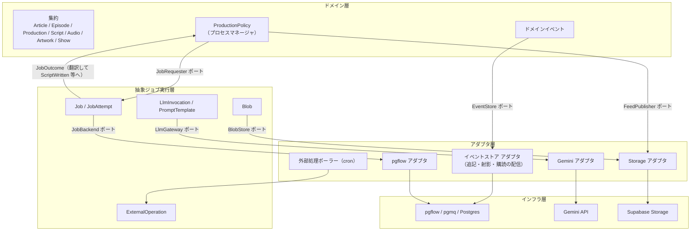
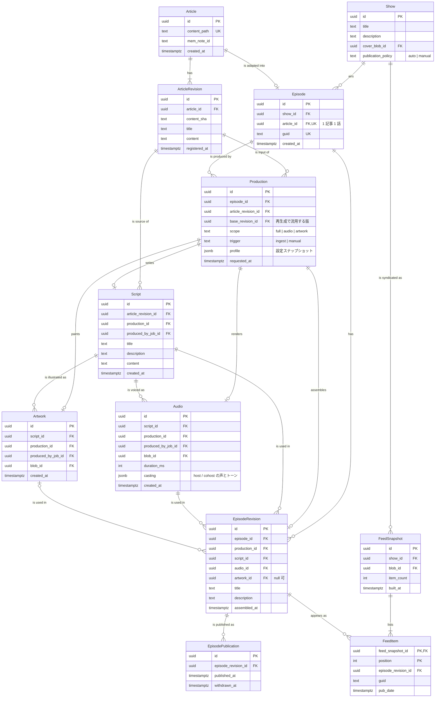
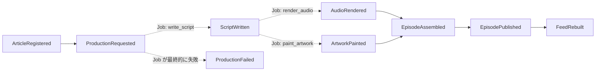
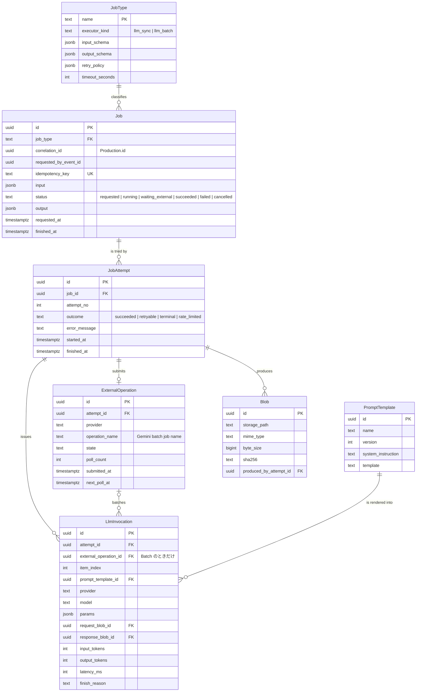
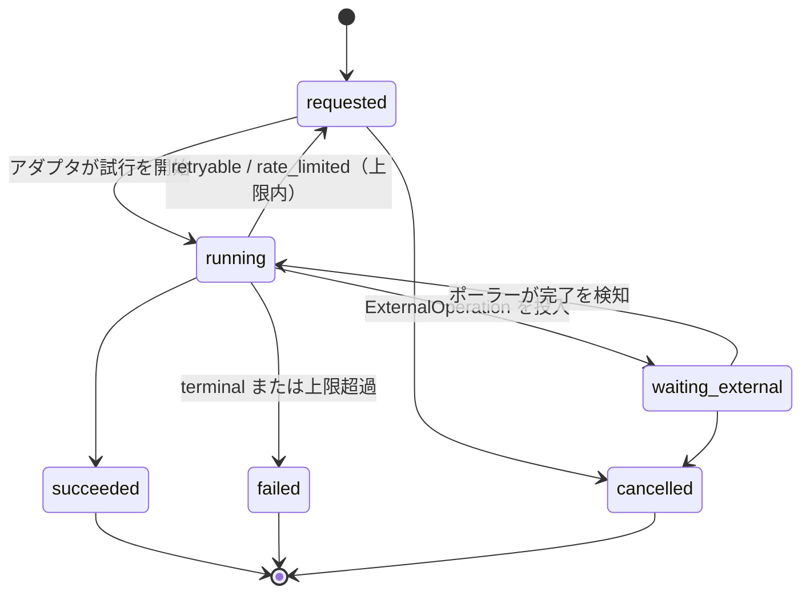
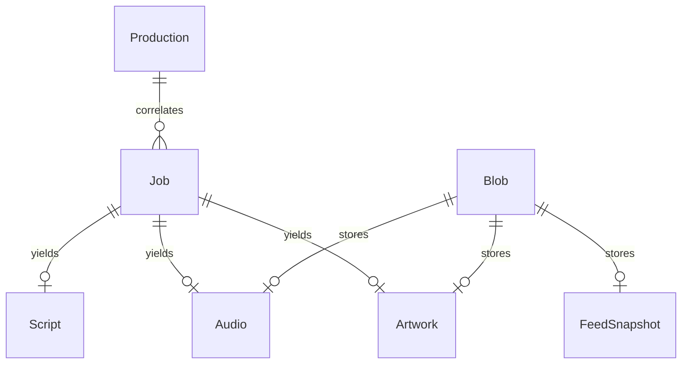
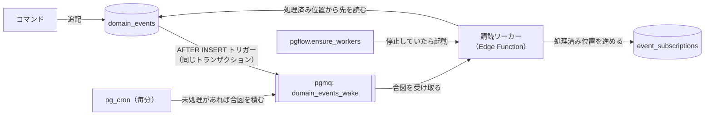

# ポッドキャスト制作のドメインモデル（ToBe 案）

ポッドキャスト制作（ingest → 台本 → 音声・アートワーク → 公開 → RSS）を DDD で組み直すための ToBe 案である。粗い初案をレビューし、次の 4 層に分ける。

1. ドメイン層（制作の事実と規則）
2. 抽象ジョブ実行層（LLM 呼び出しを含む、非同期ジョブの記録と再試行）
3. ジョブ基盤アダプタ層（pgflow・Gemini・Storage への変換）
4. インフラ層（pgflow / pgmq / Postgres、Gemini API、Supabase Storage、Edge Runtime）

現行実装からの移行手順は [podcast-domain-model-migration.md](./podcast-domain-model-migration.md) にある。

---

## 1. レイヤー構成

依存の向きは上から下だけにする。各層の責務と、知ってはいけないものを次に示す。

| 層 | 責務 | 知ってはいけないもの |
|----|------|----------------------|
| ドメイン | 何を作るか、何が揃えば次へ進むか、何を公開するか | 再試行回数、モデル名、pgflow の run・step |
| 抽象ジョブ実行 | ジョブの依頼・試行・失敗分類・外部待ち・LLM 呼び出し記録・成果物 | エピソードの状態遷移、pgflow のテーブル |
| アダプタ | Job を pgflow の run / task に、LlmGateway を Gemini SDK に変換する。イベントの追記と配信、feed.xml の書き出し | 集約の不変条件 |
| インフラ | キュー、ワーカー、API、オブジェクト保存 | 上の層すべて |

境界をまたぐ参照は 3 本に限る。

- `Job.correlation_id` → `Production.id`（どの制作のジョブか）
- `Job.requested_by_event_id` → ドメインイベント（何がきっかけか）
- `Script.produced_by_job_id` など → `Job.id`（どのジョブが作ったか）

ドメインは `JobAttempt` や `LlmInvocation` を読まない。TUI やコスト集計のような運用ビューだけが、この 3 本を辿って両層を結合する。

---

## 2. 初案のレビュー

### 2.1 全体の指摘

**FK を持つ側が多側（または 1:1 の従側）になる。** 初案は「イベントがエンティティを作る」向きで線を引いているため、FK の向きとカーディナリティが逆になっている箇所が多い。Mermaid の `A ||--o{ B` は「A 1 件に B が 0..n 件」であり、FK は B が持つ。

**`previous` はエンティティ間の関係ではない。** イベント同士の因果関係なので、ER ではなくイベントの封筒（envelope）に `causation_id`（直前のイベント）と `correlation_id`（同じ制作に属するイベントの束）を持たせる。流れは ER とは別の図（§3.3）で表す。合流（音声とアートワークの両方を待つ）は FK では表せないので、プロセスマネージャの規則として書く。

**`*CreateStarted` の多くはジョブ実行層の事実である。** 「台本生成を開始した」「失敗して再試行した」はドメインの事実ではない。ドメインに残すのは「制作を依頼した（`ProductionRequested`）」だけにし、各工程の開始・試行・失敗は `Job` / `JobAttempt` に移す。`EpisodeCreateStarted.workflow_run_id` は pgflow の識別子がドメインに漏れているので、アダプタ層の対応表に移す。

### 2.2 関係ごとの指摘

| 初案の関係 | 問題 | ToBe |
|------------|------|------|
| `ArticleRegistered \|\|--o{ Article : registers` | FK はイベント側にある。同じ記事は再 ingest で何度も登録される | `Article \|\|--o{ ArticleRegistered`。本文の変化は `ArticleRevision`（`content_sha`）で表す |
| `ArticleRegistered \|\|--o{ EpisodeCreateStarted : previous` | `EpisodeCreateStarted` に FK がない。手動の再生成は記事登録なしで始まる | `ProductionRequested.causation_id`（任意）。依頼の入力は `article_revision_id` で持つ |
| `ScriptCreateStarted \|\|--o{ ScriptCreated` ほか `*Started → *Created` | 1 回の開始に成功は高々 1 件。再試行の多重度はジョブ層の話 | ジョブ層で `Job \|\|--o{ JobAttempt`、ドメインは `Production \|\|--o\| Script` |
| `AudioCreated`・`EpisodeCreated` | 開始イベントや合流元への FK がない | 封筒の `causation_id`。合流は ProductionPolicy の規則 |
| `EpisodeCreateStarted \|\|--o{ ArtworkCreateStarted` | 現行のアートワーク生成は Script の title・description を入力にする。`ArtworkCreateStarted.script_id` とも食い違う | `Script \|\|--o{ Artwork`。台本の後に分岐する |
| `Artwork.input_article_id` | 上と同じ理由で入力が違う | `Artwork.script_id` |
| `Script.outcome` | 失敗した Script は台本ではない | Script は成功時だけ作る。失敗は `JobAttempt` |
| `EpisodeCreated \|\|--o{ Episode : creates` | FK はイベント側にあり 1:1 | `Episode` 側から見て 1:1。ToBe では `EpisodeRevision` を作るイベントになる |
| `Article \|\|--\|\| Episode : generates` | 再生成で Episode を作り直すと RSS の GUID が変わり、購読アプリで別エピソード扱いになる | 安定した `Episode`（GUID を持つ）と、構成を差し替える `EpisodeRevision` に分ける。`Article \|\|--o\| Episode` |
| `Episode \|\|--\|\| Script/Audio/Artwork : contains` | FK は Episode 側。音声だけ作り直すと同じ Script が複数の版で使われる。アートワークは無効化できる | `Script \|\|--o{ EpisodeRevision`、`Audio \|\|--o{ EpisodeRevision`、`Artwork \|o--o{ EpisodeRevision` |
| `EpisodePublished \|\|--o{ EpisodePublication : projects` | 1:1 の射影 | `EpisodeRevision \|\|--o{ EpisodePublication`。取り下げ・再公開の履歴を持つ |
| `EpisodePublication \|\|--\|\| Episode : publishs` | 公開されるのは版。綴りも誤り | `EpisodePublication.episode_revision_id` |
| `EpisodePublished \|\|--o{ FeedRebuilt` | 1 回の再構築は複数の公開・取り下げ・番組情報の変更をまとめて反映する | `FeedRebuilt` は `Show` 単位。きっかけは `causation_id`、中身は `FeedItem` |
| `FeedEpisode }\|--\|{ FeedSnapshot / Episode` | 関連エンティティ自身に多対多は付かない | `FeedSnapshot \|\|--\|{ FeedItem`、`EpisodeRevision \|\|--o{ FeedItem`。並び順と GUID・pubDate を持つ |

### 2.3 足りない属性

| 属性 | 理由 |
|------|------|
| `Episode.guid` | RSS の同一性。現行は `episodes.id` を流用している |
| `EpisodeRevision.title / description` | 現行は台本生成が `episodes` に書き込んでいる。版ごとに持つ |
| `Audio.duration_ms`、`Blob.byte_size` | `itunes:duration` と enclosure の `length`。現行は length が 0 固定 |
| `Audio.casting` | `tts.selection_mode = random` で選ばれた声とトーン。再現と比較に要る |
| `Production.profile` | 制作時点の設定（モデル、プロンプトの版、チャンク長）のスナップショット。`podcast_config` は後から変わる |
| 封筒の `actor` | ingest 以外（手動再生成、管理画面）も誰が依頼したかを残す |

---

## 3. ドメイン層

### 3.1 集約

| 集約 | ルート | 役割 |
|------|--------|------|
| Article | `Article` + `ArticleRevision` | Git 上の記事（`content_path`）と、その本文の版（`content_sha`） |
| Show | `Show` | 番組。タイトル・説明・カバー。`podcast_config` の `podcast.*` を移す |
| Episode | `Episode` + `EpisodeRevision` + `EpisodePublication` | 購読者から見た 1 話。記事 1 本に Episode は 1 件だけで、GUID は不変。中身は版で何度でも差し替える |
| Production | `Production` | 1 回の制作依頼。範囲（全部・音声だけ・画像だけ）と設定スナップショットを持つ。ジョブの `correlation_id` |
| Script / Audio / Artwork | 各ルート | 生成物。作成後は変更しない |
| Feed | `FeedSnapshot` + `FeedItem` | ある時点の RSS の中身 |

Script・Audio・Artwork は不変の生成物なので、それぞれ小さな集約にする。Episode 集約に含めると、音声だけの再生成でも Episode 全体をロックすることになる。

ドメイン層の正本はイベントである（§3.5）。次の ER 図の表は、イベントから作る射影である。

### 3.2 ER 図

関係名は「左 → 右」に能動態で読める動詞にそろえた（例: Production writes Script）。

不変条件は次のとおりである。

- 1 本の Article に Episode は高々 1 件である。同じ記事から作り直した結果は、すべてその Episode の `EpisodeRevision` になる。
- `EpisodeRevision.audio_id` の Audio と `artwork_id` の Artwork は、同じ `script_id` から作られている。
- 1 つの Episode で、公開中（`withdrawn_at is null`）の `EpisodePublication` は高々 1 件である。
- `Production.scope = audio` のとき、Script は `base_revision_id` の版から流用し、新しく作らない。

### 3.3 ドメインイベント

イベントは種類ごとのテーブルではなく、共通の封筒を持つ 1 本の追記専用テーブルに入れる。種類ごとの差は `payload` に置く。

| 封筒の列 | 意味 |
|----------|------|
| `id` | イベント ID |
| `position` | 全イベントを通した追記順（bigserial）。購読と射影の再生に使う |
| `type` | 下表のイベント名 |
| `stream_type` / `stream_id` | 対象集約（例: `production` / Production の ID） |
| `stream_version` | 集約内の連番。`(stream_id, stream_version)` を一意にして楽観ロックにする |
| `occurred_at` | 発生時刻 |
| `actor` | `ingest`、`manual:<user>`、`system` など |
| `correlation_id` | Production の ID。記事登録だけは null |
| `causation_id` | 直前のイベント。初案の `previous` はここに入る |
| `payload` | 種類ごとの属性 |

| イベント | payload | 初案との対応 |
|----------|---------|--------------|
| `ShowConfigured` | `show_id`、`title`、`description`、`cover_blob_id`、`publication_policy` | 新規。番組情報の作成と変更 |
| `ArticleRegistered` | `article_id`、`article_revision_id`、`content_path`、`content_sha`、`title`、`content`、`ingest_route` | 同名 |
| `EpisodeOpened` | `episode_id`、`article_id`、`show_id`、`guid` | 新規。その記事で最初の制作依頼のときだけ出す |
| `ProductionRequested` | `production_id`、`episode_id`、`article_revision_id`、`base_revision_id`、`scope`、`trigger`、`profile` | `EpisodeCreateStarted` |
| `ScriptWritten` | `script_id`、`job_id`、`title`、`description`、`content` | `ScriptCreated` |
| `AudioRendered` | `audio_id`、`job_id`、`script_id`、`blob_id`、`duration_ms`、`casting` | `AudioCreated` |
| `ArtworkPainted` | `artwork_id`、`job_id`、`script_id`、`blob_id` | `ArtworkCreated` |
| `EpisodeAssembled` | `episode_revision_id`、`script_id`、`audio_id`、`artwork_id`、`title`、`description` | `EpisodeCreated` |
| `EpisodePublished` | `publication_id`、`episode_revision_id`、`superseded_publication_id` | 同名 |
| `EpisodeWithdrawn` | `publication_id`、`reason` | 新規 |
| `FeedRebuilt` | `feed_snapshot_id`、`blob_id`、`items`（版 ID・GUID・pubDate の並び） | 同名 |
| `ProductionFailed` | `production_id`、`failed_job_id`、`reason` | 新規 |

イベントは正本なので、payload には射影を作り直すのに要る事実をすべて入れる。ID だけを入れて中身を別表に置くと、その表が実質の正本になる。記事の本文も `ArticleRegistered.content` に入れる。Git の `content_path` と `content_sha` は出どころの記録であり、制作時にどの本文を読んだかはイベントだけで決まる。Git の履歴が書き換わっても、制作の入力は再現できる。例外はバイト列で、音声・画像・feed.xml は Blob に置き、イベントは `blob_id` で参照する。Blob は上書きせず、内容ごとに新しいパスへ書く。

`ScriptCreateStarted`・`AudioCreateStarted`・`ArtworkCreateStarted` はドメインイベントにしない。ジョブ層の `Job`（依頼）と `JobAttempt`（試行）がその役目を担う。

正常系の因果は次のようになる。

点線はジョブ層を経由する区間、実線はドメイン内で同期的に決まる区間である。記事の初回の制作では、`ProductionRequested` の直前に `EpisodeOpened` が入る。

### 3.4 ProductionPolicy（プロセスマネージャ）

工程の順序と合流はドメインの規則として持つ。現行の `startFrom` による step のスキップは、この規則が pgflow の DAG に入り込んでいるために生じている。

| 受け取るもの | 条件 | 行うこと |
|--------------|------|----------|
| `ProductionRequested` | `scope = full` | `write_script` を依頼 |
| `ProductionRequested` | `scope = audio` | 流用する Script で `render_audio` を依頼 |
| `ProductionRequested` | `scope = artwork` | 流用する Script で `paint_artwork` を依頼 |
| `ScriptWritten` | — | `render_audio` を依頼。`profile.artwork.enabled` なら `paint_artwork` も依頼 |
| `AudioRendered` / `ArtworkPainted` | 必要な生成物が揃った。足りない側は `base_revision_id` から流用 | `EpisodeRevision` を組み立て、`EpisodeAssembled` |
| `EpisodeAssembled` | 公開方針が自動 | 公開コマンドを実行する（下記） |
| `JobFailed`（再試行の上限に達した） | — | `ProductionFailed` |

公開と取り下げでは、RSS を同期的に作り直す。公開コマンドは次の順で動く。

1. 公開後の Show の状態（公開中の版の一覧）をイベントから組み立て、feed.xml を生成する。
2. `FeedPublisher` ポートで、feed.xml を新しいパス（`feeds/<feed_snapshot_id>.xml`）に書き、続けて公開用の `feed.xml` を上書きする。
3. `EpisodePublished`（旧版があれば `superseded_publication_id` 付き）と `FeedRebuilt` を、1 トランザクションで追記する。

2 で失敗したらイベントは追記せず、コマンドごと失敗させて再実行する。2 が成功して 3 が楽観ロックで失敗した場合は、`feed.xml` だけが先に進む。このときはコマンドを再実行すれば、最新の状態で feed.xml を書き直してからイベントを追記するので、両者は一致する。取り下げ（`EpisodeWithdrawn` + `FeedRebuilt`）も同じ手順で行う。

公開と取り下げは、アプリケーション層のユースケース（`PublishEpisode`・`WithdrawEpisode`）として 1 か所に実装し、入口を 2 つ用意する。

| 入口 | 呼び方 | 用途 |
|------|--------|------|
| 購読ワーカー | ProductionPolicy が `EpisodeAssembled` を受けて、同じプロセス内でユースケースを直接呼ぶ | 自動公開 |
| `publish` Edge Function | CLI・TUI・管理画面から HTTP で呼ぶ。中身はユースケースを呼ぶだけ | 手動公開・取り下げ・特定の版への差し戻し |

自動公開のためにワーカーから Edge Function を HTTP で呼ぶ形は採らない。呼び出しが 1 段増え、失敗の理由が HTTP とユースケースのどちらにあるか切り分けにくくなる。ワーカーが同じプロセスで呼べば、失敗したイベントの処理位置を進めずに済むので、再実行は購読の仕組みにそのまま乗る。

自動と手動が同時に走っても、どちらも Show のストリームに `stream_version` を指定して追記するので、片方が楽観ロックで失敗して再実行される。feed.xml を書き直してから追記する順序（上の 1〜3）なので、再実行後は feed.xml とイベントが一致する。

`episodes.status`（`script_running` など）は、イベントとジョブの状態から作る読み取りモデルにする。書き込み側の状態としては持たない。

### 3.5 イベントを正本にする

ドメイン層の状態は、イベントの再生だけで復元できるようにする。ジョブ層は運用の記録なので、イベントソーシングにせず状態テーブルで持つ。

| 仕組み | 方式 |
|--------|------|
| 追記 | コマンドは集約のストリームを読んで不変条件を確かめ、`stream_version` を指定して追記する。一意制約に当たったら読み直して再試行する |
| 射影 | ER 図の表と `episodes.status` などの読み取りモデルは、追記と同じトランザクションで更新する（インライン射影）。壊れたら `position` 順に全イベントを再生して作り直す |
| 購読 | ProductionPolicy は外部（ジョブ層・Storage）を呼ぶので、追記と同じトランザクションでは動かさない。購読者ごとに処理済みの `position` を記録し、そこから先のイベントを受け取る。配信の仕組みは §5 |
| 冪等 | 購読は同じイベントを 2 度受け取りうる。ProductionPolicy が依頼するジョブの冪等キーに `causation_id` を含め、重複依頼を 1 件にまとめる |

射影の表に書くのは追記処理だけである。アプリやスクリプトが射影を直接更新すると、再生で作り直したときに差分が消える。

既存データ（`articles`・`episodes`・`scripts`・`audio_files`）は、移行時に同じ意味のイベントへ変換して追記する。変換したイベントの `actor` は `migration` にする。

---

## 4. 抽象ジョブ実行層

### 4.1 概念

| 概念 | 意味 |
|------|------|
| `JobType` | ジョブの種類。実行方式（`llm_sync`・`llm_batch`）、入出力スキーマ、再試行方針、タイムアウトを宣言する |
| `Job` | ドメインからの 1 件の依頼。冪等キーを持ち、成功すれば出力（生成物への参照）を返す |
| `JobAttempt` | 1 回の実行。失敗は `retryable`・`terminal`・`rate_limited` に分類する |
| `ExternalOperation` | 外部で長時間走る処理（Gemini Batch）。待っている間はジョブを `waiting_external` にし、試行回数を消費しない |
| `LlmInvocation` | LLM への 1 リクエスト。モデル、プロンプトの版、パラメータ、トークン使用量、レイテンシ、終了理由。Batch の各チャンクも 1 件ずつ記録する |
| `PromptTemplate` | 版付きのプロンプト。台本・TTS 指示・画像プロンプト |
| `Blob` | 生成されたバイト列（音声・画像・feed.xml・LLM の生レスポンス）。ドメインからも参照する共有カーネル |

ジョブ層の `JobType` は次の 3 種である。RSS の再構築は公開コマンドの中で同期的に行うので、ジョブにしない（§3.4）。

| JobType | 実行方式 | 入力 | 出力 |
|---------|----------|------|------|
| `write_script` | `llm_sync` | `article_revision_id`、profile | 台本・title・description |
| `render_audio` | `llm_batch` | `script_id`、profile | 音声 Blob、duration、casting |
| `paint_artwork` | `llm_sync` | `script_id`、profile | 画像 Blob |

`render_audio` は台本をチャンクに分け、1 本の Batch（1 件の `ExternalOperation`）にまとめて投げる。チャンクはジョブに分けず、`LlmInvocation` として 1 件ずつ記録する。チャンク単位の再生成はしないので、失敗したらジョブ全体をやり直す。

ジョブ層は「台本」や「エピソード」を知らない。出力は JSON と Blob 参照であり、ドメイン側の翻訳器（Anti-Corruption Layer）が `Script` 行と `ScriptWritten` に変換する。

### 4.2 ER 図

ジョブの状態遷移は次のとおりである。

`waiting_external` を独立した状態にすると、現行の `craftEpisodeSubmit` → download-monitor → `craftEpisodeDownload` という 2 本のフローへの分割が不要になる。ポーラーは pgflow の外で `ExternalOperation.next_poll_at` を見て、完了したジョブだけを `running` に戻す。

冪等キーは `job_type`・入力の参照 ID・profile のハッシュ・依頼元イベントの ID から作る。pgflow が同じ step を再実行しても、同じキーの Batch が投入済みならそれを再利用する。現行の `pendingAudio` の再利用をジョブ層の一般規則にしたものである。

### 4.3 実行時間の上限

1 回の試行には、次の上限がかかる。

| 上限 | 値 | 出どころ |
|------|----|----------|
| Edge Function の実行時間（wall clock） | Free 150 秒、有料 400 秒 | Supabase Edge Runtime |
| CPU 時間 | 1 リクエストあたり 2 秒（非同期 I/O の待ちは含まない） | Supabase Edge Runtime |
| メモリ | 256 MB | Supabase Edge Runtime |
| pgflow の step `timeout` | 現行 60〜180 秒 | pgmq の可視性タイムアウト。超えるとタスクが再配信され、別のワーカーが同じ試行を始める |

音声合成そのものは Gemini Batch の側で走り、その間ジョブは `waiting_external` なので、合成時間は上の上限に入らない。上限に入るのは、Batch の投入と、完了後のチャンク取得・WAV の結合・Storage への書き込みである。現行の実装は、チャンクを `/tmp` の WAV ファイルに順に書き足し、ストリームでアップロードする。そのためメモリは音声の長さに比例して増えず、効くのは取得とアップロードにかかる wall clock である。24 kHz・16 bit・モノラルの WAV は 1 分あたり約 2.9 MB なので、30 分の回で約 86 MB を転送する。

ジョブ層は `JobType.timeout_seconds` を、アダプタが受け入れられる上限（Edge Function の実行時間より短く、pgflow の `timeout` 以下）に収める。超える処理は `ExternalOperation` に切り出す。WAV から配信用 m4a への変換は Cloud Run Jobs に委譲する（**events パイプラインのみ**。legacy pgflow は対象外）。設計は [audio-transcode-cloud-run.md](./audio-transcode-cloud-run.md) を参照。

### 4.4 ドメインとの接続

ポートは次のとおりにする。

| ポート | 定義する層 | 実装する層 | 操作 |
|--------|------------|------------|------|
| `EventStore` | ドメイン | アダプタ（Postgres） | `read(streamId)`、`append(streamId, expectedVersion, events)`、`subscribe(name, fromPosition)` |
| `FeedPublisher` | ドメイン | アダプタ（Storage） | `publish(feedSnapshotId, xml)` |
| `JobRequester` | ドメイン | ジョブ層 | `request(jobType, input, correlationId, causationEventId)` |
| `JobOutcomeHandler` | ドメイン | ドメイン（翻訳器） | `onSucceeded(job)`、`onFailed(job)` |
| `JobBackend` | ジョブ層 | アダプタ（pgflow） | `dispatch(job)`、`cancel(job)` |
| `LlmGateway` | ジョブ層 | アダプタ（Gemini） | `generate`、`submitBatch`、`pollBatch`、`fetchBatchResults` |

`BlobStore`（`put` / `get`）もジョブ層で定義し、Storage アダプタが実装する。

---

## 5. アダプタ層とインフラ層

pgflow アダプタは `Job` 1 件を pgflow の run 1 件に対応させる。フローは汎用の 1 ステップ（入力 `{ jobId }`）にし、ステップの中でジョブ層の `JobRunner.runAttempt(jobId)` を呼ぶ。pgflow の再試行は使わず（`maxAttempts: 1`）、再試行の判断は `JobType.retry_policy` に寄せる。pgflow の識別子はアダプタ専用の表に閉じ込める。

| 列 | 意味 |
|----|------|
| `job_id` | ジョブ層の Job |
| `attempt_id` | ジョブ層の JobAttempt |
| `flow_slug` / `run_id` / `step_slug` / `task_index` | pgflow 側の識別子 |

この形にすると、pgflow を pgmq 直結や別のジョブ基盤に替えても、ドメイン層とジョブ層は変わらない。

一方で、工程の DAG が pgflow のフロー定義から消え、pgflow の画面で制作全体の流れを追えなくなる。追跡はドメインイベントの `correlation_id` で行う。DAG を pgflow に残す案（ジョブ層に `Workflow` を置き、アダプタがフロー定義にコンパイルする）も取れる。ただし、部分的な再生成や合流の条件がフロー定義側に残り、現行の `startFrom` 分岐と同じ問題が戻るので、本案では採らない。

イベントストア アダプタは、Postgres の追記専用テーブル 1 本と、購読者ごとの処理済み位置の表で `EventStore` を実装する。追記とインライン射影は 1 トランザクションで行う。

購読者への配信は pgmq を合図に使い、pg_cron を取りこぼしの保険にする。

| 要素 | 役割 |
|------|------|
| AFTER INSERT トリガー | 追記と同じトランザクションで、合図（中身は `position` だけ）を pgmq に積む。追記がロールバックされれば合図も消える |
| pgmq `domain_events_wake` | 合図の置き場。ワーカーが止まっていても合図は残り、起動後に受け取れる |
| 購読ワーカー | `@pgflow/edge-worker` のキューワーカーとして動く Edge Function。合図を受けたら `event_subscriptions` の処理済み位置から先を `position` 順に読み、ProductionPolicy に渡す。1 件処理するごとに処理済み位置を進める |
| `pgflow.ensure_workers` | 既存の死活監視。購読ワーカーを `pgflow.worker_functions` に登録し、止まっていたら起動させる |
| pg_cron（毎分） | 処理済み位置が最新の `position` より遅れていれば合図を積む。合図の取りこぼしや、処理中に落ちたワーカーの続きを拾う |

合図は「読みに来い」という意味しか持たず、イベントの中身は毎回 `domain_events` から読む。このため合図が重複しても欠けても、処理結果は変わらない。同じ購読者のワーカーが 2 つ同時に動くと順序が崩れるので、`event_subscriptions` の行にリース（`lease_owner`・`leased_until`）を持たせる。ワーカーは `leased_until < now()` の行だけを更新して取り、取れなければ何もせず終わる。ProductionPolicy は Storage やジョブ層を呼ぶため、行ロックを握ったままトランザクションを開いておく形は採らない。リースの期限は Edge Function の実行時間の上限より短くし、ワーカーは期限内に処理を区切って位置を進める。

同じイベントの処理が上限回数を超えて失敗したら、そのイベントを `event_subscription_failures` に記録して購読を止める。後続のイベントは順序に依存するので、飛ばして先へ進めない。原因を直したら、処理済み位置はそのままで購読を再開する。

`pg_notify` だけで配信する案は採らない。Edge Function は常駐しないので、通知の時点で LISTEN している受け手がいないことがあり、届かなかった通知は残らない。pg_cron だけで配信する案は、確実だが最大 1 分遅れる。pgmq の合図を主にし、pg_cron を保険にすると、通常は追記の直後に動き、障害時も 1 分以内に回復する。

Gemini アダプタは `LlmGateway` を実装する。チャンク分割した TTS の Batch 投入、ポーリング、WAV の取得と結合はここに置き、モデル名やエンドポイント（`gemini.api_root`）の解決もここで閉じる。

---

## 6. その他の提案

| 要素 | 内容 | 理由 |
|------|------|------|
| Show 集約 | `podcast.title` などを `podcast_config` から移す | フィードが Show に属する。将来の複数番組にも対応できる |
| Production の profile | 制作時点の設定を JSON で凍結する | 後から設定を変えても、どの設定で作ったかを再現できる |
| PromptTemplate の版管理 | 台本・TTS 指示・画像プロンプトを版付きで保存する | 品質の比較と差し戻しができる |
| 公開方針 | `auto` / `manual` を Show に持つ | 人が確認してから公開する運用を足せる |
| EpisodeWithdrawn | 公開の取り下げ | 誤った回を RSS から消せる。FeedItem の再計算のきっかけになる |
| コスト集計 | `LlmInvocation` のトークン数を Production 単位で集計する読み取りモデル | 再生成のコストが見える |
| 読み取りモデル | エピソード一覧・制作状況を、イベントとジョブ状態から射影する | TUI / CLI は射影だけを読む |
